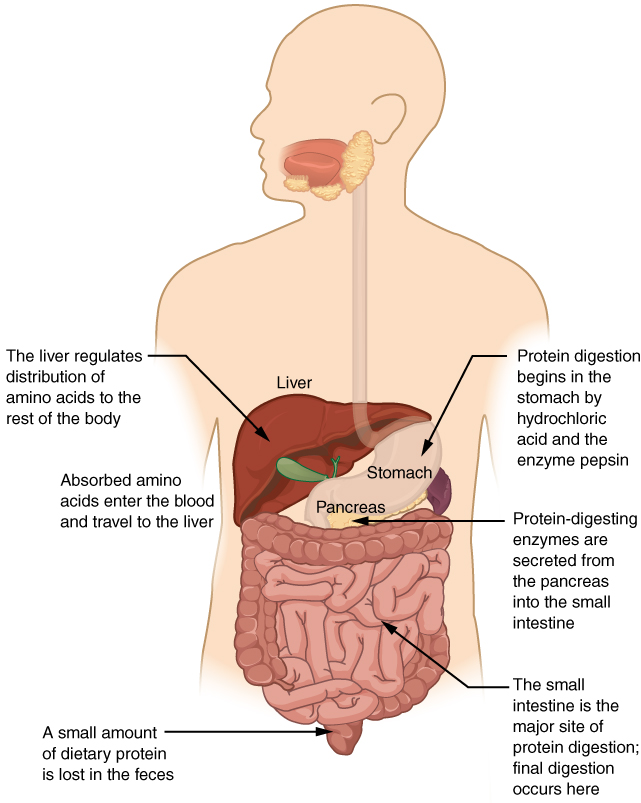
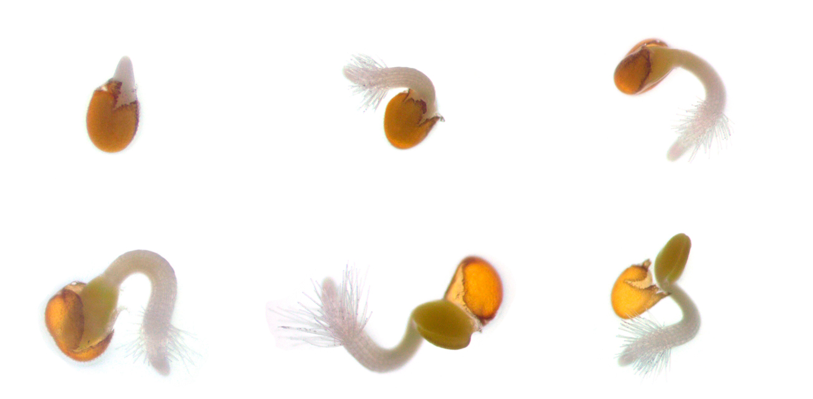
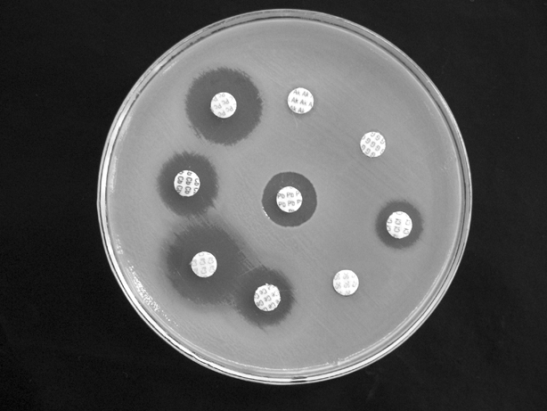
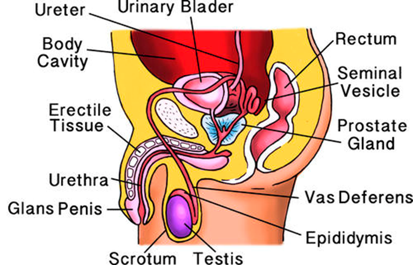
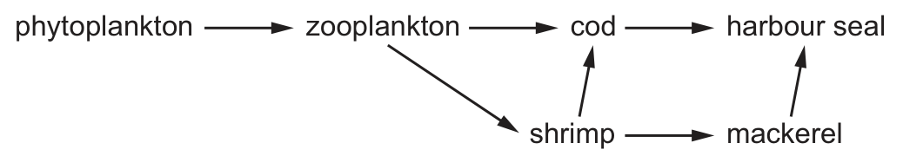
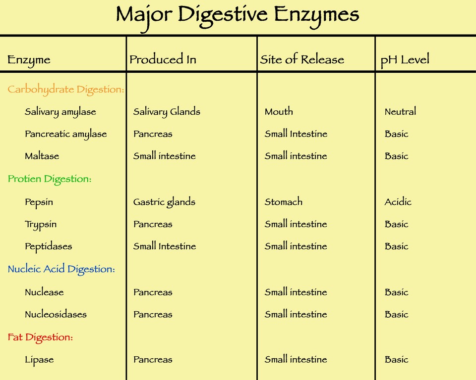

# Downloaded explanation image credits

All included explanation image files are JPG or PNG, downloaded from the sources below. Source illustrations, photographs and licence links are retained beside the images. The files are included locally for offline display.

## images/earthworm.jpg
- Author: Jochem Kühnen
- Licence: [CC BY 4.0](https://creativecommons.org/licenses/by/4.0)
- [Source page](https://commons.wikimedia.org/wiki/File:Aporrectodea_rosea_(Gelderland,_Netherlands).jpg)
- [Downloaded file](https://thumb.wikimedia.org/wikipedia/commons/thumb/e/ed/Aporrectodea_rosea_%28Gelderland%2C_Netherlands%29.jpg/960px-Aporrectodea_rosea_%28Gelderland%2C_Netherlands%29.jpg)

## images/dunnock.jpg
- Author: Hobbyfotowiki
- Licence: [CC0](http://creativecommons.org/publicdomain/zero/1.0/deed.en)
- [Source page](https://commons.wikimedia.org/wiki/File:The_dunnock_(Prunella_modularis).jpg)
- [Downloaded file](https://thumb.wikimedia.org/wikipedia/commons/thumb/0/08/The_dunnock_%28Prunella_modularis%29.jpg/960px-The_dunnock_%28Prunella_modularis%29.jpg)

## images/prunella-vulgaris.jpg
- Author: H. Zell
- Licence: [CC BY-SA 3.0](https://creativecommons.org/licenses/by-sa/3.0)
- [Source page](https://commons.wikimedia.org/wiki/File:Prunella_vulgaris_003.jpg)
- [Downloaded file](https://thumb.wikimedia.org/wikipedia/commons/thumb/9/95/Prunella_vulgaris_003.jpg/960px-Prunella_vulgaris_003.jpg)

## images/vespula-vulgaris.jpg
- Author: Soebe
- Licence: [CC BY-SA 3.0](http://creativecommons.org/licenses/by-sa/3.0/)
- [Source page](https://commons.wikimedia.org/wiki/File:Vespula_vulgaris.jpg)
- [Downloaded file](https://thumb.wikimedia.org/wikipedia/commons/thumb/c/c3/Vespula_vulgaris.jpg/960px-Vespula_vulgaris.jpg)

## images/myriapod.jpg
- Author: Medsile
- Licence: [CC BY-SA 4.0](https://creativecommons.org/licenses/by-sa/4.0)
- [Source page](https://commons.wikimedia.org/wiki/File:Close-up_photo_of_a_centipede_-_02.jpg)
- [Downloaded file](https://thumb.wikimedia.org/wikipedia/commons/thumb/f/fa/Close-up_photo_of_a_centipede_-_02.jpg/960px-Close-up_photo_of_a_centipede_-_02.jpg)

## images/onion-plasmolysis.jpg
- Author: Trương Minh Khải
- Licence: [CC BY 4.0](https://creativecommons.org/licenses/by/4.0/)
- [Source page](https://commons.wikimedia.org/wiki/File:Plasmolysis_of_red_onion_(Allium_cepa)_cells.jpg)
- [Downloaded file](https://thumb.wikimedia.org/wikipedia/commons/thumb/e/e1/Plasmolysis_of_red_onion_%28Allium_cepa%29_cells.jpg/500px-Plasmolysis_of_red_onion_%28Allium_cepa%29_cells.jpg)

## images/cricket.jpg
- Author: Roberto Zanon
- Licence: [CC BY-SA 3.0](http://creativecommons.org/licenses/by-sa/3.0/)
- [Source page](https://commons.wikimedia.org/wiki/File:Gryllus_campestris_3.jpg)
- [Downloaded file](https://thumb.wikimedia.org/wikipedia/commons/thumb/e/e9/Gryllus_campestris_3.jpg/960px-Gryllus_campestris_3.jpg)

## images/plant-cells.jpg
- Author: Emilio Ermini
- Licence: [CC BY 4.0](https://creativecommons.org/licenses/by/4.0)
- [Source page](https://commons.wikimedia.org/wiki/File:Leaf_epithelium,_stomata.jpg)
- [Downloaded file](https://thumb.wikimedia.org/wikipedia/commons/thumb/c/ce/Leaf_epithelium%2C_stomata.jpg/960px-Leaf_epithelium%2C_stomata.jpg)

## images/root-hairs.jpg
- Author: G Lens Microscopist, Megan Gerber
- Licence: [CC BY 4.0](https://creativecommons.org/licenses/by/4.0/)
- [Source page](https://commons.wikimedia.org/wiki/File:Arabidopsis_root_hairs.jpg)
- [Downloaded file](https://upload.wikimedia.org/wikipedia/commons/0/03/Arabidopsis_root_hairs.jpg)

## images/question-30-red-blood-cells.jpg
- Author: OpenStax College
- Licence: [CC BY 3.0](https://creativecommons.org/licenses/by/3.0/)
- [Source page](https://commons.wikimedia.org/wiki/File:1903_Shape_of_Red_Blood_Cells.jpg)
- [Downloaded file](https://upload.wikimedia.org/wikipedia/commons/9/97/1903_Shape_of_Red_Blood_Cells.jpg)

## images/question-30-root-hairs.jpg
- Author: G Lens Microscopist, Megan Gerber
- Licence: [CC BY 4.0](https://creativecommons.org/licenses/by/4.0/)
- [Source page](https://commons.wikimedia.org/wiki/File:Arabidopsis_root_hairs.jpg)
- [Downloaded file](https://upload.wikimedia.org/wikipedia/commons/0/03/Arabidopsis_root_hairs.jpg)

## images/question-30-xylem.png
- Author: Kelvinsong; microscope inset: Micropix
- Licence: [CC BY-SA 3.0](https://creativecommons.org/licenses/by-sa/3.0/)
- [Source page](https://commons.wikimedia.org/wiki/File:Xylem_cells.svg)
- [Downloaded file](https://thumb.wikimedia.org/wikipedia/commons/thumb/c/ce/Xylem_cells.svg/500px-Xylem_cells.svg.png)

## images/question-31-polysaccharides.jpg
- Author: OpenStax College
- Licence: [CC BY 3.0](https://creativecommons.org/licenses/by/3.0/)
- [Source page](https://commons.wikimedia.org/wiki/File:219_Three_Important_Polysaccharides-01.jpg)
- [Downloaded file](https://upload.wikimedia.org/wikipedia/commons/5/52/219_Three_Important_Polysaccharides-01.jpg)

## images/question-32-metabolism.png
- Author: Christinelmiller
- Licence: [CC BY-SA 4.0](https://creativecommons.org/licenses/by-sa/4.0/)
- [Source page](https://commons.wikimedia.org/wiki/File:Anabolism_and_Catabolism.png)
- [Downloaded file](https://upload.wikimedia.org/wikipedia/commons/b/bb/Anabolism_and_Catabolism.png)

## images/question-34-spirogyra.jpg
- Author: Wiedehopf20
- Licence: [CC BY-SA 4.0](https://creativecommons.org/licenses/by-sa/4.0/)
- [Source page](https://commons.wikimedia.org/wiki/File:The_freshwater_alga_Spirogyra.jpg)
- [Downloaded file](https://thumb.wikimedia.org/wikipedia/commons/thumb/8/85/The_freshwater_alga_Spirogyra.jpg/960px-The_freshwater_alga_Spirogyra.jpg)

## images/question-35-light-response.png
- Author: Obsidian Soul
- Licence: [CC BY-SA 3.0](https://creativecommons.org/licenses/by-sa/3.0/)
- [Source page](https://commons.wikimedia.org/wiki/File:Carbon_assimilation_vs_irradiance.png)
- [Downloaded file](https://upload.wikimedia.org/wikipedia/commons/7/78/Carbon_assimilation_vs_irradiance.png)

## images/question-36-oxygen-bubbles.jpg
- Author: Rcaravit
- Licence: [CC BY 4.0](https://creativecommons.org/licenses/by/4.0/)
- [Source page](https://commons.wikimedia.org/wiki/File:Photosynthesis_in_action.jpg)
- [Downloaded file](https://thumb.wikimedia.org/wikipedia/commons/thumb/8/8e/Photosynthesis_in_action.jpg/960px-Photosynthesis_in_action.jpg)

## images/question-37-plasmolysis.jpg
- Author: Trương Minh Khải
- Licence: [CC BY 4.0](https://creativecommons.org/licenses/by/4.0/)
- [Source page](https://commons.wikimedia.org/wiki/File:Plasmolysis_of_red_onion_(Allium_cepa)_cells.jpg)
- [Downloaded file](https://thumb.wikimedia.org/wikipedia/commons/thumb/e/e1/Plasmolysis_of_red_onion_%28Allium_cepa%29_cells.jpg/500px-Plasmolysis_of_red_onion_%28Allium_cepa%29_cells.jpg)

## images/question-38-double-circulation.jpg
- Author: OpenStax College
- Licence: [CC BY 3.0](https://creativecommons.org/licenses/by/3.0/)
- [Source page](https://commons.wikimedia.org/wiki/File:2101_Blood_Flow_Through_the_Heart.jpg)
- [Downloaded file](https://thumb.wikimedia.org/wikipedia/commons/thumb/f/f2/2101_Blood_Flow_Through_the_Heart.jpg/960px-2101_Blood_Flow_Through_the_Heart.jpg)

## images/question-39-microscope.jpg
- Author: GcG(jawp)
- Licence: [Public domain](https://creativecommons.org/publicdomain/mark/1.0/)
- [Source page](https://commons.wikimedia.org/wiki/File:Optical_microscope_nikon_alphaphot.jpg)
- [Downloaded file](https://thumb.wikimedia.org/wikipedia/commons/thumb/3/3a/Optical_microscope_nikon_alphaphot.jpg/500px-Optical_microscope_nikon_alphaphot.jpg)

## images/question-40-intestine-villi.jpg
- Author: OpenStax College
- Licence: [CC BY 3.0](https://creativecommons.org/licenses/by/3.0/)
- [Source page](https://commons.wikimedia.org/wiki/File:2418_Histology_Small_IntestinesN.jpg)
- [Downloaded file](https://thumb.wikimedia.org/wikipedia/commons/thumb/c/c1/2418_Histology_Small_IntestinesN.jpg/960px-2418_Histology_Small_IntestinesN.jpg)

## images/online-phloem-source-sink.png
- Author: Alyssa Pham
- Licence: [CC BY-SA 4.0](https://creativecommons.org/licenses/by-sa/4.0)
- [Source page](https://commons.wikimedia.org/wiki/File:Translocation_from_the_source_to_the_sink_within_the_phloem.svg)
- [Downloaded file](https://thumb.wikimedia.org/wikipedia/commons/thumb/f/fc/Translocation_from_the_source_to_the_sink_within_the_phloem.svg/960px-Translocation_from_the_source_to_the_sink_within_the_phloem.svg.png)

## images/online-agave-americana.jpg
- Author: Marc Ryckaert (MJJR)
- Licence: [CC BY-SA 3.0](https://creativecommons.org/licenses/by-sa/3.0)
- [Source page](https://commons.wikimedia.org/wiki/File:Agave_americana_R01.jpg)
- [Downloaded file](https://thumb.wikimedia.org/wikipedia/commons/thumb/2/21/Agave_americana_R01.jpg/960px-Agave_americana_R01.jpg)

## images/online-potometer.png
- Author: Benedikt.Seidl
- Licence: [CC BY-SA 3.0](https://creativecommons.org/licenses/by-sa/3.0)
- [Source page](https://commons.wikimedia.org/wiki/File:Potetometer.svg)
- [Downloaded file](https://thumb.wikimedia.org/wikipedia/commons/thumb/9/93/Potetometer.svg/960px-Potetometer.svg.png)

## images/online-transpiration-overview.png
- Author: Laurel Jules
- Licence: [CC BY-SA 3.0](https://creativecommons.org/licenses/by-sa/3.0)
- [Source page](https://commons.wikimedia.org/wiki/File:Transpiration_Overview.svg)
- [Downloaded file](https://thumb.wikimedia.org/wikipedia/commons/thumb/c/c0/Transpiration_Overview.svg/960px-Transpiration_Overview.svg.png)

## images/online-dandelion-broadleaf.jpg
- Author: SriMesh
- Licence: [CC BY-SA 3.0](https://creativecommons.org/licenses/by-sa/3.0)
- [Source page](https://commons.wikimedia.org/wiki/File:DandelionLeaf.jpg)
- [Downloaded file](https://thumb.wikimedia.org/wikipedia/commons/thumb/6/66/DandelionLeaf.jpg/960px-DandelionLeaf.jpg)

## images/online-ecological-energy-pyramid.png
- Author: Saric
- Licence: [CC BY-SA 3.0](https://creativecommons.org/licenses/by-sa/3.0)
- [Source page](https://commons.wikimedia.org/wiki/File:Ecological_pyramid.svg)
- [Downloaded file](https://thumb.wikimedia.org/wikipedia/commons/thumb/8/86/Ecological_pyramid.svg/960px-Ecological_pyramid.svg.png)

## images/online-phototropism-auxin.png
- Author: MacKhayman
- Licence: [CC BY-SA 3.0](https://creativecommons.org/licenses/by-sa/3.0)
- [Source page](https://commons.wikimedia.org/wiki/File:Phototropism_Diagram.svg)
- [Downloaded file](https://thumb.wikimedia.org/wikipedia/commons/thumb/1/14/Phototropism_Diagram.svg/960px-Phototropism_Diagram.svg.png)

## images/online-pancreas-digestive-organs.jpg
- Author: OpenStax College
- Licence: [CC BY 3.0](https://creativecommons.org/licenses/by/3.0/)
- [Source page](https://commons.wikimedia.org/wiki/File:2422_Accessory_Organs.jpg)
- [Downloaded file](https://upload.wikimedia.org/wikipedia/commons/2/2d/2422_Accessory_Organs.jpg)

## images/online-hepatic-portal-vein.jpg
- Author: OpenStax College
- Licence: [CC BY 3.0](https://creativecommons.org/licenses/by/3.0/)
- [Source page](https://commons.wikimedia.org/wiki/File:2138_Hepatic_Portal_Vein_System.jpg)
- [Downloaded file](https://upload.wikimedia.org/wikipedia/commons/thumb/c/cf/2138_Hepatic_Portal_Vein_System.jpg/960px-2138_Hepatic_Portal_Vein_System.jpg)

## images/online-fish-single-circulation.png
- Author: Lennert B
- Licence: [CC BY-SA 3.0](https://creativecommons.org/licenses/by-sa/3.0/)
- [Source page](https://commons.wikimedia.org/wiki/File:Fish_circulation.PNG)
- [Downloaded file](https://upload.wikimedia.org/wikipedia/commons/1/1a/Fish_circulation.PNG)

## images/online-phagocytosis.png
- Author: OpenStax
- Licence: [CC BY 3.0](https://creativecommons.org/licenses/by/3.0/)
- [Source page](https://commons.wikimedia.org/wiki/File:0309_Phagocytosis.png)
- [Downloaded file](https://upload.wikimedia.org/wikipedia/commons/8/85/0309_Phagocytosis.png)

## images/online-cardiac-cycle.jpg
- Author: OpenStax College
- Licence: [CC BY 3.0](https://creativecommons.org/licenses/by/3.0/)
- [Source page](https://commons.wikimedia.org/wiki/File:2027_Phases_of_the_Cardiac_Cycle.jpg)
- [Downloaded file](https://upload.wikimedia.org/wikipedia/commons/thumb/3/38/2027_Phases_of_the_Cardiac_Cycle.jpg/960px-2027_Phases_of_the_Cardiac_Cycle.jpg)

## images/online-primary-secondary-antibody-response.jpg
- Author: OpenStax College
- Licence: [CC BY 3.0](https://creativecommons.org/licenses/by/3.0/)
- [Source page](https://commons.wikimedia.org/wiki/File:2223_Primary_and_Secondary_Antibody_Respons_new.jpg)
- [Downloaded file](https://upload.wikimedia.org/wikipedia/commons/e/e0/2223_Primary_and_Secondary_Antibody_Respons_new.jpg)

## images/online-exercise-oxygen-debt.jpg
- Author: Henoktade; crop by Belbury
- Licence: [CC BY-SA 4.0](https://creativecommons.org/licenses/by-sa/4.0/)
- [Source page](https://commons.wikimedia.org/wiki/File:Excess_post-oxygen_consumption_%282%29.jpg)
- [Downloaded file](https://upload.wikimedia.org/wikipedia/commons/c/ce/Excess_post-oxygen_consumption_%282%29.jpg)

## images/online-trachea-bronchi-cartilage.jpg
- Author: OpenStax College
- Licence: [CC BY 3.0](https://creativecommons.org/licenses/by/3.0/)
- [Source page](https://commons.wikimedia.org/wiki/File:2308_The_Trachea.jpg)
- [Downloaded file](https://upload.wikimedia.org/wikipedia/commons/thumb/4/46/2308_The_Trachea.jpg/960px-2308_The_Trachea.jpg)

## images/online-bronchioles-alveoli.jpg
- Author: OpenStax College
- Licence: [CC BY 3.0](https://creativecommons.org/licenses/by/3.0/)
- [Source page](https://commons.wikimedia.org/wiki/File:2309_The_Respiratory_Zone.jpg)
- [Downloaded file](https://upload.wikimedia.org/wikipedia/commons/thumb/0/00/2309_The_Respiratory_Zone.jpg/960px-2309_The_Respiratory_Zone.jpg)

## images/online-chemical-synapse.jpg
- Author: Young, KA.; Wise, JA.; DeSaix, P.; Kruse, DH.; Poe, B.; Johnson, E.; Johnson, JE.; Korol, O.; Betts, JG.; Womble, M. (OpenStax Anatomy and Physiology)
- Licence: [CC BY 4.0](https://creativecommons.org/licenses/by/4.0/)
- [Source page](https://commons.wikimedia.org/wiki/File:1225_Chemical_Synapse.jpg)
- [Downloaded file](https://upload.wikimedia.org/wikipedia/commons/3/37/1225_Chemical_Synapse.jpg)

## images/online-adrenal-gland-hormones.jpg
- Author: OpenStax College
- Licence: [CC BY 3.0](https://creativecommons.org/licenses/by/3.0/)
- [Source page](https://commons.wikimedia.org/wiki/File:1818_The_Adrenal_Glands.jpg)
- [Downloaded file](https://upload.wikimedia.org/wikipedia/commons/c/ca/1818_The_Adrenal_Glands.jpg)

## images/online-pupil-constriction-dilation.jpg
- Author: Rapidreflex
- Licence: [CC BY-SA 4.0](https://creativecommons.org/licenses/by-sa/4.0/)
- [Source page](https://commons.wikimedia.org/wiki/File:Pupillary_light_reflex.jpg)
- [Downloaded file](https://upload.wikimedia.org/wikipedia/commons/thumb/d/dc/Pupillary_light_reflex.jpg/960px-Pupillary_light_reflex.jpg)

## images/online-enzyme-active-site.png
- Author: User:Mcy_jerry on EN WP as en:File:Enzymeactivesite.png
- Licence: [CC BY-SA 3.0](http://creativecommons.org/licenses/by-sa/3.0/)
- [Source page](https://commons.wikimedia.org/wiki/File:Enzyme_active_site.png)
- [Downloaded file](https://upload.wikimedia.org/wikipedia/commons/0/0d/Enzyme_active_site.png)

## images/online-enzyme-reaction.png
- Author: domdomegg
- Licence: [CC BY 4.0](https://creativecommons.org/licenses/by/4.0)
- [Source page](https://commons.wikimedia.org/wiki/File:Lock_and_key_enzyme_mechanism.svg)
- [Downloaded file](https://thumb.wikimedia.org/wikipedia/commons/thumb/7/77/Lock_and_key_enzyme_mechanism.svg/500px-Lock_and_key_enzyme_mechanism.svg.png)

## images/online-digestive-enzymes.png
- Author: Stephaniegrenwood (attributed by Wikimedia Commons)
- Licence: [Public domain](https://commons.wikimedia.org/wiki/Commons:Public_domain)
- [Source page](https://commons.wikimedia.org/wiki/File:Major_digestive_enzymes.png)
- [Downloaded file](https://thumb.wikimedia.org/wikipedia/commons/thumb/6/6f/Major_digestive_enzymes.png/960px-Major_digestive_enzymes.png)

## images/online-protein-digestion.jpg
- Author: OpenStax College
- Licence: [CC BY 3.0](https://creativecommons.org/licenses/by/3.0)
- [Source page](https://commons.wikimedia.org/wiki/File:2429_Digestion_of_Proteins_(Physiology).jpg)
- [Downloaded file](https://upload.wikimedia.org/wikipedia/commons/3/32/2429_Digestion_of_Proteins_%28Physiology%29.jpg)

## images/online-dna-sequence-comparison.jpg
- Author: Maggi F, Macera L, Focosi D, Vatteroni ML, Boggi U, Antonelli G, et al.
- Licence: [Public domain](https://commons.wikimedia.org/wiki/Commons:Public_domain)
- [Source page](https://commons.wikimedia.org/wiki/File:Alignment_of_the_nucleotide_sequences_-Human_Gyrovirus_DNA_genome.jpg)
- [Downloaded file](https://thumb.wikimedia.org/wikipedia/commons/thumb/5/5c/Alignment_of_the_nucleotide_sequences_-Human_Gyrovirus_DNA_genome.jpg/960px-Alignment_of_the_nucleotide_sequences_-Human_Gyrovirus_DNA_genome.jpg)

## images/online-dna-base-pairing.png
- Author: Geometry guy
- Licence: [CC BY 4.0](https://creativecommons.org/licenses/by/4.0)
- [Source page](https://commons.wikimedia.org/wiki/File:Four_nucleobase_pairs_of_DNA.svg)
- [Downloaded file](https://thumb.wikimedia.org/wikipedia/commons/thumb/c/c9/Four_nucleobase_pairs_of_DNA.svg/500px-Four_nucleobase_pairs_of_DNA.svg.png)

## images/online-menstrual-cycle.png
- Author: Isometrik, Kaldari; Begoon; Marnanel
- Licence: [CC BY-SA 3.0](https://creativecommons.org/licenses/by-sa/3.0)
- [Source page](https://commons.wikimedia.org/wiki/File:Menstrual_cycle.svg)
- [Downloaded file](https://thumb.wikimedia.org/wikipedia/commons/thumb/9/92/Menstrual_cycle.svg/500px-Menstrual_cycle.svg.png)

## images/online-osmosis.png
- Author: Yassine Mrabet
- Licence: [CC BY-SA 3.0](https://creativecommons.org/licenses/by-sa/3.0)
- [Source page](https://commons.wikimedia.org/wiki/File:Osmosis.svg)
- [Downloaded file](https://thumb.wikimedia.org/wikipedia/commons/thumb/1/17/Osmosis.svg/500px-Osmosis.svg.png)

## images/online-balanced-diet.jpg
- Author: National Cancer Institute, National Institutes of Health (photographer uncredited)
- Licence: [Public domain](https://creativecommons.org/publicdomain/mark/1.0/)
- [Source page](https://commons.wikimedia.org/wiki/File:Good_Food_Display_-_NCI_Visuals_Online.jpg)
- [Downloaded file](https://thumb.wikimedia.org/wikipedia/commons/thumb/6/6d/Good_Food_Display_-_NCI_Visuals_Online.jpg/960px-Good_Food_Display_-_NCI_Visuals_Online.jpg)

## images/online-x-linked-recessive.jpg
- Author: OpenStax College
- Licence: [CC BY 3.0](https://creativecommons.org/licenses/by/3.0/)
- [Source page](https://commons.wikimedia.org/wiki/File:2928_X-linked_Recessive_Inheritance-new.jpg)
- [Downloaded file](https://thumb.wikimedia.org/wikipedia/commons/thumb/b/b3/2928_X-linked_Recessive_Inheritance-new.jpg/960px-2928_X-linked_Recessive_Inheritance-new.jpg)

## Question 61 original graph choices

- Files: `images/question-61-graph-a.png`, `images/question-61-graph-b.png`, `images/question-61-graph-c.png`, `images/question-61-graph-d.png`.
- Author/rightsholder: Cambridge University Press & Assessment, © 2026. All rights reserved; no Creative Commons licence is claimed.
- Source: [0610/21 May/June 2026 question paper, question 8, page 5](https://pastpapers.papacambridge.com/directories/CAIE/CAIE-pastpapers/upload/0610_s26_qp_21.pdf).
- Downloaded source paper was rasterised at 3× and cropped to the four graphs from the question supplied by the user. Original labels, scales and watermarks are retained.
- Answer C is confirmed by the [mark scheme, question 8](https://pastpapers.papacambridge.com/directories/CAIE/CAIE-pastpapers/upload/0610_s26_ms_21.pdf).
- Question 61 also reuses `images/online-enzyme-reaction.png`, credited above (domdomegg, CC BY 4.0).

## images/online-abo-codominance.png
- Author: YassineMrabet, based on an NIH illustration.
- Licence: [Public domain](https://creativecommons.org/publicdomain/mark/1.0/).
- [Source page](https://commons.wikimedia.org/wiki/File:ABO_system_codominance.svg).
- [Downloaded PNG](https://thumb.wikimedia.org/wikipedia/commons/thumb/c/ce/ABO_system_codominance.svg/960px-ABO_system_codominance.svg.png).
- A published PNG rendering downloaded online. The illustration shows possible AO × BO offspring outcomes; four children are not guaranteed to have one of each group.

## images/question-62-family.png
- Author/rightsholder: Cambridge Assessment International Education, © UCLES 2022. All rights reserved; no Creative Commons licence is claimed.
- [Source question paper, 0610/23/O/N/22, question 32, page 12](https://pastpapers.papacambridge.com/directories/CAIE/CAIE-pastpapers/upload/0610_w22_qp_23.pdf).
- The original family diagram from the question supplied by the user was cropped from the downloaded paper and rasterised at 4× as a 1100 × 336 PNG.
- [Mark scheme confirms answer D](https://pastpapers.papacambridge.com/directories/CAIE/CAIE-pastpapers/upload/0610_w22_ms_23.pdf).

## images/online-protein-synthesis.jpg
- Author: OpenStax, Anatomy and Physiology (2016 edition).
- Licence: [CC BY 4.0](https://creativecommons.org/licenses/by/4.0/), as specified on the image’s source page.
- [Source image page](https://commons.wikimedia.org/wiki/File:0328_Transcription-translation_Summary.jpg).
- [Downloaded original JPG](https://upload.wikimedia.org/wikipedia/commons/1/11/0328_Transcription-translation_Summary.jpg).
- [Publisher’s protein synthesis chapter](https://openstax.org/books/anatomy-and-physiology/pages/3-4-protein-synthesis).
- The diagram illustrates normal transcription and translation; it does not demonstrate the drug’s target. The downloaded JPG is unchanged.

## images/question-64-amylase-graph.png
- Author/rightsholder: Cambridge University Press & Assessment, © 2026. All rights reserved; no Creative Commons licence is claimed.
- [Source question paper, 0610/22/M/J/26, question 8, page 4](https://pastpapers.papacambridge.com/directories/CAIE/CAIE-pastpapers/upload/0610_s26_qp_22.pdf).
- [Matching mark scheme confirms B](https://pastpapers.papacambridge.com/directories/CAIE/CAIE-pastpapers/upload/0610_s26_ms_22.pdf).
- A 1218 × 750 PNG crop of the graph supplied in the user’s question, rasterised from the downloaded original paper at 3×. Original axes, scales, line key and watermarks are retained. This downloaded graph appears in both the question and its explanation and opens locally at full size.
- P, Q and R come from the published graph; S’s 0.75 g/s is supplied by the question. The explanatory rate bars are calculated comparisons, and Q is marked approximate.

## images/question-65-thorax-volume.png
- Author/rightsholder: Cambridge University Press & Assessment, © 2026. All rights reserved; no Creative Commons licence is claimed.
- [Source question paper, 0610/22/M/J/26, question 19, page 9](https://pastpapers.papacambridge.com/directories/CAIE/CAIE-pastpapers/upload/0610_s26_qp_22.pdf).
- [Matching mark scheme confirms C](https://pastpapers.papacambridge.com/directories/CAIE/CAIE-pastpapers/upload/0610_s26_ms_22.pdf).
- A 1168 × 808 PNG crop of the graph supplied by the user, rasterised from the downloaded original paper at 4×. Original axes, volume levels, P–T labels and watermarks are retained. The time axis has no numerical scale. This locally bundled image appears in the question and its explanation and opens at full size.

## images/online-mitosis-cytokinesis.jpg
- Author: OpenStax, Anatomy and Physiology (2016 edition).
- Licence: [CC BY 4.0](https://creativecommons.org/licenses/by/4.0/), as specified on the source image page.
- [Source image page](https://commons.wikimedia.org/wiki/File:0331_Stages_of_Mitosis_and_Cytokinesis.jpg).
- [Downloaded original JPEG](https://upload.wikimedia.org/wikipedia/commons/b/ba/0331_Stages_of_Mitosis_and_Cytokinesis.jpg).
- A 1118 × 861 published illustration, downloaded unchanged. The 204-minute interval comes from the exam question, rather than from this general mitosis/cytokinesis illustration.

## images/question-68-cat-pedigree.png
- Author/rightsholder: Cambridge University Press & Assessment, © 2026. All rights reserved; no Creative Commons licence is claimed.
- [Source question paper, 0610/22/F/M/26, question 30, page 13](https://pastpapers.papacambridge.com/directories/CAIE/CAIE-pastpapers/upload/0610_m26_qp_22.pdf).
- [Matching mark scheme confirms C, six cats](https://pastpapers.papacambridge.com/directories/CAIE/CAIE-pastpapers/upload/0610_m26_ms_22.pdf).
- A 1191 × 525 PNG of the original pedigree and complete legend supplied by the user, rasterised from the downloaded paper at 3×. Original symbols and watermarks are retained.
- The feedback’s green outlines and numbers are native HTML overlays. The downloaded PNG is unchanged, and the question shows the original without answer annotations.
- Question 66 reuses the already credited `images/online-hepatic-portal-vein.jpg` for anatomical context; the image does not measure or rank urea concentrations.

## images/online-red-eyed-fruit-fly.jpg
- Author: André Karwath.
- Licence: [CC BY-SA 2.5](https://creativecommons.org/licenses/by-sa/2.5/).
- [Source image page](https://commons.wikimedia.org/wiki/File:Drosophila_melanogaster_-_side_(aka).jpg).
- [Downloaded original JPEG](https://upload.wikimedia.org/wikipedia/commons/4/4c/Drosophila_melanogaster_-_side_%28aka%29.jpg).
- A 546 × 424 photograph, downloaded unchanged. It illustrates a red-eyed fruit fly; no genotype, orange-eye inheritance or sex-linkage conclusion is inferred from the photograph.
- Question 70 reuses the public-domain `images/online-abo-codominance.png`, already credited above, as an example of inherited allele combinations producing different phenotypes.

## Question 71 original graph choices
- Files: `images/question-71-graph-a.png`, `images/question-71-graph-b.png`, `images/question-71-graph-c.png`, `images/question-71-graph-d.png`.
- Author/rightsholder: Cambridge University Press & Assessment, © UCLES 2025. All rights reserved; no Creative Commons licence is claimed.
- [Source question paper, 0610/22/F/M/25, question 10, page 4](https://pastpapers.papacambridge.com/directories/CAIE/CAIE-pastpapers/upload/0610_m25_qp_22.pdf).
- [Matching mark scheme confirms A](https://pastpapers.papacambridge.com/directories/CAIE/CAIE-pastpapers/upload/0610_m25_ms_22.pdf).
- Raster excerpts of the question supplied by the user, rendered from the downloaded original paper at 4×. Each graph retains its complete axes, units, 0–24 hour tick labels and option letter. A/B are 860 × 724 PNG; C/D are 860 × 784 PNG. The solid/dashed key is presented as text and native CSS lines beside the question. Graph A is also included in feedback.

## images/question-72-dna-mass.png
- Author/rightsholder: Cambridge University Press & Assessment, © UCLES 2025. All rights reserved; no Creative Commons licence is claimed.
- [Source question paper, 0610/22/F/M/25, question 31, page 10](https://pastpapers.papacambridge.com/directories/CAIE/CAIE-pastpapers/upload/0610_m25_qp_22.pdf).
- [Matching mark scheme confirms D](https://pastpapers.papacambridge.com/directories/CAIE/CAIE-pastpapers/upload/0610_m25_ms_22.pdf).
- A 1076 × 528 PNG of the original graph supplied by the user, rendered from the downloaded paper at 4×. Complete axes, A–D arrows and arbitrary-unit DNA levels are retained; no numerical times or DNA measurements were added.
- Question 72 also reuses the already credited `images/online-mitosis-cytokinesis.jpg`. The native 2/4/2 + 2 unit model is explicitly illustrative, rather than a measurement from either source image.

## Additional explanation SVGs

At the user's request, 42 project explanation diagrams have been reused unchanged from the earlier illustrated quiz: `q07-explanation.svg`–`q11-explanation.svg`, `q13-explanation.svg`–`q29-explanation.svg`, `q39-explanation.svg`, and `q41-explanation.svg`–`q59-explanation.svg`, all under `images/`. They match the filenames shown by the user and the current quiz question topics. These project illustrations are separate from the downloaded source photographs and published diagrams credited above; no external source or Creative Commons licence is claimed for them. Each file contains its own title and description and has no external image dependencies. The user can replace these files with their own copies using the same names.

The existing 67 raster image files and all their source/licence credits are preserved. SVGs are included here because the user explicitly requested their existing explanation diagrams.

## Thirty additional explanation diagrams

Files `q01-explanation.svg`–`q06-explanation.svg`, `q12-explanation.svg`, `q30-explanation.svg`–`q38-explanation.svg`, `q40-explanation.svg`, and `q60-explanation.svg`–`q72-explanation.svg` were created as original educational schematics for the missing quiz explanations. They use the existing project's visual palette, contain descriptive SVG titles/descriptions, and have no external assets or scripts. Graphs, probabilities and calculations use the quiz data; qualitative models and illustrative quantities are identified as such. The Q66 diagram preserves the qualification that the organ effects do not establish an absolute ranking of all four blood samples. The existing 42 SVGs and 67 downloaded raster files are unchanged, with prior source/licence credits preserved.

## Questions 73–76

- Original PNG excerpts `images/question-73-hydra-budding.png`, `images/question-75-synapse.png`, `images/question-76-lung-volume.png`: © UCLES 2025 / Cambridge University Press & Assessment, all rights reserved. Excerpts of the questions supplied by the user, rendered from [https://pastpapers.papacambridge.com/directories/CAIE/CAIE-pastpapers/upload/0610_s25_qp_21.pdf](https://pastpapers.papacambridge.com/directories/CAIE/CAIE-pastpapers/upload/0610_s25_qp_21.pdf), original Q27/page10, Q21/page8 and Q18/page7. The full graph axes and biological diagram labels are retained. No Creative Commons licence is claimed. Matching mark scheme: https://pastpapers.papacambridge.com/directories/CAIE/CAIE-pastpapers/upload/0610_s25_ms_21.pdf.
- `images/online-glomerulus.jpg`: OpenStax Anatomy and Physiology (2016), https://commons.wikimedia.org/wiki/File:2616_Glomerulus.jpg, CC BY 4.0 https://creativecommons.org/licenses/by/4.0/. Original 1575×1171 JPEG downloaded unchanged. The same credit and licence appear directly in Q74 feedback in the delivered script.
- `images/q73-explanation.svg`–`images/q76-explanation.svg`: original project educational schematics for Hydra budding, glomerular filtration, a chemical synapse and quiet expiration. Self-contained SVGs, no external assets. Existing image files and their credits remain unchanged.

## Questions 77–80

- `images/question-78-wheat-shoots.png` and `images/question-79-pollination.png`: original diagram excerpts of the user-supplied questions from [0610/22/O/N/25](https://pastpapers.papacambridge.com/directories/CAIE/CAIE-pastpapers/upload/0610_w25_qp_22.pdf), © UCLES 2025 / Cambridge University Press & Assessment, all rights reserved. Original Q21/page9 and Q24/page10 respectively, rendered at 4×, preserving all diagram labels, arrows and edges. No Creative Commons licence is claimed. Matching mark scheme: https://pastpapers.papacambridge.com/directories/CAIE/CAIE-pastpapers/upload/0610_w25_ms_22.pdf.
- `images/q77-explanation.svg`–`images/q80-explanation.svg`: original project educational schematics, with descriptive titles and descriptions and no external dependencies. They distinguish pupil reflex from accommodation, even-light growth from phototropism, pollination from fertilisation and B/plasma cells from the broad term lymphocytes.
- Q77 reuses the existing unmodified Rapidreflex pupil-response JPG (CC BY-SA4.0) with its inline source/licence credit. Q80 reuses the existing unmodified OpenStax2016 protein-synthesis JPG (CC BY4.0) with its inline credit and a general-process caption. All prior image files and credits are preserved.

## Questions 81–83

- Original PNG excerpts `images/question-81-potato-ratio.png`, `images/question-82-leaf-section.png`, `images/question-83-leaf-respirometer.png`: © UCLES 2025 / Cambridge University Press & Assessment, all rights reserved. Diagrams from the questions supplied by the user, rendered at 4× from [0610/23/O/N/25](https://pastpapers.papacambridge.com/directories/CAIE/CAIE-pastpapers/upload/0610_w25_qp_23.pdf), original Q6/page3, Q9/page4 and Q10/page4. Complete graph axes, points and biological/apparatus labels are preserved. No Creative Commons licence is claimed. Matching mark scheme: https://pastpapers.papacambridge.com/directories/CAIE/CAIE-pastpapers/upload/0610_w25_ms_23.pdf.
- `images/q81-explanation.svg`–`images/q83-explanation.svg`: original project educational schematics, with descriptive titles/descriptions and no external dependencies. The graph measures a length ratio; the leaf vein contains xylem above phloem; the respirometer shows ink moving towards the dark respiring leaf. Graph values are approximate source readings and the apparatus assumes constant temperature and an airtight seal. All earlier image files and credits are preserved.

## Questions 84–86

- `images/question-84-nitrogen-cycle.png` and `images/question-85-river-pollution.png`: © UCLES 2025 / Cambridge University Press & Assessment, all rights reserved. Original diagrams from [0610/23/O/N/25](https://pastpapers.papacambridge.com/directories/CAIE/CAIE-pastpapers/upload/0610_w25_qp_23.pdf), Q36/page13 and Q39/page15. Crops preserve arrow directions, X/Y labels, graph line styles, axes and A–D markers. No Creative Commons licence is claimed.
- `images/online-polydactyl-paw.jpg`: Broly0, [CC0 1.0](https://creativecommons.org/publicdomain/zero/1.0/), [source](https://commons.wikimedia.org/wiki/File:Polydactyl_Paw.jpg). Image unchanged. This illustrates extra toes; no PP/Pp genotype is inferred from the photograph.
- `images/q84-explanation.svg`–`images/q86-explanation.svg`: original project educational schematics, with descriptive titles/descriptions and no external dependencies. The river graph is qualitative with no invented numerical scale. The Punnett square shows four equally likely allele combinations; ratios are expected probabilities.

## Question 87

- `images/question-87-pedigree-a.png`–`images/question-87-pedigree-d.png`: © UCLES 2024 / Cambridge University Press & Assessment, all rights reserved. Four original pedigree excerpts from [0610/21/M/J/24](https://pastpapers.papacambridge.com/directories/CAIE/CAIE-pastpapers/upload/0610_s24_qp_21.pdf), question 34, page 14. Original symbols, connections and A–D labels are preserved. Source and full original mark scheme: https://pastpapers.papacambridge.com/directories/CAIE/CAIE-pastpapers/upload/0610_s24_ms_21.pdf. No Creative Commons licence is claimed.
- `images/q87-explanation.svg`: original educational schematic highlighting the affected couple’s unaffected daughter and an Aa × Aa Punnett square. Accessible title/description, self-contained with no external dependencies. Simple autosomal complete-dominance model; genotype ratios are expected probabilities.

## Question 88

- `images/question-88-excretion-pathway.png`: © UCLES 2021 / Cambridge University Press & Assessment, all rights reserved. Original flow diagram from [0610/22/F/M/21](https://pastpapers.papacambridge.com/directories/CAIE/CAIE-pastpapers/upload/0610_m21_qp_22.pdf), question 24, page 11. All V–Z labels and pathway arrows are preserved, including liver-to-carbon-dioxide. Matching mark scheme: https://pastpapers.papacambridge.com/directories/CAIE/CAIE-pastpapers/upload/0610_m21_ms_22.pdf. No Creative Commons licence is claimed.
- `images/q88-explanation.svg`: original educational schematic showing waste production and excretion, with descriptive title/description and no external dependencies. Deamination is distinguished from subsequent conversion of ammonia to urea; the liver produces urea and the kidneys excrete it.

## Questions 89–90

- `images/question-89-vaccination-a.png`–`images/question-89-vaccination-d.png`: © UCLES 2021 / Cambridge University Press & Assessment, all rights reserved. Four original diagrams from [0610/22/F/M/21](https://pastpapers.papacambridge.com/directories/CAIE/CAIE-pastpapers/upload/0610_m21_qp_22.pdf), Q21/page9. Labels, boxes, arrows and complete text retained. Matching mark scheme: https://pastpapers.papacambridge.com/directories/CAIE/CAIE-pastpapers/upload/0610_m21_ms_22.pdf. No Creative Commons licence is claimed.
- Q90 reuses the unchanged existing `images/online-bronchioles-alveoli.jpg`: OpenStax College, [CC BY 3.0](https://creativecommons.org/licenses/by/3.0/), [source](https://commons.wikimedia.org/wiki/File:2309_The_Respiratory_Zone.jpg). Anatomical gas-exchange context; the illustration does not measure expired-air percentages. No duplicate image is included in the incremental package.
- `images/q89-explanation.svg` and `images/q90-explanation.svg`: original educational schematics, self-contained with titles/descriptions and no external dependencies. Antigen-specific immune memory is distinguished from passive antibody transfer. The gas bars share a common0–25%axis and accurately show21/16/0.04/4%; approximate mixed-expired-air composition, with5and3.96percentage-point changes.

## Questions 91–100

Original teaching SVGs q91-explanation.svg through q100-explanation.svg are self-contained project schematics. Source-paper figures retain original axes/labels and carry source/copyright captions. No fabricated measurements are introduced.

# Raster assets for quiz questions 91–95

## `images/online-thermoregulation.jpg` — Q91

- Author: OpenStax College.
- Title: 515 Thermoregulation.
- Licence: [CC BY 3.0](https://creativecommons.org/licenses/by/3.0/).
- [Source page](https://commons.wikimedia.org/wiki/File:515_Thermoregulation.jpg).
- [Downloaded original](https://upload.wikimedia.org/wikipedia/commons/d/d5/515_Thermoregulation.jpg).
- Original size: 1122 × 494 pixels. Downloaded unchanged.
- Commons API metadata archived in `online-thermoregulation.jpg.metadata.json`.
- Caption describes qualitative surface blood flow and heat loss. The image is not measured data from the examination question.

## `images/online-pancreas-digestive-organs.jpg` — Q92, existing asset reused

- Author: OpenStax College.
- Licence: [CC BY 3.0](https://creativecommons.org/licenses/by/3.0/).
- [Source page](https://commons.wikimedia.org/wiki/File:2422_Accessory_Organs.jpg).
- [Downloaded original](https://upload.wikimedia.org/wikipedia/commons/2/2d/2422_Accessory_Organs.jpg).
- Existing canonical file reused unchanged.
- The caption identifies the liver and pancreas and explains their endocrine roles. The image also shows digestive anatomy; it does not itself depict the feedback process.

## `images/question-93-placenta-blood-supply.png` — Q93

- Original question diagram: © UCLES 2025 / Cambridge University Press & Assessment.
- [Question paper 0610/23/O/N/25](https://pastpapers.papacambridge.com/directories/CAIE/CAIE-pastpapers/upload/0610_w25_qp_23.pdf), printed question 28, page 11.
- Rendered directly from the cached PDF page, diagram-only crop `(85, 88, 495, 317)` PDF points at 2.5×.
- Result: 1025 × 573 pixels. All diagram labels, fetal outline and direction key retained. No redrawing, changes to the diagram, or invented measurements.
- The source URL and exact original question number are retained in the inline caption. The image is the actual question's diagram.

## `images/online-seed-germination.jpg` — Q94

- Author: Alena Kravchenko.
- Title: Different stages of seed germination (Arabidopsis thaliana).
- Licence: [CC BY-SA 4.0](https://creativecommons.org/licenses/by-sa/4.0/).
- [Source page](https://commons.wikimedia.org/wiki/File:Different_stages_of_seed_germination(Arabidopsis_thaliana).jpg).
- [Downloaded original](https://upload.wikimedia.org/wikipedia/commons/a/af/Different_stages_of_seed_germination%28Arabidopsis_thaliana%29.jpg).
- Original size: 1305 × 641 pixels. Downloaded unchanged.
- Commons API metadata archived in `online-seed-germination.jpg.metadata.json`.
- Caption explicitly states that the photo shows stages of germination and does not compare storage temperatures.

## `images/prunella-vulgaris.jpg` — Q95, existing asset reused

- Author: H. Zell.
- Licence: [CC BY-SA 3.0](https://creativecommons.org/licenses/by-sa/3.0/).
- [Source page](https://commons.wikimedia.org/wiki/File:Prunella_vulgaris_003.jpg).
- [Downloaded file](https://thumb.wikimedia.org/wikipedia/commons/thumb/9/95/Prunella_vulgaris_003.jpg/960px-Prunella_vulgaris_003.jpg).
- Existing canonical file reused unchanged.
- Caption states the photograph shows flowers; the internal pollen-tube route is explained in the new schematic and is not visible in this photograph.

New explanatory SVGs q91–q95 are original project educational diagrams, supplied separately by the diagram agent.

# Image credits for questions 96–100

## images/online-antibiotic-disk-diffusion.jpg

- Author: Microrao, JJMMC, Davangere, Karnataka, India.
- Licence: public domain, released by the copyright holder (PD-self).
- [Source page](https://commons.wikimedia.org/wiki/File:Antibiotic_disk_diffusion.jpg).
- [Downloaded original JPG](https://upload.wikimedia.org/wikipedia/commons/7/7a/Antibiotic_disk_diffusion.jpg).
- Downloaded unchanged, 614 × 461 pixels, 145,063 bytes. Shows antibiotic susceptibility testing of bacteria, not viruses. Used in question 96 feedback.

## images/question-97-antibiotic-resistance.png

- Author/rightsholder: Cambridge Assessment International Education, © UCLES 2025. All rights reserved; no Creative Commons licence is claimed.
- [Source question paper, 0610/23/M/J/25, question 35, page 16](https://pastpapers.papacambridge.com/directories/CAIE/CAIE-pastpapers/upload/0610_s25_qp_23.pdf).
- [Matching mark scheme, page 3, question 35 = B](https://pastpapers.papacambridge.com/directories/CAIE/CAIE-pastpapers/upload/0610_s25_ms_23.pdf).
- The source graph was cropped at PDF point rectangle [145, 83, 449, 247] and rasterised at scale 4 as a 1216 × 656 PNG. Original axes and curve are preserved. Used in question 97 context and feedback.

## images/online-bacterial-plasmids.png

- Author: Spaully on English Wikipedia.
- Licence: [CC BY-SA 2.5](https://creativecommons.org/licenses/by-sa/2.5/).
- [Source page](https://commons.wikimedia.org/wiki/File:Plasmid_(english).svg).
- [Downloaded PNG rendering](https://thumb.wikimedia.org/wikipedia/commons/thumb/c/cf/Plasmid_%28english%29.svg/960px-Plasmid_%28english%29.svg.png).
- Downloaded PNG unchanged, 960 × 450 pixels, 152,456 bytes. The underlying work is an SVG; this local file is the published raster rendering. It shows red bacterial chromosomal DNA and blue plasmids. The caption identifies it as a plasmid-location illustration, not a ligase-reaction diagram. Used in question 98 feedback.
- Preserve the image on a white figure background: it has transparent regions and black labels.

## images/online-enzyme-reaction.png

- Author: domdomegg.
- Licence: [CC BY 4.0](https://creativecommons.org/licenses/by/4.0/).
- [Source page](https://commons.wikimedia.org/wiki/File:Lock_and_key_enzyme_mechanism.svg).
- [Originally downloaded PNG](https://thumb.wikimedia.org/wikipedia/commons/thumb/7/77/Lock_and_key_enzyme_mechanism.svg/500px-Lock_and_key_enzyme_mechanism.svg.png).
- Reused unchanged from the existing quiz's credited local image, `quiz-90-paper-question-numbers/images/online-enzyme-reaction.png`. The caption explicitly identifies it as a general enzyme-action model. It is not presented as washing-powder measurements or as a particular protease's molecular structure. Used in question 99 feedback.

## images/question-100-marine-food-web.png

- Author/rightsholder: Cambridge University Press & Assessment, © 2026. All rights reserved; no Creative Commons licence is claimed.
- [Source question paper, 0610/21/M/J/26, question 34, page 16](https://pastpapers.papacambridge.com/directories/CAIE/CAIE-pastpapers/upload/0610_s26_qp_21.pdf).
- [Matching mark scheme, page 3, question 34 = A](https://pastpapers.papacambridge.com/directories/CAIE/CAIE-pastpapers/upload/0610_s26_ms_21.pdf).
- The source food web was cropped at PDF point rectangle [64, 82, 305, 160] and rasterised at scale 4 as a 964 × 312 PNG. Original labels, feeding-arrow directions and visible watermark are preserved. Used in question 100 context and feedback.

## Questions101–110

Original teaching SVGs q101-explanation.svg through q110-explanation.svg are self-contained project schematics. Source crops retain original figure details and source/copyright captions. No fabricated experimental measurements are introduced.

# Questions 101–105

- `images/q101-explanation.svg` through `images/q105-explanation.svg`: original project teaching schematics, generated by `output/make-diagrams101-105.py`. Self-contained SVGs with accessible titles and descriptions; qualitative models without fabricated measured values.
- Q101 reuses `images/root-hairs.jpg`: G Lens Microscopist / Megan Gerber, [Arabidopsis root hairs](https://commons.wikimedia.org/wiki/File:Arabidopsis_root_hairs.jpg), [CC BY 4.0](https://creativecommons.org/licenses/by/4.0/). Caption describes active ion uptake as an example, without claiming the micrograph shows transport directly. Existing file unchanged.
- Q102 reuses `images/online-balanced-diet.jpg`: National Cancer Institute / NIH, [Good Food Display](https://commons.wikimedia.org/wiki/File:Good_Food_Display_-_NCI_Visuals_Online.jpg), public domain. Existing file unchanged. Caption explicitly identifies it as a food photograph rather than a biuret-test result.
- `images/online-cholera-bacterium.jpg`: CDC, [Vibrio cholerae gram stain CDC.jpg](https://commons.wikimedia.org/wiki/File:Vibrio_cholerae_gram_stain_CDC.jpg), public domain as a US federal government work. Original JPEG downloaded unchanged; metadata archived beside the source JSON. The photograph depicts the bacterium, not the toxin mechanism.
- `images/question-104-reflex-arc.png`: original figure cropped from [0610/23/M/J/25](https://pastpapers.papacambridge.com/directories/CAIE/CAIE-pastpapers/upload/0610_s25_qp_23.pdf), printed Question 23, page 10. © UCLES 2025. Original P/Q/R/receptor/effector labels and anatomical connections retained; no redrawing or measured data added.
- Q105 reuses `images/online-glomerulus.jpg`: OpenStax Anatomy and Physiology (2016), [2616 Glomerulus.jpg](https://commons.wikimedia.org/wiki/File:2616_Glomerulus.jpg), [CC BY 4.0](https://creativecommons.org/licenses/by/4.0/). Existing labelled kidney micrograph unchanged. Caption identifies the glomerulus and nearby proximal/distal tubules and does not claim the photograph shows molecular movement.

Source questions and published mark-scheme keys were checked against the PDFs linked in `questions101-105.json`. Screenshots of the exact question-paper pages are in `evidence/`. Keys in original option order: D, C, A, D, D.

`online-tropical-forest.jpg`: Vyacheslav Argenberg, Mount Lempuyang tropical forest, Bali. [Source](https://commons.wikimedia.org/wiki/File:Mount_Lempuyang,_Tropical_forest,_Bali,_Indonesia.jpg), [CC BY4.0](https://creativecommons.org/licenses/by/4.0/). Unchanged. Used as habitat/soil-cover context on108/110, without measured species or erosion claims.

`online-amur-leopard.jpg`: Derek Ramsey (Ram-Man). [Source](https://commons.wikimedia.org/wiki/File:Amur_Leopard_Panthera_pardus_orientalis_Facing_Forward_1761px.jpg), [CC BY-SA2.5](https://creativecommons.org/licenses/by-sa/2.5/). Unchanged. A captive animal illustrates the species, not the survey underlying the question counts. Original metadata archived under output/questions101-110-source/group106-110.

`question-106-diploid-chromosomes.png`: original figure,0610/22/M/J/26 Q30,page12. `question-107-population-growth.png`: original curve,0610/22/M/J/26 Q34,page14. Both are direct raster crops retaining source labels and visible source details; © Cambridge University Press & Assessment2026. [Question paper](https://pastpapers.papacambridge.com/directories/CAIE/CAIE-pastpapers/upload/0610_s26_qp_22.pdf). No Creative Commons licence is claimed.

## Questions111–120

Original teaching SVGs q111-explanation.svg through q120-explanation.svg are accessible, self-contained project schematics. All measured values and source figures are checked against the original question papers.

# Image credits for questions 111–115

New assets are isolated in this group's `assets/` directory. Existing quiz images are reused unchanged. The JSON references their final `images/` URLs; integration copies the new assets into the new package. Source evidence page renders and SVG previews are audit material, not runtime assets.

## Question 111

- `images/online-pancreas-digestive-organs.jpg`: existing image, unmodified; OpenStax College, [2422 Accessory Organs](https://commons.wikimedia.org/wiki/File:2422_Accessory_Organs.jpg), [CC BY 3.0](https://creativecommons.org/licenses/by/3.0/).
- Caption identifies the liver, gallbladder and bile ducts as anatomy. It does not claim that the image depicts fat emulsification.

## Question 112

- `images/question-112-yeast-equation.png`: original equation from [0610/23/M/J/26, Q19, printed page 8](https://pastpapers.papacambridge.com/directories/CAIE/CAIE-pastpapers/upload/0610_s26_qp_23.pdf), © Cambridge University Press & Assessment 2026, all rights reserved. Cropped using PyMuPDF from the original PDF at rectangle `(176,646,367,674)` and rendered at 5×. Original symbols, subscripts, order and coefficients are retained. No Creative Commons licence is claimed. [Published mark scheme, Q19 C, page 2](https://pastpapers.papacambridge.com/directories/CAIE/CAIE-pastpapers/upload/0610_s26_ms_23.pdf).
- `images/online-yeast-sem.jpg`: Mogana Das Murtey and Patchamuthu Ramasamy, [Saccharomyces cerevisiae SEM](https://commons.wikimedia.org/wiki/File:Saccharomyces_cerevisiae_SEM.jpg), [CC BY 3.0](https://creativecommons.org/licenses/by/3.0/). [Downloaded original](https://upload.wikimedia.org/wikipedia/commons/9/95/Saccharomyces_cerevisiae_SEM.jpg), unchanged including its 5 µm scale bar. Commons imageinfo metadata is archived as `assets/online-yeast-sem.jpg.metadata.json`.
- Caption identifies a yeast cell micrograph, not a photograph of the chemical reaction or experimental evidence about respiration rate.

## Question 113

- `images/online-dna-base-pairing.png`: existing raster image, unmodified; Geometry guy, [Four nucleobase pairs of DNA.svg](https://commons.wikimedia.org/wiki/File:Four_nucleobase_pairs_of_DNA.svg), [CC BY 4.0](https://creativecommons.org/licenses/by/4.0/).
- The original question's base table is transcribed as a native `sourceOptionTable` with headers `base 1`, `base 2` and rows A `(A,C)`, B `(G,A)`, C `(G,T)`, D `(T,A)`, preserving the published column and option order. [0610/22/M/J/26 Q6, page 3](https://pastpapers.papacambridge.com/directories/CAIE/CAIE-pastpapers/upload/0610_s26_qp_22.pdf); [published answer D, MS page 2](https://pastpapers.papacambridge.com/directories/CAIE/CAIE-pastpapers/upload/0610_s26_ms_22.pdf).

## Question 114

- `images/online-active-passive-immunity.png`: User:DO11.10, [Immunity.png](https://commons.wikimedia.org/wiki/File:Immunity.png), [CC BY 2.5](https://creativecommons.org/licenses/by/2.5/). [Downloaded original](https://upload.wikimedia.org/wikipedia/commons/d/d1/Immunity.png), unchanged. Commons imageinfo metadata is archived as `assets/online-active-passive-immunity.png.metadata.json`.
- The caption describes the chart's actual categories, including natural maternal passive immunity and artificial antibody transfer, and contrasts them with active immunity following infection or immunisation.

## Question 115

- `images/online-protein-synthesis.jpg`: existing image, unmodified; OpenStax, *Anatomy and Physiology* (2016), [0328 Transcription-translation Summary.jpg](https://commons.wikimedia.org/wiki/File:0328_Transcription-translation_Summary.jpg), [CC BY 4.0](https://creativecommons.org/licenses/by/4.0/).
- Caption accurately identifies transcription, mRNA, translation and the growing amino-acid chain. It does not imply that the image is a new source-paper figure.

## Standalone teaching SVGs

`images/q111-explanation.svg` through `images/q115-explanation.svg` are original educational schematics generated by `output/make-diagrams111-115.py` using `output/svg_diagram.py`. They are not redrawings of examination source figures or measured experimental results. Each includes a title and a detailed accessible description. Qualitative diagram sizes, symbols and colours are illustrative.

All borrowed raster images also have visible author/source/licence credits beside them in `explanationHTML`; the original source equation has its paper link and copyright credit in `contextHTML`.

# Image credits for questions 116–120

All five teaching SVGs (`q116-explanation.svg` through `q120-explanation.svg`) are original project educational schematics generated by `output/make-diagrams116-120.py`. They are self-contained and have accessible titles and descriptions. Qualitative drawings are not presented as measured anatomy, fish lengths, harvesting rates or experimental results. The sperm percentages in q120 come directly from its cited question paper.

## Q116 — `images/online-female-reproductive-anatomy.jpg`

- National Cancer Institute / National Institutes of Health; illustrator not named.
- [Source: Reproductive (female).jpg](https://commons.wikimedia.org/wiki/File:Reproductive_(female).jpg), NCI Visuals Online image 1783.
- [Downloaded original](https://upload.wikimedia.org/wikipedia/commons/e/e9/Reproductive_%28female%29.jpg), unchanged, 2264 × 1800 pixels, 732360 bytes.
- Public domain, US federal government work. The Commons source explicitly states there are no reuse restrictions. No Creative Commons attribution licence is asserted.
- The labelled anatomy drawing shows the uterus, oviducts, ovaries, cervix and vagina; the caption identifies it as anatomy rather than an insemination procedure.
- Download and attribution metadata: `online-female-reproductive-anatomy.jpg.metadata.json`.

## Q117 — existing `images/online-agave-americana.jpg`

- Marc Ryckaert (MJJR), [Agave americana R01.jpg](https://commons.wikimedia.org/wiki/File:Agave_americana_R01.jpg).
- [CC BY-SA 3.0](https://creativecommons.org/licenses/by-sa/3.0/).
- Existing credited asset from `quiz-110-complete-diagrams/images/online-agave-americana.jpg` reused unchanged; no replacement or duplicate asset supplied.
- The caption identifies Agave as an example capable of vegetative reproduction and explicitly avoids claiming a photograph proves genetic identity.

## Q118 — `images/online-pacific-sardines.jpg`

- NOAA Southwest Fisheries Science Center; photographer not named.
- [Source: Catch of Pacific sardines.jpg](https://commons.wikimedia.org/wiki/File:Catch_of_Pacific_sardines.jpg).
- [Downloaded Commons original](https://upload.wikimedia.org/wikipedia/commons/7/70/Catch_of_Pacific_sardines.jpg), unchanged, 545 × 388 pixels, 129256 bytes.
- Public domain, US federal government work (NOAA).
- The source describes adult Pacific sardines collected in a NOAA 2006 survey and examined for size, weight, reproductive status and age. The caption does not claim that the photograph establishes a minimum catch size or a sustainable harvest rate.
- Download and attribution metadata: `online-pacific-sardines.jpg.metadata.json`.

## Q119 — existing `images/online-tropical-forest.jpg`

- Vyacheslav Argenberg, [Mount Lempuyang, Tropical forest, Bali, Indonesia.jpg](https://commons.wikimedia.org/wiki/File:Mount_Lempuyang,_Tropical_forest,_Bali,_Indonesia.jpg).
- [CC BY 4.0](https://creativecommons.org/licenses/by/4.0/).
- Existing credited asset from `quiz-110-complete-diagrams/images/online-tropical-forest.jpg` reused unchanged; no replacement or duplicate asset supplied.
- Context for lignin-containing woody biomass. The caption does not claim that this forest’s replacement rate or harvesting sustainability has been measured.

## Q120 — `images/question-120-sperm-abnormalities.png`

- © UCLES 2024 / Cambridge University Press & Assessment. All rights reserved; no Creative Commons licence is claimed.
- Direct raster crop of the original data table in [0610/21/M/J/24, printed Question 31, page 12](https://pastpapers.papacambridge.com/directories/CAIE/CAIE-pastpapers/upload/0610_s24_qp_21.pdf).
- Original PDF point crop `(97, 100, 497, 245)`, rendered at 3×, producing 1200 × 435 pixels. All row labels, sample headings and percentages are retained; no values have been redrawn or altered.
- Normal/P/Q percentages: no acrosome 2/25/2; deformed flagellum 11/11/35; few mitochondria 4/4/30.
- The native HTML question table uses the same values. The raster appears in feedback as original-source evidence.
- [Matching mark scheme](https://pastpapers.papacambridge.com/directories/CAIE/CAIE-pastpapers/upload/0610_s24_ms_21.pdf), page 3, Q31 = B.

## Source verification

Exact question-paper pages and corresponding published mark-scheme pages are rendered in `evidence/`. Source and mark-scheme links, printed question numbers, page numbers, original option ordering and source evidence are recorded in `questions116-120.json`. Correct keys in quiz order: **B, A, D, A, B**.

The standalone SVGs were rendered with Inkscape, inspected as a contact sheet, and checked for text clipping. Renderer output is under `/tmp/diagrams116-120-render/`; the generator is retained for reproducibility.

## Questions121–130

Original teaching SVGs q121-explanation.svg through q130-explanation.svg are accessible, self-contained project schematics. All measured values and source figures are checked against the original question papers.

# Image credits for questions 121–125

New runtime rasters are isolated under `assets/`; their Commons metadata files are preserved beside them for auditing. Q122 and Q125 reuse existing images without changes. All images also have visible source, author and licence information next to the image in `explanationHTML`. QP/MS evidence renders and SVG previews are audit material, not runtime assets.

## Q121 — blood clotting

- `images/online-blood-clot-sem.jpg`: Janice Carr / US Centers for Disease Control and Prevention, [Blood clot in scanning electron microscopy](https://commons.wikimedia.org/wiki/File:Blood_clot_in_scanning_electron_microscopy.jpg), [public domain](https://creativecommons.org/publicdomain/mark/1.0/) as a US federal government work.
- [Downloaded original](https://upload.wikimedia.org/wikipedia/commons/d/d7/Blood_clot_in_scanning_electron_microscopy.jpg), unchanged. The original 10 µm scale bar and instrument annotations remain intact.
- Commons metadata archived as `assets/online-blood-clot-sem.jpg.metadata.json`.
- Caption accurately identifies red blood cells in a fibrinous matrix on the lumen of a vascular catheter. It does not present the image as a photo of a skin wound or claim that the whole clotting process can be observed.

## Q122 — goblet cells and mucus

- `images/online-trachea-bronchi-cartilage.jpg`: existing unmodified image; OpenStax College, [2308 The Trachea](https://commons.wikimedia.org/wiki/File:2308_The_Trachea.jpg), [CC BY 3.0](https://creativecommons.org/licenses/by/3.0/).
- Caption identifies the visible labelled cilia and airway epithelium and explicitly notes that individual goblet cells are not labelled.

## Q123 — vein structure

- `images/online-artery-vein-comparison.jpg`: OpenStax College, [2102 Comparison of Artery and Vein](https://commons.wikimedia.org/wiki/File:2102_Comparison_of_Artery_and_Vein.jpg), [CC BY 3.0](https://creativecommons.org/licenses/by/3.0/).
- [Downloaded Wikimedia 1280 px raster](https://upload.wikimedia.org/wikipedia/commons/thumb/a/a4/2102_Comparison_of_Artery_and_Vein.jpg/1280px-2102_Comparison_of_Artery_and_Vein.jpg), no further changes; original labels retained.
- Commons metadata archived as `assets/online-artery-vein-comparison.jpg.metadata.json`.
- Caption describes the wall diagrams and artery/vein tissue micrograph. It notes that tissue preparation can change lumen shape and that valves are not shown, so neither is inferred as a measured feature from this image.
- The examination option table is retained as native `sourceOptionTable`, with its complete original headers and row order from [0610/22/M/J/25 Q18, printed page 9](https://pastpapers.papacambridge.com/directories/CAIE/CAIE-pastpapers/upload/0610_s25_qp_22.pdf). © UCLES 2025. [Published mark scheme gives D on page 2](https://pastpapers.papacambridge.com/directories/CAIE/CAIE-pastpapers/upload/0610_s25_ms_22.pdf).

## Q124 — mitochondrion structure

- `images/online-mitochondrion-structure.png`: Mariana Ruiz Villarreal (LadyofHats), [Animal mitochondrion diagram en.svg](https://commons.wikimedia.org/wiki/File:Animal_mitochondrion_diagram_en.svg), released into the [public domain](https://creativecommons.org/publicdomain/mark/1.0/).
- [Downloaded Wikimedia 1280 px PNG rendering](https://upload.wikimedia.org/wikipedia/commons/thumb/3/3b/Animal_mitochondrion_diagram_en.svg/1280px-Animal_mitochondrion_diagram_en.svg.png), without further alteration. Transparency and labels retained.
- Commons metadata archived as `assets/online-mitochondrion-structure.png.metadata.json`.
- Caption identifies a qualitative labelled cutaway and does not attribute measured energy output or a measured size to it.

## Q125 — dietary fibre

- `images/online-balanced-diet.jpg`: existing unmodified image; National Cancer Institute / National Institutes of Health (photographer uncredited), [Good Food Display – NCI Visuals Online](https://commons.wikimedia.org/wiki/File:Good_Food_Display_-_NCI_Visuals_Online.jpg), [public domain](https://creativecommons.org/publicdomain/mark/1.0/) as a US federal government work.
- Caption refers specifically to the plant foods visible as potential sources of dietary fibre and does not claim measured fibre content.

## Original teaching SVGs

`images/q121-explanation.svg` through `images/q125-explanation.svg` are original educational schematics generated by `output/make-diagrams121-125.py` using `output/svg_diagram.py`. Each is self-contained, 1000 px wide, with an accessible title and descriptive text. They are qualitative teaching models and introduce no claimed experimental measurements or redrawn examination source figures.

# Image credits for questions 126–130

`q126-explanation.svg` through `q130-explanation.svg` are original project educational schematics generated by `output/make-diagrams126-130.py`. All are 1000 pixels wide, have accessible titles/descriptions, and contain no external assets. Figures are qualitative teaching guides; no invented measurements or experimental curves are presented. Q127 and Q128 retain the actual source graphs separately as PNGs.

## Q126 — `images/online-golden-rice.jpg`

- International Rice Research Institute (IRRI); embedded photograph metadata identifies Isagani Serrano.
- [Source: Golden Rice.jpg](https://commons.wikimedia.org/wiki/File:Golden_Rice.jpg).
- [CC BY 2.0](https://creativecommons.org/licenses/by/2.0/). Commons records a Flickr licence review on 14 April 2011. Subsequent withdrawal of the licence on Flickr does not revoke the existing licence.
- [Downloaded current Commons JPEG](https://upload.wikimedia.org/wikipedia/commons/2/29/Golden_Rice.jpg), unchanged, 3600 × 2391 pixels, 1876249 bytes. The Commons history records a levels adjustment by Veikk0.ma in 2019; the local file adds no changes.
- Shows Golden Rice compared with white rice, in a screenhouse of Golden Rice plants. Caption identifies a nutritional genetic-modification example without claiming that the photograph shows a gene-insertion procedure or measured nutrient concentrations.
- Scientific context is supported by [IRRI’s description of Golden Rice as genetically modified to produce beta-carotene in its grains](https://news.irri.org/2019/09/compositional-analysis-shows-beta.html). No claim about current approval, deployment or health outcomes is made.
- Metadata: `online-golden-rice.jpg.metadata.json`.

## Q127 — `images/question-127-source-graph.png`

- © UCLES 2024 / Cambridge University Press & Assessment. All rights reserved; no Creative Commons licence is claimed.
- Direct crop from [0610/23/O/N/24, printed Q39, page 15](https://pastpapers.papacambridge.com/directories/CAIE/CAIE-pastpapers/upload/0610_w24_qp_23.pdf).
- Crop in PDF points: `(100, 94, 496, 286)`, rasterised at 3×, 1188 × 576 pixels.
- Original solid fungal-mass curve, dashed penicillin-concentration curve, both y-axis labels and time scale 0–5 days are retained. The y-axes have no printed numeric scale or units; none are added.
- [Published mark scheme](https://pastpapers.papacambridge.com/directories/CAIE/CAIE-pastpapers/upload/0610_w24_ms_23.pdf), page 3, Q39 = D (5.0 days).
- Metadata: `question-127-source-graph.png.metadata.json`.

## Q128 — `images/question-128-source-graph.png`

- © UCLES 2025 / Cambridge University Press & Assessment. All rights reserved; no Creative Commons licence is claimed.
- Direct crop from [0610/22/O/N/25, printed Q39, page 15](https://pastpapers.papacambridge.com/directories/CAIE/CAIE-pastpapers/upload/0610_w25_qp_22.pdf).
- Crop in PDF points: `(86, 82, 508, 268)`, rasterised at 3×, 1266 × 558 pixels.
- Original paired bars, key (dark carbon dioxide / light methane), years 1990, 1995, 2000, 2005, 2010, 2015, and emissions axis in million tonnes with 0–40000 scale and 5000 intervals are retained. No values are redrawn or inferred as exact readings.
- [Published mark scheme](https://pastpapers.papacambridge.com/directories/CAIE/CAIE-pastpapers/upload/0610_w25_ms_22.pdf), page 3, Q39 = A (one supported statement).
- Metadata: `question-128-source-graph.png.metadata.json`.

## Q129 — existing `images/online-amur-leopard.jpg`

- Derek Ramsey (Ram-Man), [Amur Leopard Panthera pardus orientalis Facing Forward 1761px.jpg](https://commons.wikimedia.org/wiki/File:Amur_Leopard_Panthera_pardus_orientalis_Facing_Forward_1761px.jpg).
- [CC BY-SA 2.5](https://creativecommons.org/licenses/by-sa/2.5/).
- Existing credited image reused unchanged from `quiz-120-complete-diagrams/images/online-amur-leopard.jpg`; no replacement or duplicate supplied.
- Shows a captive Amur leopard. Caption uses it as an endangered-animal example and expressly distinguishes the photograph from evidence of habitat destruction or a measured cause of decline.

## Q130 — existing `images/prunella-vulgaris.jpg`

- H. Zell, [Prunella vulgaris 003.jpg](https://commons.wikimedia.org/wiki/File:Prunella_vulgaris_003.jpg).
- [CC BY-SA 3.0](https://creativecommons.org/licenses/by-sa/3.0/).
- Existing credited image reused unchanged from `quiz-120-complete-diagrams/images/prunella-vulgaris.jpg`; no replacement or duplicate supplied.
- Flowering-plant context. Caption does not claim that internal flower parts or gamete nuclei can be resolved in the photograph. The separate teaching SVG explains the structures.

## Verification

Source question-paper and published mark-scheme pages are rendered in `evidence/`. Exact original source numbers, paper codes, pages, links and A–D order appear in `questions126-130.json`. Source keys in quiz order: **C, D, A, A, B**.

All SVGs were rendered with Inkscape, visually inspected in `/tmp/diagrams126-130-render/contact.png`, and checked for text clipping. Original source PNG crops were also inspected for complete labels, units, axes and key. No application files are edited by this group.

## Questions131–140

Original teaching SVGs q131-explanation.svg through q140-explanation.svg are accessible, self-contained project schematics. All measured values and source figures are checked against the original question papers.

# Image credits for Questions 131–135

The original teaching SVGs are separate from the credited raster images. They are qualitative explanations, not reproductions of source-question figures or measured experiments. All four newly downloaded raster assets retain the complete downloaded image, original labels and original scale bars where present. Wikimedia thumbnail resizing is the only transformation.

## `images/q131-explanation.svg` to `images/q135-explanation.svg`

- Original educational schematics created for this quiz with `output/make-diagrams131-135.py` and `output/svg_diagram.py`.
- Topics: kingdom classification of a single-celled photosynthetic eukaryote; iodine/starch and other food tests; three diffusion-rate factors; coronary-heart-disease risks and arterial narrowing; palisade/spongy mesophyll adaptations.
- Accessible SVG titles and descriptions are included. Symbols, cell arrangements and the narrowed artery are qualitative; no measured dimensions, concentrations, cell counts or percentage narrowing are claimed.
- The q135 stoma leader points into the actual illustrated pore between the guard cells.

## Q131: `images/online-chlamydomonas-tem.jpg`

- Creator: Dartmouth Electron Microscope Facility, Dartmouth College.
- Source: [Chlamydomonas TEM 01.jpg](https://commons.wikimedia.org/wiki/File:Chlamydomonas_TEM_01.jpg).
- Licence/status: [public domain](https://creativecommons.org/publicdomain/mark/1.0/), as recorded on Wikimedia Commons.
- Subject: thin-section transmission electron micrograph of the unicellular green alga *Chlamydomonas reinhardtii*.
- Original 800 nm scale bar and instrument annotations are retained. The supporting example does not identify the species in the question, which gives no species name.
- Download: see `assets/online-chlamydomonas-tem.jpg.metadata.json` for original file URL, actual Wikimedia thumbnail URL, creator and licence metadata. Retrieved 5 November 2026.

## Q132: `images/online-iodine-starch-test.jpg`

- Creator: Flo Sorg.
- Source: [Jodprobe.jpg](https://commons.wikimedia.org/wiki/File:Jodprobe.jpg).
- Licence/status: [public domain](https://creativecommons.org/publicdomain/mark/1.0/), as recorded on Wikimedia Commons.
- Subject: iodine tests on brewing mash. The two left wells give dark positive results where starch remains; the two right wells show samples in which starch has been converted.
- Entire photograph retained; no labels, results or colours changed.
- Download and licence metadata: `assets/online-iodine-starch-test.jpg.metadata.json`. Retrieved 5 November 2026.

## Q133: existing `images/online-bronchioles-alveoli.jpg`

- Creator: OpenStax College.
- Source: [2309 The Respiratory Zone.jpg](https://commons.wikimedia.org/wiki/File:2309_The_Respiratory_Zone.jpg).
- Licence: [CC BY 3.0](https://creativecommons.org/licenses/by/3.0/).
- Existing image reused unchanged from `quiz-130-complete-diagrams/images`. No additional copy is needed in the incremental package.
- The image supplies anatomical context for alveoli and capillaries; its labels are preserved. The teaching SVG supplies the separate qualitative diffusion-rate model.

## Q134: `images/online-atherosclerosis.jpg`

- Creator: OpenStax College.
- Source: [2113ab Atherosclerosis.jpg](https://commons.wikimedia.org/wiki/File:2113ab_Atherosclerosis.jpg).
- Licence: [CC BY 3.0](https://creativecommons.org/licenses/by/3.0/).
- Subject: illustration comparing a normal artery with plaque-related narrowing, beside a labelled tissue micrograph showing plaque.
- Both original panels and all original labels retained.
- Download and licence metadata: `assets/online-atherosclerosis.jpg.metadata.json`. Retrieved 5 November 2026.

## Q135: `images/online-leaf-tissue-structure.png`

- Creator: Zephyris.
- Source: [Leaf Tissue Structure.svg](https://commons.wikimedia.org/wiki/File:Leaf_Tissue_Structure.svg).
- Licence: [CC BY-SA 3.0](https://creativecommons.org/licenses/by-sa/3.0/).
- Subject: leaf tissue structure, including palisade/spongy mesophyll, chloroplasts, epidermis, guard cells and a stoma. The source description states that vascular tissue is not shown.
- Unchanged Wikimedia PNG rendering of the original SVG, retaining all original labels. This raster is a licensed supporting illustration, separate from the original q135 teaching SVG.
- Download and licence metadata: `assets/online-leaf-tissue-structure.png.metadata.json`. Retrieved 5 November 2026.

## Source evidence

- The question text, option order and any numbered statements were verified against rendered original Cambridge papers. Q133's native choice-table columns and all four rows were checked visually.
- Q131: [0610/22/M/J/25](https://pastpapers.papacambridge.com/directories/CAIE/CAIE-pastpapers/upload/0610_s25_qp_22.pdf), original Q3, printed page 3; published MS page 2 gives D.
- Q132: [0610/21/M/J/24](https://pastpapers.papacambridge.com/directories/CAIE/CAIE-pastpapers/upload/0610_s24_qp_21.pdf), original Q8, printed page 3; published MS page 2 gives C.
- Q133: 0610/22/M/J/25, original Q6, printed page 3; published MS page 2 gives A.
- Q134: [0610/22/O/N/24](https://pastpapers.papacambridge.com/directories/CAIE/CAIE-pastpapers/upload/0610_w24_qp_22.pdf), original Q19, printed page 7; published MS page 2 gives C.
- Q135: [0610/21/O/N/25](https://pastpapers.papacambridge.com/directories/CAIE/CAIE-pastpapers/upload/0610_w25_qp_21.pdf), original Q9, printed page 6; published MS page 2 gives C.
- Cambridge source text and the local QP/MS evidence-page screenshots remain © UCLES / Cambridge University Press & Assessment. No open licence is claimed for them. Evidence screenshots and temporary extracted text are audit material rather than runtime images.

# Image credits for quiz questions 136–140

All assets listed below are new files for this batch. Existing application assets are not modified. Source-image captions and credits are also embedded in the question JSON. The five original teaching SVGs are separate from the unchanged original question figures.

| Quiz | Asset | Source and attribution | Rights and treatment |
|---|---|---|---|
| 136 | `assets/online-roan-shorthorn.jpg` | Robert Scarth, [Light Roan Shorthorn Heifer DSCN1872b.jpg](https://commons.wikimedia.org/wiki/File:Light_Roan_Shorthorn_Heifer_DSCN1872b.jpg); original photograph 5 August 2004, [Flickr source](https://www.flickr.com/photos/robert_scarth/63966084/). | [CC BY-SA 2.0](https://creativecommons.org/licenses/by-sa/2.0/). Downloaded unchanged, 2103 × 1503. This example animal is not presented as an offspring from the source farmer’s crosses. |
| 137 | `assets/question-137-sex-chromosomes-a.png` through `-d.png` | [Cambridge 0610/23/M/J/24 question paper](https://pastpapers.papacambridge.com/directories/CAIE/CAIE-pastpapers/upload/0610_s24_qp_23.pdf), printed Q28, page 12. © UCLES 2024. | All rights reserved; no Creative Commons licence is claimed. Direct PDF crops rendered at 3×, retaining every original A–D label, parent label, gamete heading and offspring cell. Diagram B also appears in the answer explanation. The choices are not redrawn or corrected. |
| 138 | `assets/question-138-energy-transfer.png` | [Cambridge 0610/22/O/N/24 question paper](https://pastpapers.papacambridge.com/directories/CAIE/CAIE-pastpapers/upload/0610_w24_qp_22.pdf), printed Q34, page 12. © UCLES 2024. | All rights reserved; no Creative Commons licence is claimed. Direct PDF crop rendered at 3×. Source values 88 000, 14 000 and 2000, trophic-level names, arrows and source units kJ m−2 yr−1 are retained. |
| 139 | `assets/question-139-marine-food-web.png` | [Cambridge 0610/23/O/N/24 question paper](https://pastpapers.papacambridge.com/directories/CAIE/CAIE-pastpapers/upload/0610_w24_qp_23.pdf), printed Q34, page 13. © UCLES 2024. | All rights reserved; no Creative Commons licence is claimed. Direct PDF crop rendered at 3×. All six organism labels and all feeding arrows are retained. |
| 140 | `assets/online-coral-reef-community.jpg` | Dr James P. McVey / NOAA Sea Grant Program, [Reef with Forcipiger and Siganus.jpg](https://commons.wikimedia.org/wiki/File:Reef_with_Forcipiger_and_Siganus.jpg), July 1974. Original NOAA photograph reef0017. | Public domain: work of a United States federal government employee in the course of official duties. Downloaded unchanged, 898 × 698. It illustrates a reef community and seawater; it does not purport to show all named species or measured water conditions. |

Per-asset `.metadata.json` files record download URLs, source URLs, attribution, rights, dimensions, and PDF crop coordinates where applicable.

## Original teaching diagrams

`output/make-diagrams136-140.py` generates `output/new-explanation-diagrams/q136-explanation.svg` through `q140-explanation.svg` with the shared `svg_diagram.py` helper. These are original, self-contained teaching schematics with accessible titles and descriptions. They illustrate codominance, sex-chromosome inheritance, the source energy-loss calculation, two actual food-web paths, and ecosystem definitions. They contain no fabricated measurements or additional feeding arrows. Source numerical values in the energy calculation are explicitly identified as source values.

## Source evidence

Full question-paper pages and corresponding published mark-scheme pages are saved under `evidence/`. The original QP/MS PDFs remain in their existing cached locations, recorded by `localQuestionPaper` and `localMarkScheme` in `questions136-140.json`. The Cambridge source material is attributed as copyrighted exam content; the open photo licences do not extend to that material.

## Questions141–190

Original teaching SVGs q141-explanation.svg through q190-explanation.svg are accessible, self-contained project schematics. All measured values and source figures are checked against the original question papers.

# Image and source credits for questions 141–150

All ten questions are from **0610/22/M/J/24**. Original stems, full A–D order, printed pages and published answer rows were checked against rendered PDFs. Source QP: https://pastpapers.papacambridge.com/directories/CAIE/CAIE-pastpapers/upload/0610_s24_qp_22.pdf. Published MS: https://pastpapers.papacambridge.com/directories/CAIE/CAIE-pastpapers/upload/0610_s24_ms_22.pdf. Local source QP: `output/paper-code-audit/extra-21-40/0610_s24_qp_22.pdf`; local MS is retained in this group. Rendered audit pages are in `audit/` and are not runtime assets.

## New source crops

- Q147, `assets/question-147-flower.png`: entire original flower figure from Q30, printed page 11, crop rectangle `(200,85,390,280)` PDF points, rendered at 3× with PyMuPDF. The crop retains pollen on the stigma, the entire style and ovary, all ovules and meaningful edges. © UCLES 2024 / Cambridge University Press & Assessment. All rights reserved; no Creative Commons licence claimed. This original source figure is retained separately from the teaching SVG.
- Q148, `assets/question-148-water-lily.png`: entire original photographic panel from Q35, printed page 14, crop rectangle `(150,92,448,532)` PDF points, rendered at 3× with PyMuPDF. All photograph edges are retained. © UCLES 2024 / Cambridge University Press & Assessment. All rights reserved; no Creative Commons licence claimed. No photographer identity is inferred from the paper. The source's third-party copyright acknowledgement may be in its series acknowledgement booklet.

## New Creative Commons download

- Q149, `assets/online-wheat-monoculture.jpg`: **Zorba the Geek**, [A sea of ripe wheat, Geograph 905835](https://www.geograph.org.uk/photo/905835), [Wikimedia Commons source](https://commons.wikimedia.org/wiki/File:A_sea_of_ripe_wheat_-_geograph.org.uk_-_905835.jpg), [CC BY-SA 2.0](https://creativecommons.org/licenses/by-sa/2.0/). Photograph taken 1 August 2008; original 640×480 JPEG downloaded unchanged from https://upload.wikimedia.org/wikipedia/commons/b/bf/A_sea_of_ripe_wheat_-_geograph.org.uk_-_905835.jpg. Commons `imageinfo` metadata, including author, description, licence and original URL, is archived in `assets/online-wheat-monoculture.jpg.metadata.json`; search response is in `audit/monoculture-search.json`. The caption describes a ripe wheat field and explicitly does not claim measured yield or water-use data.

## Existing credited rasters reused unchanged

These files already exist in `quiz-140-complete-diagrams/images/`. They should be reused with their existing bytes, filenames and credit entries. The new feedback also provides author/source/licence beside each image.

- Q141: `online-dna-base-pairing.png`; **Geometry guy**, [Four nucleobase pairs of DNA.svg](https://commons.wikimedia.org/wiki/File:Four_nucleobase_pairs_of_DNA.svg), [CC BY 4.0](https://creativecommons.org/licenses/by/4.0/). Existing raster of a molecular model. Caption says it illustrates the pair types, not the specific nine-base source sequence.
- Q142: `question-30-xylem.png`; **Kelvinsong**, microscope inset **Micropix**, [Xylem cells.svg](https://commons.wikimedia.org/wiki/File:Xylem_cells.svg), [CC BY-SA 3.0](https://creativecommons.org/licenses/by-sa/3.0/). Existing labelled diagram and microscope inset retained.
- Q143: `online-bronchioles-alveoli.jpg`; **OpenStax College**, [2309 The Respiratory Zone.jpg](https://commons.wikimedia.org/wiki/File:2309_The_Respiratory_Zone.jpg), [CC BY 3.0](https://creativecommons.org/licenses/by/3.0/). Caption describes anatomy ventilated during breathing, not an exercise measurement.
- Q144: `online-glomerulus.jpg`; **OpenStax Anatomy and Physiology (2016)**, [2616 Glomerulus.jpg](https://commons.wikimedia.org/wiki/File:2616_Glomerulus.jpg), [CC BY 4.0](https://creativecommons.org/licenses/by/4.0/). Original labels retained. Caption states that the kidney micrograph does not measure blood-gas concentrations.
- Q145: `online-chemical-synapse.jpg`; **Young, Wise, DeSaix, Kruse, Poe, Johnson, Johnson, Korol, Betts and Womble / OpenStax Anatomy and Physiology**, [1225 Chemical Synapse.jpg](https://commons.wikimedia.org/wiki/File:1225_Chemical_Synapse.jpg), [CC BY 4.0](https://creativecommons.org/licenses/by/4.0/). Original labels retained.
- Q146: `online-polydactyl-paw.jpg`; **Broly0**, [Polydactyl Paw.jpg](https://commons.wikimedia.org/wiki/File:Polydactyl_Paw.jpg), [CC0 1.0](https://creativecommons.org/publicdomain/zero/1.0/). Caption uses presence/absence of extra toes as a categorical example and makes no genotype claim.
- Q150: `online-yeast-sem.jpg`; **Mogana Das Murtey and Patchamuthu Ramasamy**, [Saccharomyces cerevisiae SEM.jpg](https://commons.wikimedia.org/wiki/File:Saccharomyces_cerevisiae_SEM.jpg), [CC BY 3.0](https://creativecommons.org/licenses/by/3.0/). Original 5 µm scale bar retained. Caption does not imply that the micrograph depicts reaction rates or products.

## Original teaching SVGs

`output/make-diagrams141-150.py` uses the established `output/svg_diagram.py` primitives to create `q141-explanation.svg` through `q150-explanation.svg`. All ten are original project schematics, 1000 px wide, with accessible title/desc, no scripts, no external resources and no foreignObject. Numerical sequence and statement order are retained from sources. Every diagram identifies qualitative models and avoids invented measured values or curves. Source crops remain separate.

All ten SVGs were rendered to PNG through the installed Sharp module and inspected against a cream background. Audit PNGs and the contact sheet are in `audit/`, not runtime assets.

# Image credits for questions 151–160

The five new PNGs below are direct, unaltered raster crops of the printed source tables or biological figure. The five relevant original question-paper pages and all published key rows were rendered and visually inspected. Page screenshots, crop metadata and SVG previews are audit material under `audit/`; they are not runtime assets. The source question papers are © UCLES 2025 / Cambridge University Press & Assessment, all rights reserved. No Creative Commons licence is claimed for these crops.

| Quiz | Runtime file | Exact source | Treatment |
| --- | --- | --- | --- |
| 151 | `assets/question-151-nutrient-data.png` | [0610/21/M/J/25, Q9, printed page 4](https://pastpapers.papacambridge.com/directories/CAIE/CAIE-pastpapers/upload/0610_s25_qp_21.pdf) | PDF crop `(98,108,497,208)` points, rendered at 3×; 1197 × 300 px. Retains every nutrient heading, unit, RDA and intake. Native HTML repeats the same data for accessibility. |
| 154 | `assets/question-154-breathing-data.png` | [0610/22/M/J/25, Q20, printed page 10](https://pastpapers.papacambridge.com/directories/CAIE/CAIE-pastpapers/upload/0610_s25_qp_22.pdf) | PDF crop `(153,98,441,257)` points, rendered at 3×; 864 × 477 px. Retains all five time points and rate/volume units. Native HTML repeats the same data. |
| 155 | `assets/question-155-rod-cell-options.png` | [0610/21/M/J/25, Q22, printed page 8](https://pastpapers.papacambridge.com/directories/CAIE/CAIE-pastpapers/upload/0610_s25_qp_21.pdf) | PDF crop `(67,581,273,694)` points, rendered at 3×; 618 × 339 px. Retains the complete original choice table, headings and A–D rows. Used in feedback only; question choices are a native clickable table. |
| 157 | `assets/question-157-soil-results.png` | [0610/21/M/J/25, Q36, printed page 15](https://pastpapers.papacambridge.com/directories/CAIE/CAIE-pastpapers/upload/0610_s25_qp_21.pdf) | PDF crop `(179,211,416,295)` points, rendered at 3×; 711 × 252 px. Retains both temperature conditions and present/absent results. |
| 158 | `assets/question-158-embryo.png` | [0610/23/M/J/25, Q31, printed page 14](https://pastpapers.papacambridge.com/directories/CAIE/CAIE-pastpapers/upload/0610_s25_qp_23.pdf) | PDF crop `(260,465,338,533)` points, rendered at 3×; 234 × 204 px. Complete biological line drawing, including every cell edge, nucleus and chromosome symbol. Caption identifies a schematic rather than a photomicrograph. |

## Existing credited rasters reused unchanged

These exact files are already included in `quiz-140-complete-diagrams/images/`. No downloads, recrops or image edits were made to them. Each question includes its source/author/licence in its inline caption.

- Q152 — `question-32-metabolism.png`: Christinelmiller, [Anabolism and Catabolism](https://commons.wikimedia.org/wiki/File:Anabolism_and_Catabolism.png), [CC BY-SA 4.0](https://creativecommons.org/licenses/by-sa/4.0/). Used as a general metabolism model; building nutrients into cell molecules exemplifies assimilation. It is not labelled as an intestinal absorption image.
- Q153 — `question-38-double-circulation.jpg`: OpenStax College, [Blood Flow Through the Heart](https://commons.wikimedia.org/wiki/File:2101_Blood_Flow_Through_the_Heart.jpg), [CC BY 3.0](https://creativecommons.org/licenses/by/3.0/). Complete illustration and original colour key/labels retained.
- Q156 — `online-agave-americana.jpg`: Marc Ryckaert (MJJR), [Agave americana R01](https://commons.wikimedia.org/wiki/File:Agave_americana_R01.jpg), [CC BY-SA 3.0](https://creativecommons.org/licenses/by-sa/3.0/). A xerophyte example; the caption makes no measurements of stomata, cuticle or surface area from the photograph.
- Q159 — `online-abo-codominance.png`: YassineMrabet, based on an NIH illustration, [ABO system codominance](https://commons.wikimedia.org/wiki/File:ABO_system_codominance.svg), [public domain](https://creativecommons.org/publicdomain/mark/1.0/). Existing PNG rendering. ABO blood groups illustrate discrete categories. Caption states that offspring outcomes are possibilities, not guaranteed family proportions, and does not claim that the picture depicts pea seeds.
- Q160 — `online-golden-rice.jpg`: International Rice Research Institute (IRRI), photograph credited to Isagani Serrano, [Golden Rice](https://commons.wikimedia.org/wiki/File:Golden_Rice.jpg), [CC BY 2.0](https://creativecommons.org/licenses/by/2.0/). Used as a supporting crop-growing setting. The caption identifies the rice comparison and makes no claim that the photograph shows a disease outbreak, measured losses, or identical pathogen resistance.

## Original teaching SVGs

`q151-explanation.svg` through `q160-explanation.svg` are original self-contained educational diagrams generated by `output/make-diagrams151-160.py` using the existing `output/svg_diagram.py` primitives. Each is 1000 px wide, with 30 px title text and body text of 24–28 px, plus accessible SVG title/description. They contain no scripts, foreign objects, raster dependencies or external references.

The diagrams explain the reasoning separately from original source figures. Q151 preserves each source nutrient unit and explicitly treats disease as a long-term risk. Q154 uses volume per minute divided by breaths per minute and labels rounded calculated depth in cm³ per breath. Q157 preserves experimental order, 100 °C and the two-week interval. Q158 distinguishes copied chromosomes before separation from daughter chromosomes and labels chromosome symbol counts as illustrative. Other cell, circulation, leaf, variation and monoculture diagrams are qualitative teaching models; no measured anatomy, frequencies or disease rates are invented.

All ten SVGs were rendered with the installed Sharp renderer, flattened on cream, inspected as a contact sheet, and checked for off-canvas text. Full-size PNG previews and `diagrams-contact.png` are in `audit/`.

# Image credits for questions 161–170

Four new source-paper raster crops are supplied in `assets/`. Six previously credited runtime rasters are reused unchanged from `quiz-140-complete-diagrams/images/`; no new CC/PD download was needed. Source-page and mark-scheme screenshots and SVG previews in `audit/` are verification material, not runtime assets.

## Original teaching diagrams

`q161-explanation.svg` through `q170-explanation.svg` are original project educational schematics created with `output/make-diagrams161-170.py` and the shared `output/svg_diagram.py` primitives. They are self-contained, accessible SVGs with descriptive titles and descriptions, 1000 px wide, with no external images, scripts or dependencies. The source graphs remain unaltered raster crops; the teaching diagrams distinguish qualitative models from source values. The arthropod counts and mitosis quantities reproduce the source numbers accurately. The natural-selection and eutrophication diagrams retain the original printed statement numbers.

## New Cambridge question-paper crops

Author/rightsholder: Cambridge University Press & Assessment, © 2026. All rights reserved. No Creative Commons licence is claimed. Each crop is rasterised at 3× from the cached original question paper, retaining original labels, axes, key, meaningful edges and watermarks. All four crops are used in the question and its explanation, with source and copyright captions.

| Runtime asset | Original source | Crop rectangle in original PDF points | Published key |
| --- | --- | --- | --- |
| `images/question-161-cell-membrane-root-hair.png` | [0610/21/M/J/26 Q3, printed p3](https://pastpapers.papacambridge.com/directories/CAIE/CAIE-pastpapers/upload/0610_s26_qp_21.pdf) | (65, 85, 460, 229); 1185 × 432 px | D, [MS p2](https://pastpapers.papacambridge.com/directories/CAIE/CAIE-pastpapers/upload/0610_s26_ms_21.pdf) |
| `images/question-164-kidney-vessels.png` | [0610/21/M/J/26 Q20, printed p11](https://pastpapers.papacambridge.com/directories/CAIE/CAIE-pastpapers/upload/0610_s26_qp_21.pdf) | (65, 85, 235, 214); 510 × 387 px | C, [MS p2](https://pastpapers.papacambridge.com/directories/CAIE/CAIE-pastpapers/upload/0610_s26_ms_21.pdf) |
| `images/question-165-retina-distribution.png` | [0610/21/M/J/26 Q22, printed p12](https://pastpapers.papacambridge.com/directories/CAIE/CAIE-pastpapers/upload/0610_s26_qp_21.pdf) | (65, 86, 482, 240); 1251 × 462 px | D, [MS p2](https://pastpapers.papacambridge.com/directories/CAIE/CAIE-pastpapers/upload/0610_s26_ms_21.pdf) |
| `images/question-168-arthropod-chart.png` | [0610/22/M/J/26 Q2, printed p2](https://pastpapers.papacambridge.com/directories/CAIE/CAIE-pastpapers/upload/0610_s26_qp_22.pdf) | (65, 272, 399, 435); 1002 × 489 px | A, [MS p2](https://pastpapers.papacambridge.com/directories/CAIE/CAIE-pastpapers/upload/0610_s26_ms_22.pdf) |

The retina graph has no numerical scales; none are introduced in its teaching diagram. The arthropod chart reads arachnids 10, crustaceans 12, insects 16 and myriapods 5. The source diagrams have been viewed after cropping to confirm completeness.

## Existing credited rasters reused unchanged

### Q162: `images/question-31-polysaccharides.jpg`

- Author: OpenStax College.
- Licence: [CC BY 3.0](https://creativecommons.org/licenses/by/3.0/).
- [Source page](https://commons.wikimedia.org/wiki/File:219_Three_Important_Polysaccharides-01.jpg).
- [Original download](https://upload.wikimedia.org/wikipedia/commons/5/52/219_Three_Important_Polysaccharides-01.jpg).
- Published molecular schematic of starch, glycogen and cellulose; all labels retained. Used to compare carbohydrate structure and role.

### Q163: `images/online-primary-secondary-antibody-response.jpg`

- Author: OpenStax College.
- Licence: [CC BY 3.0](https://creativecommons.org/licenses/by/3.0/).
- [Source page](https://commons.wikimedia.org/wiki/File:2223_Primary_and_Secondary_Antibody_Respons_new.jpg).
- [Original download](https://upload.wikimedia.org/wikipedia/commons/e/e0/2223_Primary_and_Secondary_Antibody_Respons_new.jpg).
- General qualitative immune-response graph. The caption explicitly says it gives no measured influenza data or recovery time.

### Q166: `images/question-36-oxygen-bubbles.jpg`

- Author: Rcaravit.
- Licence: [CC BY 4.0](https://creativecommons.org/licenses/by/4.0/).
- [Source page](https://commons.wikimedia.org/wiki/File:Photosynthesis_in_action.jpg).
- [Existing downloaded Wikimedia thumbnail](https://thumb.wikimedia.org/wikipedia/commons/thumb/8/8e/Photosynthesis_in_action.jpg/960px-Photosynthesis_in_action.jpg).
- Underwater photograph of aquatic vegetation and bubbles. It illustrates habitat only; neither its caption nor alt text claims that the photograph demonstrates an absent cuticle.

### Q167: `images/online-red-eyed-fruit-fly.jpg`

- Author: André Karwath.
- Licence: [CC BY-SA 2.5](https://creativecommons.org/licenses/by-sa/2.5/).
- [Source page](https://commons.wikimedia.org/wiki/File:Drosophila_melanogaster_-_side_(aka).jpg).
- [Original download](https://upload.wikimedia.org/wikipedia/commons/4/4c/Drosophila_melanogaster_-_side_%28aka%29.jpg).
- Side-view photograph of a red-eyed fruit fly. It illustrates an organism used to study inherited traits; no selection experiment, genotype or selective advantage is inferred from the photograph.

### Q169: `images/online-mitosis-cytokinesis.jpg`

- Author: OpenStax, Anatomy and Physiology (2016 edition).
- Licence: [CC BY 4.0](https://creativecommons.org/licenses/by/4.0/), as specified on its source page.
- [Source page](https://commons.wikimedia.org/wiki/File:0331_Stages_of_Mitosis_and_Cytokinesis.jpg).
- [Original download](https://upload.wikimedia.org/wikipedia/commons/b/ba/0331_Stages_of_Mitosis_and_Cytokinesis.jpg).
- Stage illustration and microscopy panels, with original 5 µm scale bars retained. The caption distinguishes the published illustration's example chromosomes from the source question's 26 chromosomes and 50 arbitrary units.

### Q170: `images/question-34-spirogyra.jpg`

- Author: Wiedehopf20.
- Licence: [CC BY-SA 4.0](https://creativecommons.org/licenses/by-sa/4.0/).
- [Source page](https://commons.wikimedia.org/wiki/File:The_freshwater_alga_Spirogyra.jpg).
- [Existing downloaded Wikimedia thumbnail](https://thumb.wikimedia.org/wikipedia/commons/thumb/8/85/The_freshwater_alga_Spirogyra.jpg/960px-The_freshwater_alga_Spirogyra.jpg).
- Freshwater algal micrograph used as an example of a producer. The caption explicitly distinguishes the supporting micrograph from the river in the question.

## Content notes

- Q166 preserves the published answer D while explaining that absent cuticles are especially associated with submerged leaves. Floating aquatic leaves can have a cuticle on their exposed upper surface.
- Q167 retains the source's exact statement 4 wording, “There is genetic variation within organisms in a population.” Its explanation clarifies the intended meaning: inherited genetic variation among individuals within a population.
- No original 140-question object, application file, stylesheet, control or existing asset was edited by this group.

# Image credits for questions171–180

All reused runtime images are byte-for-byte unchanged from `quiz-140-complete-diagrams/images/`. Existing attribution records remain authoritative. No Creative Commons licence is claimed for Cambridge source figures. Audit page renders and SVG previews are evidence files, not runtime assets.

## New source raster crops

Rendered directly from the original PDF at four pixels per PDF point with PyMuPDF. All meaningful source edges, labels, table headings and units are retained. Coordinates below are in PDF points, measured from the page’s top left.

- `assets/question-171-water-loss-table.png`: [0610/22/O/N/25, Q12, printed page6](https://pastpapers.papacambridge.com/directories/CAIE/CAIE-pastpapers/upload/0610_w25_qp_22.pdf). Crop `[110,158,485,267]`, 1500×436px. Source table of water mass lost in seven days; treatment rows and12.0/8.7/0.0g unchanged. © UCLES2025 / Cambridge University Press & Assessment, all rights reserved. [Published MS Q12=A, page2](https://pastpapers.papacambridge.com/directories/CAIE/CAIE-pastpapers/upload/0610_w25_ms_22.pdf).
- `assets/question-172-gravitropism.png`: [0610/21/O/N/24, Q25, printed page11](https://pastpapers.papacambridge.com/directories/CAIE/CAIE-pastpapers/upload/0610_w24_qp_21.pdf). Crop `[170,157,423,250]`,1012×372px. Original seedling with upper/lower-side labels and shoot/root brackets. © UCLES2024 / Cambridge University Press & Assessment, all rights reserved. [Published MS Q25=B, page2](https://pastpapers.papacambridge.com/directories/CAIE/CAIE-pastpapers/upload/0610_w24_ms_21.pdf).
- `assets/question-173-hiv-table.png`: [0610/21/O/N/24, Q29, printed page12](https://pastpapers.papacambridge.com/directories/CAIE/CAIE-pastpapers/upload/0610_w24_qp_21.pdf). Crop `[148,548,447,597]`,1196×196px. Original1990/2021 new-infection counts8800/830 retained. © UCLES2024 / Cambridge University Press & Assessment, all rights reserved. [Published MS Q29=C, page3](https://pastpapers.papacambridge.com/directories/CAIE/CAIE-pastpapers/upload/0610_w24_ms_21.pdf).

## New CC image for Q177

- `assets/online-male-reproductive-anatomy.png`: Laura Guerin / CK-12 Foundation, [Human male reproductive anatomy.png](https://commons.wikimedia.org/wiki/File:Human_male_reproductive_anatomy.png), [CC BY-SA3.0](https://creativecommons.org/licenses/by-sa/3.0/).
- [Downloaded original raster](https://upload.wikimedia.org/wikipedia/commons/6/68/Human_male_reproductive_anatomy.png), unchanged,705×453px,405406bytes. A labelled anatomy illustration, not a photograph of hormone secretion or a measurement of testosterone.
- Commons API metadata archived in `assets/online-male-reproductive-anatomy.png.metadata.json`; retrieved5November2026. Source artist, credit, licence and image dimensions are preserved. The full lookup response is `anatomy-search3.json`.

## Existing credited rasters reused unchanged

- Q174 `question-40-intestine-villi.jpg`: OpenStax College, [2418 Histology Small IntestinesN.jpg](https://commons.wikimedia.org/wiki/File:2418_Histology_Small_IntestinesN.jpg), [CC BY3.0](https://creativecommons.org/licenses/by/3.0/). Illustration and micrographs show villi/microvilli; the caption explicitly does not claim they show the colon or measure water movement. All original labels and scale bars retained.
- Q175 `online-ecological-energy-pyramid.png`: Saric, [Ecological pyramid.svg](https://commons.wikimedia.org/wiki/File:Ecological_pyramid.svg), [CC BY-SA3.0](https://creativecommons.org/licenses/by-sa/3.0/). Existing published PNG rendering. Caption identifies it as a qualitative trophic-level model with no measured energy values or fixed efficiency.
- Q176 `online-dna-base-pairing.png`: Geometry guy, [Four nucleobase pairs of DNA.svg](https://commons.wikimedia.org/wiki/File:Four_nucleobase_pairs_of_DNA.svg), [CC BY4.0](https://creativecommons.org/licenses/by/4.0/). Supporting DNA image; caption explicitly says it does not locate the allele on the X chromosome or show inheritance probabilities. The original SVG teaching diagram supplies the correct affected-mother/unaffected-father cross.
- Q178 `question-84-nitrogen-cycle.png`: existing original source crop from [0610/23/O/N/25,Q36,printed page13](https://pastpapers.papacambridge.com/directories/CAIE/CAIE-pastpapers/upload/0610_w25_qp_23.pdf), © UCLES2025 / Cambridge University Press & Assessment, all rights reserved. Caption identifies this as a supporting figure from a different question, with processY denitrification. All source arrows/labels retained. The question being added is W24/21Q36.
- Q179 `online-bacterial-plasmids.png`: Spaully on English Wikipedia, [Plasmid (english).svg](https://commons.wikimedia.org/wiki/File:Plasmid_(english).svg), [CC BY-SA2.5](https://creativecommons.org/licenses/by-sa/2.5/). Existing published PNG rendering. It locates plasmids rather than showing DNA-ligase activity.
- Q180 `online-enzyme-reaction.png`: domdomegg, [Lock and key enzyme mechanism.svg](https://commons.wikimedia.org/wiki/File:Lock_and_key_enzyme_mechanism.svg), [CC BY4.0](https://creativecommons.org/licenses/by/4.0/). Existing raster rendering; a general enzyme model, not a molecular structure of pectinase or a fruit-juice yield experiment.

## Original explanation SVGs

`q171-explanation.svg` through `q180-explanation.svg` are original project teaching illustrations generated by `output/make-diagrams171-180.py` using `output/svg_diagram.py`. Each is1000px wide, self-contained and accessible through descriptive title/desc elements. They include no scripts, external images, foreignObject, fonts or dependencies. Source numerical values are preserved; all other biological diagrams are explicitly qualitative. The Q176 Punnett square uses maternalXᵇ/Xᵇ rows and paternalXᴮ/Y columns, and distinguishes a probability among sons from one among all children. The Q179 printed stage identities and source order are preserved, while the teaching flow follows2→1→4→3→5.

# Image credits for questions 181–190

Ten original project teaching diagrams, `q181-explanation.svg`–`q190-explanation.svg`, are generated by `output/make-diagrams181-190.py` using `output/svg_diagram.py`. Each is a self-contained 1000-pixel-wide accessible SVG, with an embedded title and description. They are original teaching explanations, separate from the examination rasters. Qualitative shapes and pathways are identified as such; numerical values and counts in the calculation diagrams come from the cited question. No external source or Creative Commons licence is claimed for these original project diagrams.

## New original source crops

These raster files were rendered directly from cached original Cambridge PDFs using PyMuPDF at 3×. Copyright remains with UCLES / Cambridge University Press & Assessment; all rights reserved. No Creative Commons licence is claimed. All original labels, edges and arrows belonging to each figure are retained.

| Runtime filename | Original source | PDF-point crop rectangle | Raster size | Use |
|---|---|---|---|---|
| `images/question-181-homo-source.png` | [0610/22/F/M/24, printed Q2, page 2](https://pastpapers.papacambridge.com/directories/CAIE/CAIE-pastpapers/upload/0610_m24_qp_22.pdf), © UCLES 2024 | `(206,214,390,366)` | 552 × 456 | Original possible-ancestry diagram in context and explanation; all four scientific names and three arrows retained. It is presented as the source’s simplified possible sequence, not an independently asserted evolutionary tree. |
| `images/question-185-teeth-source.png` | [0610/22/F/M/25, printed Q13, page 5](https://pastpapers.papacambridge.com/directories/CAIE/CAIE-pastpapers/upload/0610_m25_qp_22.pdf), © UCLES 2025 | `(145,585,449,733)` | 912 × 444 | Original tooth outlines, source numbering 1–4 and names retained. |
| `images/question-187-eye-support.png` | [0610/22/F/M/24, printed Q29, page 12](https://pastpapers.papacambridge.com/directories/CAIE/CAIE-pastpapers/upload/0610_m24_qp_22.pdf), © UCLES 2024 | `(155,115,438,320)` | 849 × 615 | Supporting eye anatomy from a different question, explicitly identified as such. All original A–D labels retained. This is not a picture of the condition described in Q187. |

New files are supplied only in this group’s `assets/` directory. Full-page QP/MS renders in `audit/` are verification evidence, not runtime assets.

## Existing credited rasters reused unchanged

The seven following files remain in `quiz-140-complete-diagrams/images/`. No modified copies are supplied. Existing metadata and source/licence records remain applicable; author/source/licence credits are also included in each question’s visible image caption.

- Q182, `online-dna-base-pairing.png`: Geometry guy, [Four nucleobase pairs of DNA.svg](https://commons.wikimedia.org/wiki/File:Four_nucleobase_pairs_of_DNA.svg), [CC BY 4.0](https://creativecommons.org/licenses/by/4.0/). The existing Wikimedia PNG rendering retains all four base-pair labels. It illustrates complementary pairing, not the 4500-base chromosome section.
- Q183, `online-phloem-source-sink.png`: Alyssa Pham, [Translocation from the source to the sink within the phloem.svg](https://commons.wikimedia.org/wiki/File:Translocation_from_the_source_to_the_sink_within_the_phloem.svg), [CC BY-SA 4.0](https://creativecommons.org/licenses/by-sa/4.0/). The existing PNG retains the published labels and shows a general sucrose-loading/unloading model, not dodder anatomy or measured transport.
- Q184, `online-mitosis-cytokinesis.jpg`: OpenStax, *Anatomy and Physiology* (2016), [0331 Stages of Mitosis and Cytokinesis.jpg](https://commons.wikimedia.org/wiki/File:0331_Stages_of_Mitosis_and_Cytokinesis.jpg), [CC BY 4.0](https://creativecommons.org/licenses/by/4.0/). Original JPEG reused unchanged with its six panels, descriptions, micrographs and 5 µm scale bars. It does not show the tissue samples whose counts appear in the question.
- Q186, `online-yeast-sem.jpg`: Mogana Das Murtey and Patchamuthu Ramasamy, [Saccharomyces cerevisiae SEM.jpg](https://commons.wikimedia.org/wiki/File:Saccharomyces_cerevisiae_SEM.jpg), [CC BY 3.0](https://creativecommons.org/licenses/by/3.0/). Original micrograph and 5 µm scale bar retained. It illustrates yeast cells, not respiration measurements. Existing metadata was archived with the Q112 assets.
- Q188, `online-female-reproductive-anatomy.jpg`: National Cancer Institute / National Institutes of Health, [Reproductive (female).jpg](https://commons.wikimedia.org/wiki/File:Reproductive_(female).jpg), NCI Visuals Online image 1783. Public domain US federal government work; the source states there are no reuse restrictions. The drawing retains its ovary, Fallopian tube, endometrium, uterus, cervix and vagina labels. It shows supporting human anatomy, not an IVF procedure or a specified captive-bred species. Existing metadata was archived with Q116.
- Q189, `question-93-placenta-blood-supply.png`: original diagram from [0610/23/O/N/25, printed Q28, page 11](https://pastpapers.papacambridge.com/directories/CAIE/CAIE-pastpapers/upload/0610_w25_qp_23.pdf), © UCLES 2025 / Cambridge University Press & Assessment; all rights reserved. No Creative Commons licence is claimed. Existing 1025 × 573 crop, PDF-point rectangle `(85,88,495,317)` rendered at 2.5×, reused unchanged with its fetal blood-flow arrows and labels. Caption explicitly distinguishes this supporting fetal anatomy from the current question’s maternal blood.
- Q190, `online-tropical-forest.jpg`: Vyacheslav Argenberg, [Mount Lempuyang, Tropical forest, Bali, Indonesia.jpg](https://commons.wikimedia.org/wiki/File:Mount_Lempuyang,_Tropical_forest,_Bali,_Indonesia.jpg), [CC BY 4.0](https://creativecommons.org/licenses/by/4.0/). General habitat context only; it is not the unnamed country’s forest-planting survey or measured evidence for the table.

## Source/key verification

Every question’s source page, original option order and published MS answer row were rendered and visually checked. Native option tables preserve the original column and row order. Native data tables preserve the exact source values and units. Source links are included in `questions181-190.json` and remain separate from image-author attribution.

## Questions191–240

Original teaching SVGs q191-explanation.svg through q240-explanation.svg are accessible, self-contained project schematics. All measured values and source figures are checked against the original question papers.

# Image credits for questions 191–200

All ten `q191-explanation.svg` through `q200-explanation.svg` are original teaching illustrations generated by `output/make-diagrams191-200.py` using the shared drawing helper. Their descriptions identify qualitative models and avoid adding measured data. They contain no external images or fonts.

## New downloaded photograph

- Q191, `assets/online-common-frog.jpg`: **Richard Bartz**, [European Common Frog Rana temporaria](https://commons.wikimedia.org/wiki/File:European_Common_Frog_Rana_temporaria.jpg), [CC BY-SA 2.5](https://creativecommons.org/licenses/by-sa/2.5/). Photograph dated 7 July 2008. Commons thumbnail downloaded unchanged from the `thumburl` recorded in `assets/online-common-frog.jpg.metadata.json`; the stored JPEG is 1280×800. The API metadata includes attribution, licence, description and original/thumbnail URLs. The Commons API search response is preserved in `audit/frog-search.json`. The caption describes the amphibian’s appearance without claiming a measurement of moisture or permeability.

## New original-paper raster crops

These source figures are © UCLES 2024 / Cambridge University Press & Assessment; all rights reserved. No Creative Commons licence is claimed. Crops use the original PDF at 3× scale. Coordinates are PDF points `(x0,y0,x1,y1)`; all meaningful axes, labels, table cells and keys are retained. `audit/crop-metadata.json` records the crops, and complete rendered source pages are in `audit/`.

| Raster | Source | Crop | Retained content |
| --- | --- | --- | --- |
| `assets/question-193-lipase-options.png` | [0610/21/M/J/24, Q9, p4](https://pastpapers.papacambridge.com/directories/CAIE/CAIE-pastpapers/upload/0610_s24_qp_21.pdf) | `(68,152,465,276)` | Four columns, rows A–D, every tick/cross, and the complete present/absent key. Used in feedback; the live question uses a native choice table. |
| `assets/question-194-time-graph.png` | [0610/23/M/J/24, Q8, p4](https://pastpapers.papacambridge.com/directories/CAIE/CAIE-pastpapers/upload/0610_s24_qp_23.pdf) | `(165,380,430,558)` | Complete time-to-digest versus temperature graph, both axis labels, curve, X and Y; no numerical scales are added. |
| `assets/question-196-enzyme-options.png` | [0610/21/M/J/24, Q15, p7](https://pastpapers.papacambridge.com/directories/CAIE/CAIE-pastpapers/upload/0610_s24_qp_21.pdf) | `(68,87,454,258)` | All three column headers and twelve original choice cells in rows A–D. Used in feedback; the live question uses a native choice table. |

## Existing credited raster assets reused unchanged

These files already exist in `quiz-190-complete-diagrams/images/`. They are referenced by filename and must not be overwritten. Their original credits remain in that release’s `IMAGE-CREDITS.md`.

- Q192, `question-30-red-blood-cells.jpg`: **OpenStax College**, [1903 Shape of Red Blood Cells](https://commons.wikimedia.org/wiki/File:1903_Shape_of_Red_Blood_Cells.jpg), [CC BY 3.0](https://creativecommons.org/licenses/by/3.0/). The coloured surface micrograph illustrates animal cells; the caption does not claim visible internal contents.
- Q195, `question-185-teeth-source.png`: [0610/22/F/M/25, printed Q13, p5](https://pastpapers.papacambridge.com/directories/CAIE/CAIE-pastpapers/upload/0610_m25_qp_22.pdf), © UCLES 2025 / Cambridge University Press & Assessment; all rights reserved. No Creative Commons licence is claimed. Existing 912×444 crop from PDF coordinates `(145,585,449,733)`, preserving all four tooth drawings, source numbers 1–4 and names. It is explicitly a supporting illustration from another question.
- Q197, `online-cardiac-cycle.jpg`: **OpenStax College**, [2027 Phases of the Cardiac Cycle](https://commons.wikimedia.org/wiki/File:2027_Phases_of_the_Cardiac_Cycle.jpg), [CC BY 3.0](https://creativecommons.org/licenses/by/3.0/). Cross-sectional heart drawings provide an anatomical illustration; the caption does not turn the cardiac-cycle diagram into measured source data.
- Q198, `online-trachea-bronchi-cartilage.jpg`: **OpenStax College**, [2308 The Trachea](https://commons.wikimedia.org/wiki/File:2308_The_Trachea.jpg), [CC BY 3.0](https://creativecommons.org/licenses/by/3.0/). The cilia label is retained on the airway micrograph. The still image locates cilia without claiming measured motion.
- Q199, `online-hepatic-portal-vein.jpg`: **OpenStax College**, [2138 Hepatic Portal Vein System](https://commons.wikimedia.org/wiki/File:2138_Hepatic_Portal_Vein_System.jpg), [CC BY 3.0](https://creativecommons.org/licenses/by/3.0/). The liver is visible above the digestive organs. The caption identifies anatomy and does not claim visible deamination.
- Q200, `online-wheat-monoculture.jpg`: **Zorba the Geek**, [A sea of ripe wheat,Geograph 905835](https://commons.wikimedia.org/wiki/File:A_sea_of_ripe_wheat_-_geograph.org.uk_-_905835.jpg), [CC BY-SA 2.0](https://creativecommons.org/licenses/by-sa/2.0/). Existing 640×480 JPEG, photographed 1 August 2008. The caption explicitly does not identify a genetically modified crop, resistant weeds, herbicide use or measured yield.

# Image credits for questions 201–210

All existing runtime rasters are reused byte-for-byte from `quiz-190-complete-diagrams/images/`. No old file is edited. Audit page renders and SVG previews are evidence files and are not runtime assets. Source examination crops retain their original labels, arrows, outlines and identifying numbers; no Creative Commons licence is claimed for them.

## New direct source crops

Each PNG was rasterised directly from its original PDF at four pixels per PDF point with PyMuPDF. The crop coordinates are in PDF points, `[left, top, right, bottom]`; dimensions and provenance are also recorded in `audit/crop-metadata.json`.

- **Q202**, `assets/question-202-digestive-sites.png`: [0610/22/M/J/25, Q11, printed page 6](https://pastpapers.papacambridge.com/directories/CAIE/CAIE-pastpapers/upload/0610_s25_qp_22.pdf). Crop `[210,429,386,689]`, 704 × 1040 pixels. Complete original body outline and numbered leaders retained: 1 mouth, 2 stomach, 3 pancreas, 4 large intestine. © UCLES 2025 / Cambridge University Press & Assessment; all rights reserved. [Published MS Q11 B, page 2](https://pastpapers.papacambridge.com/directories/CAIE/CAIE-pastpapers/upload/0610_s25_ms_22.pdf).
- **Q204**, `assets/question-204-placenta-arrows.png`: [0610/23/M/J/25, Q8, printed page 4](https://pastpapers.papacambridge.com/directories/CAIE/CAIE-pastpapers/upload/0610_s25_qp_23.pdf). Crop `[154,310,440,435]`, 1144 × 500 pixels. Tissue P, placenta, tissue Q and both complete net-movement arrows retained: substance 1 P→Q, substance 2 Q→P. © UCLES 2025 / Cambridge University Press & Assessment; all rights reserved. [Published MS Q8 B, page 2](https://pastpapers.papacambridge.com/directories/CAIE/CAIE-pastpapers/upload/0610_s25_ms_23.pdf).
- **Q208**, `assets/question-208-pyramid-shapes.png`: [0610/22/M/J/25, Q36, printed page 15](https://pastpapers.papacambridge.com/directories/CAIE/CAIE-pastpapers/upload/0610_s25_qp_22.pdf). Crop `[110,119,482,213]`, 1488 × 376 pixels. All four original pyramid outlines, all four levels in each and numbers 1–4 retained. The source gives no counts, energy values or measured widths. © UCLES 2025 / Cambridge University Press & Assessment; all rights reserved. [Published MS Q36 C, page 3](https://pastpapers.papacambridge.com/directories/CAIE/CAIE-pastpapers/upload/0610_s25_ms_22.pdf).

## Existing credited raster images reused unchanged

- **Q201**, `dunnock.jpg`: Hobbyfotowiki, [The dunnock (Prunella modularis).jpg](https://commons.wikimedia.org/wiki/File:The_dunnock_(Prunella_modularis).jpg), [CC0 1.0](https://creativecommons.org/publicdomain/zero/1.0/). Photograph illustrates feathers; it does not show an egg or prove shell hardness.
- **Q203**, `question-30-xylem.png`: Kelvinsong; microscope inset by Micropix, [Xylem cells.svg](https://commons.wikimedia.org/wiki/File:Xylem_cells.svg), [CC BY-SA 3.0](https://creativecommons.org/licenses/by-sa/3.0/). Existing published PNG rendering; complete labels and microscope inset retained. Caption describes supporting wall/lumen anatomy and does not claim that the image measures mitochondria.
- **Q205**, `online-pancreas-digestive-organs.jpg`: OpenStax College, [2422 Accessory Organs.jpg](https://commons.wikimedia.org/wiki/File:2422_Accessory_Organs.jpg), [CC BY 3.0](https://creativecommons.org/licenses/by/3.0/). Complete labelled anatomy illustration locates the pancreas, rather than depicting hormone secretion or glucose measurements.
- **Q206**, `online-dna-base-pairing.png`: Geometry guy, [Four nucleobase pairs of DNA.svg](https://commons.wikimedia.org/wiki/File:Four_nucleobase_pairs_of_DNA.svg), [CC BY 4.0](https://creativecommons.org/licenses/by/4.0/). Existing published raster rendering illustrates complementary base pairing. Caption explicitly says it does not depict a before-and-after mutation.
- **Q207**, `online-roan-shorthorn.jpg`: Robert Scarth, [Light Roan Shorthorn Heifer DSCN1872b.jpg](https://commons.wikimedia.org/wiki/File:Light_Roan_Shorthorn_Heifer_DSCN1872b.jpg), [CC BY-SA 2.0](https://creativecommons.org/licenses/by-sa/2.0/). Existing 2103 × 1503 photograph. Domestic cattle illustrate a setting for human breeding choices; this individual is not presented as evidence of a recorded selection experiment, breeding history or competition.
- **Q209**, `question-84-nitrogen-cycle.png`: original source crop from [0610/23/O/N/25, Q36, printed page 13](https://pastpapers.papacambridge.com/directories/CAIE/CAIE-pastpapers/upload/0610_w25_qp_23.pdf), © UCLES 2025 / Cambridge University Press & Assessment; all rights reserved. All original labels and arrows retained. Caption explicitly identifies the diagram as supporting material from a different question. Atmospheric nitrogen has arrows towards ammonia and nitrate; process X is nitrification and process Y is denitrification. No Creative Commons licence is claimed.
- **Q210**, `online-bacterial-plasmids.png`: Spaully on English Wikipedia, [Plasmid (english).svg](https://commons.wikimedia.org/wiki/File:Plasmid_(english).svg), [CC BY-SA 2.5](https://creativecommons.org/licenses/by-sa/2.5/). Existing published PNG rendering, 960 × 450 pixels. Red chromosomal DNA and blue plasmids are retained; caption identifies this as a location illustration rather than a measurement of reproduction rate or antibiotic sensitivity. Preserve a light figure background for its transparent regions and dark labels.

## Original explanation SVGs

`q201-explanation.svg` through `q210-explanation.svg` are original project teaching illustrations generated by `output/make-diagrams201-210.py`, using `output/svg_diagram.py`. Each is 1000 pixels wide, self-contained and accessible through descriptive title/desc elements. No scripts, external assets, fonts, foreignObject or new dependencies are used. Source figures remain separate unmodified raster crops. New anatomy sketches, food pieces, pyramid widths, protein symbols and bacterial reproduction symbols are explicitly qualitative. Q206's single-strand sequence is an invented explanatory example, without assigning a 5′/3′ direction or claiming that every new allele changes phenotype. Q207 distinguishes the selection mechanism without claiming farm organisms never compete. Q209 keeps lightning and bacterial fixation routes chemically distinct. Q210 retains the four source statements in their printed order and identifies the correct statements as 3 and 4.

# Image credits and verification for questions 211–220

All existing credited rasters are reused unchanged from `quiz-190-complete-diagrams/images/`. No old asset or application file was edited. The new runtime rasters are in this group's `assets/`; complete source-page renders and SVG previews are audit evidence only.

## Original source crops

Rightsholder for all twelve new crops: **© Cambridge University Press & Assessment 2026. All rights reserved. No Creative Commons licence is claimed.** Each image is rendered directly from the original cached question paper at 3×, without redrawing, retouching, watermark removal or changes to orientation. All meaningful labels, graph axes, units, ticks, plant numbers and answer letters are retained. Exact PDF-point crop rectangles, scales and dimensions are recorded in `audit/crop-records.json`.

All source figures in this group come from [0610/22/M/J/26](https://pastpapers.papacambridge.com/directories/CAIE/CAIE-pastpapers/upload/0610_s26_qp_22.pdf). The [published matching mark scheme](https://pastpapers.papacambridge.com/directories/CAIE/CAIE-pastpapers/upload/0610_s26_ms_22.pdf) was checked by question row and component/session header.

| Quiz | Runtime file | Original source | Content and crop preservation |
|---|---|---|---|
| 211 | `question-211-potato-ratio.png` | Q5, printed page 3 | Complete graph including 0.8–1.2 ratio axis, 0.1–0.5 concentration axis, moles per dm³ units, grid and all five plotted results. The explanation repeats this same source crop; it does not substitute a generated curve. |
| 212 | `question-212-root-a.png` | Q12, page 6, option A | Complete A root diagram, phloem/xylem labels and both leader endpoints. |
| 212 | `question-212-root-b.png` | Q12, page 6, option B | Complete B diagram, including the xylem leader ending at the outer boundary. |
| 212 | `question-212-root-c.png` | Q12, page 6, option C | Complete C diagram, including the phloem leader ending outside the vascular tissues. |
| 212 | `question-212-root-d.png` | Q12, page 6, option D | Complete D diagram with the two tissue labels reversed. |
| 213 | `question-213-glucose-day.png` | Q23, page 10 | Complete source graph: 0–160 mg per dm³ axis and 06:00–22:00 time axis, grid, peaks and troughs. The original source unit is preserved. No glucagon curve or clinical range is fabricated. |
| 214 | `question-214-clinostat.png` | Q24, page 11 | Full rotating-disc setup, seed-pin label and curved rotation arrow. |
| 214 | `question-214-shoot-a.png` | Q24, page 11, option A | Source A straight shoot, original orientation and leaf ends retained. |
| 214 | `question-214-shoot-b.png` | Q24, page 11, option B | Source B upward-curving shoot. |
| 214 | `question-214-shoot-c.png` | Q24, page 11, option C | Source C vertically downward shoot. |
| 214 | `question-214-shoot-d.png` | Q24, page 11, option D | Source D downward-curving shoot. |
| 215 | `question-215-wheat-parents.png` | Q32, page 13 | Both type G plants and both type H plants, all four plant numbers, complete stems and type labels. The thicker stem of plant 3 remains legible. |

Image choices in 212 and 214 use the existing accessible horizontally scrollable image-option pattern. Alt descriptions state each complete leader placement or shoot direction. The source choice table for 215 is represented by the native `sourceOptionTable` schema, preserving G/H columns and A–D rows.

## Existing credited supporting rasters

- **Q216 — `question-93-placenta-blood-supply.png`**: original diagram from [0610/23/O/N/25, printed Q28, page 11](https://pastpapers.papacambridge.com/directories/CAIE/CAIE-pastpapers/upload/0610_w25_qp_23.pdf), © UCLES 2025 / Cambridge University Press & Assessment; all rights reserved, no Creative Commons licence. Existing 1025 × 573 crop, PDF rectangle `(85,88,495,317)` at 2.5×, reused unchanged. All fetal blood-flow arrows and anatomical labels are retained. Caption identifies the placenta as supporting anatomy and explicitly says that the arrows do not show hormone release.
- **Q217 — `online-abo-codominance.png`**: YassineMrabet, based on an NIH illustration, [ABO system codominance.svg](https://commons.wikimedia.org/wiki/File:ABO_system_codominance.svg), [public domain](https://creativecommons.org/publicdomain/mark/1.0/). Existing published PNG rendering. The supporting picture is AO × BO, so the caption explicitly distinguishes it from successful source crosses 2 and 4 and explains that pictured offspring are possibilities rather than guaranteed proportions. The original teaching SVG supplies the actual two requested crosses.
- **Q218 — `online-phototropism-auxin.png`**: MacKhayman, [Phototropism Diagram.svg](https://commons.wikimedia.org/wiki/File:Phototropism_Diagram.svg), [CC BY-SA 3.0](https://creativecommons.org/licenses/by-sa/3.0/). Published PNG rendering reused unchanged. It shows auxin redistribution and bending under one-sided light. Caption explains the potential light confound and does not claim that it depicts the dark-grown source experiments.
- **Q219 — `online-antibiotic-disk-diffusion.jpg`**: Microrao, JJMMC, Davangere, Karnataka, India, [Antibiotic disk diffusion.jpg](https://commons.wikimedia.org/wiki/File:Antibiotic_disk_diffusion.jpg), public domain released by the copyright holder (PD-self). Existing unchanged 614 × 461 JPG. It depicts susceptibility testing on a bacterial culture plate, not resistance changing through generations or a comparison of prescribing frequency.
- **Q220 — `online-ecological-energy-pyramid.png`**: Saric, [Ecological pyramid.svg](https://commons.wikimedia.org/wiki/File:Ecological_pyramid.svg), [CC BY-SA 3.0](https://creativecommons.org/licenses/by-sa/3.0/). Existing PNG rendering reused unchanged. It identifies trophic levels as a qualitative ecological model; no energy values or fixed efficiency are inferred. The text and original SVG explain that bar width represents energy; the teaching SVG uses equal-height bars to make the distinction explicit.

Existing source pages, original download links and metadata records remain available in `quiz-190-complete-diagrams/IMAGE-CREDITS.md` and the earlier source archives. No new CC/PD download was needed for this group.

## Original teaching SVGs

`q211-explanation.svg` through `q220-explanation.svg` are original project teaching illustrations generated by `output/make-diagrams211-220.py` with `output/svg_diagram.py`. Each is 1000 px wide and self-contained, with an accessible `title`/`desc`, 30 px title text and 24–28 px body text. They have no scripts, foreign objects, external references or raster dependencies.

Every SVG was rendered with Sharp and visually inspected on the cream background. All final previews are in `audit/qNNN-preview.png`. Q211 preserves ratio denominator, 4 cm and the calculated 4.8 cm. Q212 leaders end on the coloured tissues. Q213 introduces no invented hormone curve. Q214 states that rotation averages the directional stimulus without removing gravity. Q215 distinguishes chosen parents from later offspring selection. Q217 has correct gametes and all four correctly positioned cells for each requested Punnett square, preserving source statement identities. Q218 labels experiment 3 as the upright control. Q219 bacterial symbol counts are illustrative. Q220 uses equal-height qualitative bars and no assumed 10% transfer rule.

## Source and key checks

| Quiz | Source | Printed page | Published MS page | Key |
|---|---|---:|---:|---|
| 211 | 0610/22/M/J/26 Q5 | 3 | 2 | B |
| 212 | 0610/22/M/J/26 Q12 | 6 | 2 | A |
| 213 | 0610/22/M/J/26 Q23 | 10 | 2 | C |
| 214 | 0610/22/M/J/26 Q24 | 11 | 2 | A |
| 215 | 0610/22/M/J/26 Q32 | 13 | 3 | C |
| 216 | 0610/23/M/J/26 Q28 | 11 | 2 | D |
| 217 | 0610/23/M/J/26 Q31 | 12 | 3 | D |
| 218 | 0610/21/M/J/26 Q23 | 12 | 2 | B |
| 219 | 0610/21/M/J/26 Q24 | 12 | 2 | D |
| 220 | 0610/23/M/J/26 Q34 | 14 | 3 | B |

The full source stems, printed choices, statement identities, figure orientation and published MS rows were visually checked. The current 190-question compact/full inventories and complete verified-source manifest were screened for exact prior tuples and reprints. Shared subject matter uses a new task or new data rather than a name swap. Canonical QP/MS URLs retain `0610_s26`, the exact component, and `.pdf` filenames matching the metadata. Structured verification results are in `audit/verification.json`.

# Image credits for questions 221–230

The ten accessible, self-contained teaching diagrams `q221-explanation.svg`–`q230-explanation.svg` are original project illustrations generated by `output/make-diagrams221-230.py` with `output/svg_diagram.py`. Their 1000-pixel-wide numerical models use the cited source values; qualitative models are labelled accordingly. They are separate from original examination figures. No external source or Creative Commons licence is claimed for these original project diagrams.

## New public-domain photograph

Q221 uses `images/online-adult-deer-tick.jpg`: **Scott Bauer / USDA Agricultural Research Service**, distributed by USDAgov, [K8002-1 (8456915056).jpg](https://commons.wikimedia.org/wiki/File:K8002-1_(8456915056).jpg), [original download](https://upload.wikimedia.org/wikipedia/commons/0/07/K8002-1_%288456915056%29.jpg). Public domain as a US federal government work, confirmed by the Commons `LicenseShortName`, `UsageTerms` and `Copyrighted` fields. The source description identifies an adult deer tick, *Ixodes scapularis*, on a leaf and credits Scott Bauer. The original 1910 × 2790 JPEG is supplied without cropping or other image changes. Commons API imageinfo/extmetadata is archived in `assets/online-adult-deer-tick.jpg.metadata.json`; the complete search response is `tick-search.json`.

The visible caption explicitly states that the photograph has no scale bar and does not establish the stated 2.3 mm length. The conversion uses the original examination’s given length.

## New original-source raster crops

These two figures were rendered directly from the cached original Cambridge PDFs using PyMuPDF at 4×. Copyright remains with UCLES / Cambridge University Press & Assessment; all rights reserved. No Creative Commons licence is claimed. Coordinates are PDF points. All meaningful figure content is retained.

| Runtime filename | Original source | Crop rectangle | Raster size | Content preserved |
|---|---|---|---|---|
| `images/question-223-digestive-ph.png` | [0610/22/O/N/25, printed Q8, page 4](https://pastpapers.papacambridge.com/directories/CAIE/CAIE-pastpapers/upload/0610_w25_qp_22.pdf), © UCLES 2025 | `(132,214,466,422)` | 1336 × 832 | Complete 0–12 pH scale, horizontal axis and its title, oesophagus/stomach/duodenum labels, curve, dashed region boundaries and X marker at the rise. |
| `images/question-230-lactase-apparatus.png` | [0610/22/O/N/24, printed Q40, page 14](https://pastpapers.papacambridge.com/directories/CAIE/CAIE-pastpapers/upload/0610_w24_qp_22.pdf), © UCLES 2024 | `(181,83,405,275)` | 896 × 768 | Milk inlet/arrow, full alginate-bead column, X label/leader, outlet and drops, full collection vessel and milk containing Y label/leader. |

New files are supplied only in this group’s `assets/` directory. The full-page QP/MS renders and source texts in `audit/` and the group root are verification evidence, not runtime assets.

## Existing credited rasters reused unchanged

All seven files below remain in `quiz-190-complete-diagrams/images/`. No modified copies are supplied. Their existing attribution records remain applicable; the new visible captions repeat the author/source/licence and describe the limits of each illustration.

- **Q222**, `online-yeast-sem.jpg`: **Mogana Das Murtey and Patchamuthu Ramasamy**, [Saccharomyces cerevisiae SEM.jpg](https://commons.wikimedia.org/wiki/File:Saccharomyces_cerevisiae_SEM.jpg), [CC BY 3.0](https://creativecommons.org/licenses/by/3.0/). Original micrograph, including the 5 µm scale bar, unchanged. It shows organism context, not measured carbon-dioxide volumes or rates. Original metadata was archived with Q112.
- **Q224**, `online-female-reproductive-anatomy.jpg`: **National Cancer Institute / National Institutes of Health**, [Reproductive (female).jpg](https://commons.wikimedia.org/wiki/File:Reproductive_(female).jpg), NCI Visuals Online image 1783, public domain US federal government work. The original drawing retains all anatomy labels. The caption locates the endometrium and does not claim to show pregnancy or hormone levels. Metadata was archived with Q116.
- **Q225**, `online-antibiotic-disk-diffusion.jpg`: **Microrao**, [Antibiotic disk diffusion.jpg](https://commons.wikimedia.org/wiki/File:Antibiotic_disk_diffusion.jpg), public domain. The original photograph shows antibiotic discs and zones of bacterial growth inhibition. Caption identifies antibiotics as one example of drugs; it does not claim to show every drug or an effect inside a human body.
- **Q226**, `online-protein-digestion.jpg`: **OpenStax College**, [2429 Digestion of Proteins (Physiology).jpg](https://commons.wikimedia.org/wiki/File:2429_Digestion_of_Proteins_(Physiology).jpg), [CC BY 3.0](https://creativecommons.org/licenses/by/3.0/). Complete labelled digestive-tract illustration reused unchanged. Caption explicitly distinguishes protein digestion/absorption from the subsequent liver deamination process; the SVG explains nitrogen removal.
- **Q227**, `online-thermoregulation.jpg`: **OpenStax College**, [515 Thermoregulation.jpg](https://commons.wikimedia.org/wiki/File:515_Thermoregulation.jpg), [CC BY 3.0](https://creativecommons.org/licenses/by/3.0/). Complete cold/exercise comparison reused unchanged, including surface blood-flow arrows. Caption uses the cold-condition mechanism and states that the image does not show shivering or measured results for the question. Existing metadata is `output/questions91-100-source/group91-95/online-thermoregulation.jpg.metadata.json`.
- **Q228**, `online-abo-codominance.png`: **YassineMrabet**, based on an NIH illustration, [ABO system codominance.svg](https://commons.wikimedia.org/wiki/File:ABO_system_codominance.svg), public domain. Existing PNG rendering reused unchanged. The caption explicitly distinguishes its A/O × B/O example from the current A/B × B/O question, and states that pictured offspring are possible outcomes, not guaranteed family proportions. The new SVG contains the question’s actual cross.
- **Q229**, `question-107-population-growth.png`: original figure from [0610/22/M/J/26, printed Q34, page 14](https://pastpapers.papacambridge.com/directories/CAIE/CAIE-pastpapers/upload/0610_s26_qp_22.pdf), © Cambridge University Press & Assessment 2026; all rights reserved. No Creative Commons licence is claimed. The existing crop retains the full schematic curve, axes and all phase labels, with no numerical scale. Caption explicitly identifies it as a different source question used to locate the lag phase, not as measured data for the new question.

## Verification and boundaries

QP stems, original option order, source tables/figures, printed page numbers, MS headers and all ten answer rows were checked against the cached originals. All twenty canonical QP/MS filenames include `0610_wYY` and match the paper codes. The group does not edit the application, previous question objects or existing images. Independent root/peer review follows author verification.

# Images and source evidence for questions 231–240

## Original question-paper raster crops

These five PNGs are unaltered crops rendered with PyMuPDF at 3×. Full-page audit renders are in `audit/`; exact crop rectangles, source filenames and pixel dimensions are in `audit/crop-metadata.json`. Every meaningful figure edge, leader, letter, arrow, axis, tick, unit and numerical annotation is retained. All crops were visually compared with the original pages. Audit renders and metadata are not runtime assets.

| Quiz | New runtime file | Original source | Retained content |
| --- | --- | --- | --- |
| 231 | `assets/question-231-crustacean.png` | [0610/22/F/M/26, Q2, printed p2](https://pastpapers.papacambridge.com/directories/CAIE/CAIE-pastpapers/upload/0610_m26_qp_22.pdf) | Whole arthropod, antennae and original two leaders/label; crop `(66,243,280,350)` PDF points, 642 × 321 px. |
| 232 | `assets/question-232-organism-images.png` | [0610/22/F/M/26, Q4, printed p4](https://pastpapers.papacambridge.com/directories/CAIE/CAIE-pastpapers/upload/0610_m26_qp_22.pdf) | Complete original A–D visual choices together, all four organisms, magnifications ×2/×200/×1/×1.5, lengths 60/100/28/75 mm and all choice letters; crop `(64,126,552,512)`, 1464 × 1158 px. Selectors refer to the original image letters. |
| 234 | `assets/question-234-enzyme-ph.png` | [0610/22/F/M/26, Q8, printed p6](https://pastpapers.papacambridge.com/directories/CAIE/CAIE-pastpapers/upload/0610_m26_qp_22.pdf) | Complete activity-versus-pH curve, axes, arrows, all ticks and labels 1/7/14; crop `(68,87,292,254)`, 672 × 501 px. No new curve or temperature data added. |
| 235 | `assets/question-235-leaf-cuticle.png` | [0610/22/F/M/24, Q15, printed p7](https://pastpapers.papacambridge.com/directories/CAIE/CAIE-pastpapers/upload/0610_m24_qp_22.pdf) | Complete leaf section, A–D and all leader endpoints; crop `(137,119,463,346)`, 978 × 681 px. |
| 236 | `assets/question-236-heart-defect.png` | [0610/22/F/M/25, Q16, printed p6](https://pastpapers.papacambridge.com/directories/CAIE/CAIE-pastpapers/upload/0610_m25_qp_22.pdf) | Complete heart/vessels, all source flow arrows, septal hole and leader/label; crop `(174,365,424,574)`, 750 × 627 px. |

The question papers are © UCLES 2024/2025 and Cambridge University Press & Assessment 2026, all rights reserved. These are original paper excerpts. **No Creative Commons licence is claimed**. Captions link to the exact paper, printed question and page. Matching published mark schemes are [2024](https://pastpapers.papacambridge.com/directories/CAIE/CAIE-pastpapers/upload/0610_m24_ms_22.pdf), [2025](https://pastpapers.papacambridge.com/directories/CAIE/CAIE-pastpapers/upload/0610_m25_ms_22.pdf) and [2026](https://pastpapers.papacambridge.com/directories/CAIE/CAIE-pastpapers/upload/0610_m26_ms_22.pdf).

## Existing credited rasters reused unchanged

All files below retain their existing filenames and bytes in `quiz-190-complete-diagrams/images/`. No new download or duplicate is supplied. Existing source/licence metadata remains in the release credits and source folders, and each new explanatory caption repeats source, creator and licence/status.

- **Q233 — `question-31-polysaccharides.jpg`**: OpenStax College, [219 Three Important Polysaccharides-01.jpg](https://commons.wikimedia.org/wiki/File:219_Three_Important_Polysaccharides-01.jpg), [CC BY 3.0](https://creativecommons.org/licenses/by/3.0/). Full published molecular schematic of amylose/amylopectin, glycogen and cellulose; every label retained. Caption explains that hexagons represent sugar units, not individual atoms, and uses the image as carbohydrate examples.
- **Q237 — `online-exercise-oxygen-debt.jpg`**: Henoktade; crop by Belbury, [Excess post-oxygen consumption (2).jpg](https://commons.wikimedia.org/wiki/File:Excess_post-oxygen_consumption_%282%29.jpg), [CC BY-SA 4.0](https://creativecommons.org/licenses/by-sa/4.0/). Published exercise/recovery model with original labels. Caption distinguishes schematic oxygen deficit/recovery from measured data or energy yield per glucose; the explanation supplies the human lactic-acid pathway separately.
- **Q238 — `online-chemical-synapse.jpg`**: Young, Wise, DeSaix, Kruse, Poe, Johnson, Johnson, Korol, Betts and Womble / OpenStax Anatomy and Physiology, [1225 Chemical Synapse.jpg](https://commons.wikimedia.org/wiki/File:1225_Chemical_Synapse.jpg), [CC BY 4.0](https://creativecommons.org/licenses/by/4.0/). All labels preserved; illustrates synaptic transmission rather than measured speed or duration.
- **Q239 — `question-147-flower.png`**: Original complete flower diagram from [0610/22/M/J/24, Q30, printed p11](https://pastpapers.papacambridge.com/directories/CAIE/CAIE-pastpapers/upload/0610_s24_qp_22.pdf), © UCLES 2024 / Cambridge University Press & Assessment, all rights reserved; no CC licence claimed. Existing crop `(200,85,390,280)` PDF points at 3×. Full stigma/pollen, style, ovary and ovules retained. Caption explicitly identifies ovules, notes filaments are not shown and distinguishes pollen grains from individual male gametes.
- **Q240 — `online-wheat-monoculture.jpg`**: Zorba the Geek, [A sea of ripe wheat, Geograph 905835](https://www.geograph.org.uk/photo/905835), [Wikimedia Commons source](https://commons.wikimedia.org/wiki/File:A_sea_of_ripe_wheat_-_geograph.org.uk_-_905835.jpg), [CC BY-SA 2.0](https://creativecommons.org/licenses/by-sa/2.0/). Photograph provides an example of a wind-pollinated grass. Caption says it does not resolve filaments or measure reproductive advantage. The mechanism is explained by the separate original SVG.

## Original teaching SVGs

`output/make-diagrams231-240.py` uses `output/svg_diagram.py` to generate `q231-explanation.svg` through `q240-explanation.svg` under `output/new-explanation-diagrams/`. All ten are original project teaching illustrations with accessible title/desc, 1000 px width, 30 px titles and body text 24–28 px (larger symbolic formulas are identified). They are self-contained, without scripts, external images, foreignObject or new dependencies.

The Q232 calculations use exactly the original lengths and magnifications. Q233 uses glucose as an explicitly named formula example rather than a universal carbohydrate formula. Q234 interprets acidic/neutral/alkaline pH regions without inventing another measured curve. Q235's cuticle leader lands on the outer waxy layer. Q236 infers no unmeasured pressures. Q237 compares energy per glucose and distinguishes human products from yeast. Q238 gives the standard general nervous/hormonal comparison, not universal timings. Q239 separates ovule, ovary, filament and gamete identities. All anatomical and adaptive models are explicitly qualitative or symbolic, and source rasters remain separate.

## Source verification

All selected QP pages and all published MS header/key rows were rendered and visually inspected. Exact source pairs, original A–D order, printed pages, canonical PDF URLs and explanations are in `questions231-240.json`. No 2023 fallback was needed. Sources were checked against the old190 compact/full inventory and master manifest; parent/source audit cleared cross-group overlap. Keys in quiz order: **B D C B A C D C D D**.

Final SVG renders, contact sheets, source-page screenshots and crop metadata are retained in `audit/` for independent review. No application or prior asset files are edited by this group.

## Questions241–249

Original teaching SVGs q241-explanation.svg through q249-explanation.svg are accessible, self-contained project schematics. All measured values and source figures are checked against the original question papers.

# Image credits for questions 241–244

## Q241 — existing `images/online-tropical-forest.jpg`

- Author: Vyacheslav Argenberg.
- Work: [Mount Lempuyang, Tropical forest, Bali, Indonesia.jpg](https://commons.wikimedia.org/wiki/File:Mount_Lempuyang,_Tropical_forest,_Bali,_Indonesia.jpg).
- Licence: [CC BY 4.0](https://creativecommons.org/licenses/by/4.0/).
- Reuse: existing credited raster from `quiz-240-complete-diagrams/images/online-tropical-forest.jpg`, unchanged. No new duplicate is needed in the group assets.
- Use: living trees illustrate the renewable source of wood. The caption explicitly does not claim that this photographed forest is sustainably managed. The photograph supplies no measured harvest or regrowth data.

## Q242 — `assets/paper2-sewage-treatment-0610-s19-22-q36.png`

- Source: [0610/22/M/J/19 question paper](https://pastpapers.papacambridge.com/directories/CAIE/CAIE-pastpapers/upload/0610_s19_qp_22.pdf), printed question 36, page 15.
- Copyright: © UCLES 2019 / Cambridge University Press & Assessment; all rights reserved. No Creative Commons licence is claimed.
- Change: unannotated source crop rendered at 3 pixels per PDF point, rectangle `[75, 83, 525, 241]`. All tanks, screen, air directions, sewage/sludge arrows, river outlet and sludge-disposal labels are retained.
- Use: the original question diagram appears in the prompt and feedback. The separate teaching SVG explains the aeration mechanism without changing this original figure.

## Q243 — `assets/paper2-acid-rain-fish-table-0610-w17-23-q40.png`

- Source: [0610/23/O/N/17 question paper](https://pastpapers.papacambridge.com/directories/CAIE/CAIE-pastpapers/upload/0610_w17_qp_23.pdf), printed question 40, page 17.
- Copyright: © UCLES 2017 / Cambridge University Press & Assessment; all rights reserved. No Creative Commons licence is claimed.
- Change: unannotated source crop rendered at 3 pixels per PDF point, rectangle `[92, 253, 500, 384]`. All six pH columns, four rows, 24 survival entries and the source key are retained.
- Use: original table raster in feedback. The prompt uses an accessible native table with exactly the same data and writes out the original key as `survive` / `do not survive`. The original tick/cross key is also described.

## Q244 — `assets/paper2-insulin-gene-transfer-0610-w21-21-q38.png`

- Source: [0610/21/O/N/21 question paper](https://pastpapers.papacambridge.com/directories/CAIE/CAIE-pastpapers/upload/0610_w21_qp_21.pdf), printed question 38, page 14.
- Copyright: © UCLES 2021 / Cambridge University Press & Assessment; all rights reserved. No Creative Commons licence is claimed.
- Change: unannotated source crop rendered at 3 pixels per PDF point, rectangle `[125, 277, 466, 445]`. Source labels 1 bacterial cell, 2 plasmid, 3 human cell, 4 ribosome and the “not to scale” note are retained.
- Use: original diagram in prompt and feedback. The separate teaching SVG explains transcription to mRNA and translation, so the source information route is not depicted as DNA entering a ribosome.

## Original project teaching SVGs

`output/make-diagrams241-244.py` uses the existing `output/svg_diagram.py` helper to generate `q241-explanation.svg` through `q244-explanation.svg` under `output/new-explanation-diagrams/`.

These are original, self-contained project teaching schematics. Each has an accessible title and description, a 1000 px width, 30 px title, and body text of 24–28 px. The models introduce no measured quantities or experimental curves. Q243 uses only the original pH 5.0 survival entries. They contain no scripts, foreignObject, external images or external dependencies.

Original question papers and published mark-scheme evidence, including complete rendered source pages, are archived one directory above this group. Published keys are Q241 D, Q242 A, Q243 C and Q244 A.

# Image credits for questions 245–249

## Original question-paper raster crops

The four new PNG files below are unannotated crops rendered at 3× from the original Cambridge question paper. All original diagram labels, axes, units, bars, boxes and meaningful connecting paths are retained. These are copyrighted source excerpts, not Creative Commons images.

Source: **0610/12/M/J/12, Paper 1 Multiple Choice, May/June 2012**. Copyright: **© UCLES 2012; all rights reserved.** No modern tier label is added to the original paper title.

Question paper: <https://pastpapers.papacambridge.com/directories/CAIE/CAIE-pastpapers/upload/0610_s12_qp_12.pdf>

Published mark scheme: <https://pastpapers.papacambridge.com/directories/CAIE/CAIE-pastpapers/upload/0610_s12_ms_12.pdf>, printed page 2.

| Quiz question | Runtime raster in `assets/` | Original question | Printed QP page | Published key |
| --- | --- | --- | --- | --- |
| 245 | `question-245-oxygen-bars.png` | 8 | 4 | A |
| 246 | `question-246-carbon-cycle.png` | 36 | 15 | C |
| 248 | `question-248-eye.png` | 24 | 10 | C |
| 249 | `question-249-epidermal-cells.png` | 10 | 5 | D |

- **Q245:** the complete source chart has entering 90%, leaving 60%, and a 0–100% axis. The percentage reference is oxygen carried by red blood cells on leaving the lungs. The source chart describes the relaxed muscle. The exercise answer 40% is an inference among the listed options, not a measured exercise bar. No assumption about an unchanged entering value is made.
- **Q246:** all five source boxes and the entire original carbon-cycle network are retained. Directions are not supplied in the original. Plants, animals and bacteria are the three living groups; fossil fuels are not living.
- **Q248:** the complete eye outline and original A–D leaders are retained. C identifies the choroid. The explanatory text does not assign unnecessary anatomical names to the distractor letters.
- **Q249:** all original P–S leaders are retained. P identifies the vacuole membrane (tonoplast); S identifies the cell surface membrane. The explanation does not assign uncertain individual names to the closely placed Q/R endpoints.

Full-page original renders, mark-scheme row crops and source verification records are in `output/questions241-249-source/evidence/` and `core2012-verified.json`. Separate credited figure excerpts in the source `assets/` directory retain the original copyright and paper-code footer. Evidence renders are audit material, not runtime assets.

## Q247 contextual photograph

- **`assets/online-tropical-forest.jpg`**, reused unchanged from `quiz-240-complete-diagrams/images/online-tropical-forest.jpg`.
- Author: **Vyacheslav Argenberg**.
- Work: *Mount Lempuyang, Tropical forest, Bali, Indonesia.jpg*.
- Source: <https://commons.wikimedia.org/wiki/File:Mount_Lempuyang,_Tropical_forest,_Bali,_Indonesia.jpg>.
- Licence: **CC BY 4.0**, <https://creativecommons.org/licenses/by/4.0/>.
- Caption states that the photograph illustrates modern plant biomass. It is not a source figure, a fossil fuel formation photograph, or measured energy-storage evidence.

Q247 is original source question 34, printed QP page 14; published MS page 2 key C. The source question contains no diagram.

## Five original teaching SVGs

`q245-explanation.svg` through `q249-explanation.svg` are original explanatory artwork created for this quiz using `output/svg_diagram.py`, with generator `output/make-diagrams245-249.py`. They contain no embedded external assets. Each has a 1000-pixel width, an accessible title and description, a 30-pixel title, and 24–28-pixel body text.

- Q245 distinguishes the original relaxed-muscle 90%/60% values from the predicted direction and the 40% answer choice. No new measured exercise series is invented.
- Q246 is a qualitative respiration/counting explanation. Plants also photosynthesise; combustion is separate from a living group's respiration.
- Q247 is a qualitative light → photosynthesis → biomass → fossil-fuel pathway. It supplies no invented energy quantities, rates or efficiencies.
- Q248 is a qualitative eye-wall inset. The choroid band absorbs a stray light ray; no source anatomical letter other than C is reassigned.
- Q249 is a qualitative plant-cell model linking P to tonoplast and S to cell surface membrane. The source raster remains separate and unchanged.

## Questions 250–254

Original teaching SVGs q250-explanation.svg through q254-explanation.svg are accessible, self-contained project schematics. All measured values and source figures are checked against the original question papers.

# Questions 250, 251 and 253

- `q250-explanation.svg`, `q251-explanation.svg`, `q253-explanation.svg`: original, accessible project teaching schematics. Qualitative only; no invented temperatures, rates or water potentials.
- `online-enzyme-active-site.png`: existing image reused unchanged. User Mcy_jerry, https://commons.wikimedia.org/wiki/File:Enzyme_active_site.png, CC BY-SA 3.0 (https://creativecommons.org/licenses/by-sa/3.0/). Active-site context, not a temperature experiment.
- `question-251-gas-exchange.png`: clean original diagram, 0610/12/O/N/17 Q24, printed page 10. © UCLES 2017, all rights reserved. Source https://pastpapers.papacambridge.com/directories/CAIE/CAIE-pastpapers/upload/0610_w17_qp_12.pdf. Matching identical question also appears in components 11 and 13; the uploaded image cannot uniquely distinguish those variants.
- `question-253-leaf-osmosis.png`: clean original diagram, 0610/12/O/N/12 Q8, printed page 4. © UCLES 2012, all rights reserved. Source https://pastpapers.papacambridge.com/directories/CAIE/CAIE-pastpapers/upload/0610_w12_qp_12.pdf.

The source diagrams were cropped from the public original PDFs without handwritten annotations. No Creative Commons licence is claimed for Cambridge material.

# Image credits for questions 252 and 254

## Question 252 — original river survey

`assets/paper1-river-pollution-0610-w16-12-q40.png` is a clean unannotated crop from [0610/12/O/N/16](https://pastpapers.papacambridge.com/directories/CAIE/CAIE-pastpapers/upload/0610_w16_qp_12.pdf), printed Q40, page 15. © UCLES 2016 / Cambridge University Press & Assessment; all rights reserved. No Creative Commons licence is claimed. Rendered at 3 pixels per PDF point, rectangle `[140, 98, 455, 444]`. All five survey sites, all animal labels, the factory outlet and water-flow arrow are preserved. Reused in the prompt and feedback.

## Question 254 — original trophic biomass table

`assets/paper2-trophic-biomass-0610-w17-23-q35.png` is a clean unannotated crop from [0610/23/O/N/17](https://pastpapers.papacambridge.com/directories/CAIE/CAIE-pastpapers/upload/0610_w17_qp_23.pdf), printed Q35, page 16. © UCLES 2017 / Cambridge University Press & Assessment; all rights reserved. No Creative Commons licence is claimed. Rendered at 3 pixels per PDF point, rectangle `[68, 123, 208, 248]`. All four A–D rows, both source column headings and the mass unit are preserved. Used in feedback; the prompt uses an accessible native answer table with identical values.

## Original teaching SVGs

`assets/q252-explanation.svg` and `assets/q254-explanation.svg` are original project teaching schematics generated by `build-records.py` with the existing project `svg_diagram.py` drawing helper. They have accessible titles and descriptions and contain no scripts, foreignObject, external images, fonts or dependencies. Copies are saved under `output/new-explanation-diagrams/`.

Q252 simplifies the river path into a vertical water route while preserving the original sequence of five animal groups. It names no pollutant type and supplies no numerical pollutant or oxygen measurements. Q254 ranks only the four original biomass values and explicitly states that card widths are not a numerical scale; no transfer percentage is invented.

Original QP and published MS PDFs, complete source-page rasters, extracted page text and SHA-256 metadata are archived in this directory. Published keys: Q252 A (original Q40); Q254 C (original Q35).

## Questions 255–304

Original teaching SVGs q255-explanation.svg through q304-explanation.svg are accessible, self-contained project schematics. All measured values and source figures are checked against the original question papers.

# Images for questions 255–264

## Original Cambridge source figures

Source paper: Cambridge IGCSE Biology **0610/21/M/J/24, Paper 2 Multiple Choice (Extended), May/June 2024**.

- Question paper: https://pastpapers.papacambridge.com/directories/CAIE/CAIE-pastpapers/upload/0610_s24_qp_21.pdf
- Published mark scheme: https://pastpapers.papacambridge.com/directories/CAIE/CAIE-pastpapers/upload/0610_s24_ms_21.pdf
- Copyright: **© UCLES 2024 / Cambridge University Press & Assessment; all rights reserved.** No Creative Commons licence is claimed for source-paper content. The source photograph's underlying photographer is not identified in the question paper; Cambridge notes that third-party acknowledgements are published separately in its series Copyright Acknowledgements Booklet.

All source crops below are unannotated PNGs rendered at 3 pixels per PDF point. Original labels, leader lines, scales, line patterns and visual answer choices are retained. They appear in the prompt and are reused in feedback.

| Quiz | Asset in assets/ | Original question/page | PDF crop rectangle |
|---|---|---|---|
| 258 | question-258-leaf.png | Q11, page 5 | [195,85,405,295] |
| 259 | question-259-carbohydrate-options.png | Q14, page 6 | [70,315,545,628] |
| 260 | question-260-heart.png | Q20, page 8 | [185,270,410,485] |
| 262 | question-262-hormone-graph.png | Q33, page 13 | [105,105,492,310] |
| 263 | question-263-sea-dragon.png | Q36, page 15 | [86,120,510,429] |

Q259 preserves the entire visual options table, including A–D rows and all three column headings. Q262 retains the four line patterns, A–D leaders, axes, day ticks 0/14/28 and ovulation label. No numerical hormone concentrations are supplied or inferred.

## Existing credited rasters reused unchanged

These files remain in the existing release images/ directory; no pixel edits or renaming were made. They are referenced by their existing filenames. The original credits are reproduced below.

- Q255: `online-bacterial-plasmids.png` locates the separate plasmids and main chromosome.
- Q256: `question-30-red-blood-cells.jpg` supplies red-cell context; the source question alone provides the diameters used in the calculation.
- Q257: `onion-plasmolysis.jpg` illustrates shrunken cell contents in plasmolysed onion cells.
- Q261: `online-mitosis-cytokinesis.jpg` illustrates the mitotic division that stem cells can undergo; it does not define unspecialisation or label the cells as stem cells.
- Q264: `root-hairs.jpg` illustrates the root-uptake route for mineral ions. It makes no claim to show denitrifying bacteria.

## images/online-bacterial-plasmids.png

- Author: Spaully on English Wikipedia.
- Licence: [CC BY-SA 2.5](https://creativecommons.org/licenses/by-sa/2.5/).
- [Source page](https://commons.wikimedia.org/wiki/File:Plasmid_(english).svg).
- [Downloaded PNG rendering](https://thumb.wikimedia.org/wikipedia/commons/thumb/c/cf/Plasmid_%28english%29.svg/960px-Plasmid_%28english%29.svg.png).
- Downloaded PNG unchanged, 960 × 450 pixels, 152,456 bytes. The underlying work is an SVG; this local file is the published raster rendering. It shows red bacterial chromosomal DNA and blue plasmids. The caption identifies it as a plasmid-location illustration, not a ligase-reaction diagram. Used in question 98 feedback.
- Preserve the image on a white figure background: it has transparent regions and black labels.

## images/question-30-red-blood-cells.jpg
- Author: OpenStax College
- Licence: [CC BY 3.0](https://creativecommons.org/licenses/by/3.0/)
- [Source page](https://commons.wikimedia.org/wiki/File:1903_Shape_of_Red_Blood_Cells.jpg)
- [Downloaded file](https://upload.wikimedia.org/wikipedia/commons/9/97/1903_Shape_of_Red_Blood_Cells.jpg)

## images/onion-plasmolysis.jpg
- Author: Trương Minh Khải
- Licence: [CC BY 4.0](https://creativecommons.org/licenses/by/4.0/)
- [Source page](https://commons.wikimedia.org/wiki/File:Plasmolysis_of_red_onion_(Allium_cepa)_cells.jpg)
- [Downloaded file](https://thumb.wikimedia.org/wikipedia/commons/thumb/e/e1/Plasmolysis_of_red_onion_%28Allium_cepa%29_cells.jpg/500px-Plasmolysis_of_red_onion_%28Allium_cepa%29_cells.jpg)

## images/online-mitosis-cytokinesis.jpg
- Author: OpenStax, Anatomy and Physiology (2016 edition).
- Licence: [CC BY 4.0](https://creativecommons.org/licenses/by/4.0/), as specified on the source image page.
- [Source image page](https://commons.wikimedia.org/wiki/File:0331_Stages_of_Mitosis_and_Cytokinesis.jpg).
- [Downloaded original JPEG](https://upload.wikimedia.org/wikipedia/commons/b/ba/0331_Stages_of_Mitosis_and_Cytokinesis.jpg).
- A 1118 × 861 published illustration, downloaded unchanged. The 204-minute interval comes from the exam question, rather than from this general mitosis/cytokinesis illustration.

## images/root-hairs.jpg
- Author: G Lens Microscopist, Megan Gerber
- Licence: [CC BY 4.0](https://creativecommons.org/licenses/by/4.0/)
- [Source page](https://commons.wikimedia.org/wiki/File:Arabidopsis_root_hairs.jpg)
- [Downloaded file](https://upload.wikimedia.org/wikipedia/commons/0/03/Arabidopsis_root_hairs.jpg)

## Original teaching SVGs and author-check previews

`q255-explanation.svg` through `q264-explanation.svg` are original project teaching artwork generated by `output/make-diagrams255-264.py` using `output/svg_diagram.py`. The group assets and `output/new-explanation-diagrams/` copies are identical. Each SVG has a title and description, a 1120-pixel width and body text at least 24 pixels. They contain no external images, scripts, foreignObject elements or external dependencies. They show the specific question's structures, stages or given values. Q256 uses only 20 mm and 0.008 mm from the question. Q262 is explicitly schematic and introduces no numerical concentrations or exact peak day.

The PNGs under `evidence/previews/question-NNN-teaching.png` are author-review rasterisations of those SVGs, visually inspected for layout. They are not referenced by runtime HTML. Feedback uses the separate credited/source raster above, so the teaching figure is not repeated.

Full original covers, QP pages, published MS pages and extracted text are saved under `evidence/`. `verification255-264.json` records source paths and SHA256 hashes. These are author checks; independent review is handled separately by the parent.

# Image credits for questions 265–274

All existing raster files named below are reused unchanged from `quiz-254-complete-diagrams/images/`. Existing labels, scale bars and image contents are retained. Captions identify supporting images when the image comes from another question or illustrates only part of the explanation. Each image has descriptive alt text and a link to its full-size version.

| Quiz | Raster file | Creator, source and licence |
| --- | --- | --- |
| 265 | `assets/question-265-virus-structure.png` | Original labelled scientific schematic created by the quiz authors for this addition. Source is the adjacent authored `question-265-virus-structure.svg`, generated by `output/make-diagrams265-274.py`. Not to scale. No third-party image used. The separate q265 explanation SVG compares the four answer choices, providing a distinct view. |
| 266 | `question-31-polysaccharides.jpg` | OpenStax College, [Three Important Polysaccharides](https://commons.wikimedia.org/wiki/File:219_Three_Important_Polysaccharides-01.jpg), [CC BY 3.0](https://creativecommons.org/licenses/by/3.0/). [Original raster URL](https://upload.wikimedia.org/wikipedia/commons/5/52/219_Three_Important_Polysaccharides-01.jpg). Existing image unchanged. |
| 267 | `online-digestive-enzymes.png` | Stephaniegrenwood (attributed by Wikimedia Commons), [Major digestive enzymes](https://commons.wikimedia.org/wiki/File:Major_digestive_enzymes.png), public domain. Existing image unchanged. |
| 268 | `online-leaf-tissue-structure.png` | Zephyris, [Leaf Tissue Structure](https://commons.wikimedia.org/wiki/File:Leaf_Tissue_Structure.svg), [CC BY-SA 3.0](https://creativecommons.org/licenses/by-sa/3.0/). Existing Wikimedia PNG rendering unchanged. |
| 269 | `online-yeast-sem.jpg` | Mogana Das Murtey and Patchamuthu Ramasamy, [Saccharomyces cerevisiae SEM](https://commons.wikimedia.org/wiki/File:Saccharomyces_cerevisiae_SEM.jpg), [CC BY 3.0](https://creativecommons.org/licenses/by/3.0/). Existing image and 5 µm scale bar unchanged. |
| 270 | `assets/question-270-antibody-antigen.png` | © UCLES 2023 / Cambridge Assessment International Education, *Cambridge IGCSE Biology, Paper 2 Multiple Choice (Extended)*, 0610/22/O/N/23, Q20, printed page 10. [Original question paper](https://pastpapers.papacambridge.com/directories/CAIE/CAIE-pastpapers/upload/0610_w23_qp_22.pdf). Direct PDF crop retaining X, Y, pathogen label and complete outlines. All rights reserved; no Creative Commons licence claimed. |
| 271 | `online-bronchioles-alveoli.jpg` | OpenStax College, [The Respiratory Zone](https://commons.wikimedia.org/wiki/File:2309_The_Respiratory_Zone.jpg), [CC BY 3.0](https://creativecommons.org/licenses/by/3.0/). Existing raster unchanged. Supporting lung anatomy image; the brain receptors in the question are not shown. |
| 272 | `online-red-eyed-fruit-fly.jpg` | André Karwath, [Drosophila melanogaster – side](https://commons.wikimedia.org/wiki/File:Drosophila_melanogaster_-_side_(aka).jpg), [CC BY-SA 2.5](https://creativecommons.org/licenses/by-sa/2.5/). Existing photograph unchanged. Illustrates a familiar animal needing a suitable mate; photograph does not measure isolation. |
| 273 | `assets/question-273-pollen-growth.png` | © UCLES 2023 / Cambridge Assessment International Education, *Cambridge IGCSE Biology, Paper 2 Multiple Choice (Extended)*, 0610/22/O/N/23, Q30, printed page 13. [Original question paper](https://pastpapers.papacambridge.com/directories/CAIE/CAIE-pastpapers/upload/0610_w23_qp_22.pdf). Direct PDF crop retaining both curves, all labels, axes, scales and grid. All rights reserved; no Creative Commons licence claimed. |
| 274 | `online-abo-codominance.png` | YassineMrabet, based on an NIH illustration, [ABO system codominance](https://commons.wikimedia.org/wiki/File:ABO_system_codominance.svg), [public domain](https://creativecommons.org/publicdomain/mark/1.0/). Existing raster unchanged. Demonstrates possible offspring combinations rather than a guaranteed family composition. |

The ten standalone teaching SVGs `assets/q265-explanation.svg` through `assets/q274-explanation.svg` are original explanatory diagrams created for this quiz by the quiz authors. They contain accessible titles/descriptions and self-contained text and vector paths. They are generated by `output/make-diagrams265-274.py`, with identical copies in `output/new-explanation-diagrams/`. They are schematics, not measured anatomical drawings; no unprovided measurements or proportional population bars are used.

Source-page renders in `evidence/` reproduce the same Cambridge paper and its published [mark scheme](https://pastpapers.papacambridge.com/directories/CAIE/CAIE-pastpapers/upload/0610_w23_ms_22.pdf), © UCLES 2023, all rights reserved. They are stored as verification evidence, not claimed as CC material.

# Image credits for questions 275–284

## Original Cambridge figures

- `assets/question-275-source.png`: complete original four flower options A–D, [0610/23/M/J/22, Paper 2 Multiple Choice (Extended), printed Q2, page 2](https://pastpapers.papacambridge.com/directories/CAIE/CAIE-pastpapers/upload/0610_s22_qp_23.pdf). PDF-point crop `(48,236,548,374)`, rendered at 3×: 1500 × 414 pixels. All four diagrams and letter labels are retained. Reused in the explanation while counting floral parts.
- `assets/question-279-source.png`: complete original numbered root cross-section, [same paper, printed Q16, page 6](https://pastpapers.papacambridge.com/directories/CAIE/CAIE-pastpapers/upload/0610_s22_qp_23.pdf). PDF-point crop `(210,397,385,514)`, rendered at 3×: 525 × 351 pixels. All three numbers, leader lines, root surface and vascular tissues are retained. Reused in the explanation while tracing the water route.
- Creator/copyright holder: **UCLES / Cambridge Assessment International Education, © 2022; all rights reserved**. These are unannotated crops from the published examination paper. No Creative Commons licence is claimed.
- Source and published key evidence: [question paper](https://pastpapers.papacambridge.com/directories/CAIE/CAIE-pastpapers/upload/0610_s22_qp_23.pdf), [published mark scheme](https://pastpapers.papacambridge.com/directories/CAIE/CAIE-pastpapers/upload/0610_s22_ms_23.pdf). Original PDF paths, SHA256 hashes, cover identity, selected question numbers and key pages are recorded in `evidence/verification.json`.

## Existing credited rasters reused unchanged

The following files already exist in `quiz-254-complete-diagrams/images/`; no file is changed or replaced. The rendered explanation captions include each attribution, source and licence, plus a full-size link. Their existing project metadata and original credits remain valid.

| Question | Existing raster | Creator; source; licence | Use in this question |
| --- | --- | --- | --- |
| 276 | `images/online-cardiac-cycle.jpg` | OpenStax College; [2027 Phases of the Cardiac Cycle](https://commons.wikimedia.org/wiki/File:2027_Phases_of_the_Cardiac_Cycle.jpg); [CC BY 3.0](https://creativecommons.org/licenses/by/3.0/) | Whole-heart anatomy and coordinated pumping; not measured data. |
| 277 | `images/online-bronchioles-alveoli.jpg` | OpenStax College; [2309 The Respiratory Zone](https://commons.wikimedia.org/wiki/File:2309_The_Respiratory_Zone.jpg); [CC BY 3.0](https://creativecommons.org/licenses/by/3.0/) | Another example of diffusion down a concentration gradient; caption explicitly distinguishes gas-exchange anatomy from moth chemicals. |
| 278 | `images/online-leaf-tissue-structure.png` | Zephyris; [Leaf Tissue Structure](https://commons.wikimedia.org/wiki/File:Leaf_Tissue_Structure.svg); [CC BY-SA 3.0](https://creativecommons.org/licenses/by-sa/3.0/) | Air spaces and chloroplasts; caption states vascular tissue is not shown. |
| 280 | `images/online-exercise-oxygen-debt.jpg` | Henoktade; crop by Belbury; [Excess post-oxygen consumption (2)](https://commons.wikimedia.org/wiki/File:Excess_post-oxygen_consumption_%282%29.jpg); [CC BY-SA 4.0](https://creativecommons.org/licenses/by-sa/4.0/) | Continued oxygen consumption during recovery; not data from the question. |
| 281 | `images/online-tropical-forest.jpg` | Vyacheslav Argenberg; [Mount Lempuyang, Tropical forest, Bali, Indonesia](https://commons.wikimedia.org/wiki/File:Mount_Lempuyang,_Tropical_forest,_Bali,_Indonesia.jpg); [CC BY 4.0](https://creativecommons.org/licenses/by/4.0/) | Plant habitat context for conservation; no identification of medicinal species is claimed. |
| 282 | `images/online-menstrual-cycle.png` | Isometrik, Kaldari; Begoon; Marnanel; [Menstrual cycle](https://commons.wikimedia.org/wiki/File:Menstrual_cycle.svg); [CC BY-SA 3.0](https://creativecommons.org/licenses/by-sa/3.0/) | FSH, LH and ovarian changes in a normal cycle; caption distinguishes this from a cycle suppressed by the pill. |
| 283 | `images/question-30-red-blood-cells.jpg` | OpenStax College; [1903 Shape of Red Blood Cells](https://commons.wikimedia.org/wiki/File:1903_Shape_of_Red_Blood_Cells.jpg); [CC BY 3.0](https://creativecommons.org/licenses/by/3.0/) | Normal haemoglobin-containing cells; caption states this is not a picture of sickle cells, malaria or measured protection. |
| 284 | `images/online-protein-synthesis.jpg` | OpenStax, Anatomy and Physiology (2016); [0328 Transcription-translation Summary](https://commons.wikimedia.org/wiki/File:0328_Transcription-translation_Summary.jpg); [CC BY 4.0](https://creativecommons.org/licenses/by/4.0/) | Translation connects the mRNA sequence to an amino-acid chain. |

## Original teaching SVGs and preview PNGs

`assets/q275-explanation.svg` through `assets/q284-explanation.svg` are original educational schematics authored for this quiz. They use self-contained vector shapes and text, descriptive titles and descriptions, and no external images, fonts, scripts or measurements invented for a quantitative graph. Identical SVG copies are in `output/new-explanation-diagrams/`. The reproducible generator is `output/make-diagrams275-284.py`.

`assets/question-275-teaching.png` through `assets/question-284-teaching.png` are raster review previews rendered from those SVGs. They are **not referenced in explanationHTML**, so the same teaching diagram will not appear twice when the parent injects the SVG. These are original quiz artwork, with no third-party imagery or source tracing; they do not change the Cambridge figure copyright stated above.

All SVGs and Cambridge source crops were rendered and visually inspected by the author. Final overview sheets are `evidence/teaching-contact-sheet.png` and `evidence/explanation-rasters-contact-sheet.png`. This author inspection is separate from the independent source audit arranged by the parent.

# Images for quiz 285–294

All ten questions are from **Cambridge IGCSE Biology 0610/23/O/N/21, Paper 2 Multiple Choice (Extended), October/November 2021**. Original question paper: https://pastpapers.papacambridge.com/directories/CAIE/CAIE-pastpapers/upload/0610_w21_qp_23.pdf. Matching **Published** mark scheme: https://pastpapers.papacambridge.com/directories/CAIE/CAIE-pastpapers/upload/0610_w21_ms_23.pdf.

The original Cambridge figures retain copyright © UCLES 2021. All rights reserved; no Creative Commons licence is claimed. They are clean unannotated crops rendered from the original PDF using PyMuPDF at 2.8×. Each runtime caption identifies the original paper title, question and page, links to the paper and provides a full-size image link.

| New crop | Original location | PDF crop rectangle in points |
| --- | --- | --- |
| `assets/question-286-guard-cells.png` | Q3, printed p2 | `(125,535,475,640)` |
| `assets/question-287-enzyme-graph.png` | Q10, printed p5 | `(190,94,400,250)` |
| `assets/question-288-leaf-indicator.png` | Q12, printed p6 | `(110,94,480,305)` |
| `assets/question-290-kidney-tubule.png` | Q24, printed p11 | `(190,240,410,558)` |

All source diagrams retain their complete meaningful outlines, labels, leader endpoints, arrowheads and scale information. The enzyme graph has no numerical scale in the original. Source crops appear in the corresponding prompts and explanations.

The following existing credited files are reused unchanged from `quiz-254-complete-diagrams/images/`. They are not copied or renamed. Their prior metadata and release credits remain applicable; every explanation repeats attribution and licence. Captions distinguish illustrative supporting material from the actual question data.

| Quiz | Existing image | Creator and source | Licence |
| --- | --- | --- | --- |
| 285 | `online-dna-sequence-comparison.jpg` | Maggi F, Macera L, Focosi D, Vatteroni ML, Boggi U, Antonelli G, et al.; [human gyrovirus DNA alignment](https://commons.wikimedia.org/wiki/File:Alignment_of_the_nucleotide_sequences_-Human_Gyrovirus_DNA_genome.jpg) | [Public domain](https://commons.wikimedia.org/wiki/Commons:Public_domain) |
| 289 | `online-phloem-source-sink.png` | Alyssa Pham; [Translocation from the source to the sink within the phloem.svg](https://commons.wikimedia.org/wiki/File:Translocation_from_the_source_to_the_sink_within_the_phloem.svg) | [CC BY-SA 4.0](https://creativecommons.org/licenses/by-sa/4.0/) |
| 291 | `online-wheat-monoculture.jpg` | Zorba the Geek; [A sea of ripe wheat, Geograph 905835](https://www.geograph.org.uk/photo/905835), [Commons source](https://commons.wikimedia.org/wiki/File:A_sea_of_ripe_wheat_-_geograph.org.uk_-_905835.jpg) | [CC BY-SA 2.0](https://creativecommons.org/licenses/by-sa/2.0/) |
| 292 | `online-active-passive-immunity.png` | User:DO11.10; [Immunity.png](https://commons.wikimedia.org/wiki/File:Immunity.png) | [CC BY 2.5](https://creativecommons.org/licenses/by/2.5/) |
| 293 | `online-osmosis.png` | Yassine Mrabet; [Osmosis.svg](https://commons.wikimedia.org/wiki/File:Osmosis.svg) | [CC BY-SA 3.0](https://creativecommons.org/licenses/by-sa/3.0/) |
| 294 | `online-bacterial-plasmids.png` | Spaully on English Wikipedia; [Plasmid (english).svg](https://commons.wikimedia.org/wiki/File:Plasmid_(english).svg) | [CC BY-SA 2.5](https://creativecommons.org/licenses/by-sa/2.5/) |

Quiz285 uses a DNA alignment only as a general molecular-comparison example; it does not claim those viral sequences are the animal proteins in the question. Quiz289's source diagram shows sucrose rather than amino acids and is captioned accordingly. Quiz291's wheat photo provides cereal/grass context: the caption states that wheat predominantly self-pollinates and that the photograph does not resolve anthers or filaments. Quiz292's chart classifies immunity rather than depicting HIV or measurements. Quiz293's apparatus illustrates osmosis rather than a plant cell. Quiz294's image identifies bacterial plasmids rather than a gene-insertion reaction. Transparent diagrams should remain on a white background.

`output/make-diagrams285-294.py` creates ten original accessible teaching illustrations, `q285-explanation.svg` through `q294-explanation.svg`, in this group's `assets/` and identically in `output/new-explanation-diagrams/`. The SVGs contain their own title/description, text and paths, with no external references, script or foreignObject. They are original project artwork, created with `output/svg_diagram.py` primitives. `question-285-teaching.png` through `question-294-teaching.png` are local PNG render previews of this original artwork, retained for visual audit and not referenced by runtime explanation HTML, so feedback does not duplicate each teaching diagram as both PNG and SVG.

Original PDF text/page renders, published key renders and contact sheets are retained under `evidence/`. `evidence/verification.json` records source PDF SHA256 values, selected original numbers, published keys and asset checksums. These are the author's checks; independent review is handled separately by the parent agent.

# Image credits for quiz questions 295–304

## Original question figures

These are clean, unannotated raster crops from **Cambridge IGCSE Biology 0610/21/M/J/23, Paper 2 Multiple Choice (Extended), May/June 2023**. Original material © UCLES 2023; all rights reserved. No Creative Commons licence is claimed.

Source: <https://pastpapers.papacambridge.com/directories/CAIE/CAIE-pastpapers/upload/0610_s23_qp_21.pdf>

| Asset | Published location | Use |
| --- | --- | --- |
| `question-296-plant-cell.png` | Printed Q4, p2 | Complete plant-cell photomicrograph and original XY marker; prompt and explanation. |
| `question-298-yeast-population.png` | Printed Q36, p14 | Complete population graph with axes, arrowheads and phases 1–4; prompt and explanation. |
| `question-303-albinism-pedigree.png` | Printed Q32, p12 | Complete pedigree, individuals 1–8, relationships, shading and symbol key; prompt and explanation. |

The original PDF, selected full-page PNG renders and extracted text are preserved in `evidence/`. The matched published mark scheme is also preserved there. Mark scheme source: <https://pastpapers.papacambridge.com/directories/CAIE/CAIE-pastpapers/upload/0610_s23_ms_21.pdf>.

## Existing credited explanation rasters reused unchanged

These files remain in the current release's `images/` directory. They are referenced by their existing filenames; no new copy or alteration is made by this group.

| Quiz | Existing file | Author and source | Licence and caption scope |
| --- | --- | --- | --- |
| 295 | `prunella-vulgaris.jpg` | H. Zell, [Prunella vulgaris 003](https://commons.wikimedia.org/wiki/File:Prunella_vulgaris_003.jpg) | [CC BY-SA 3.0](https://creativecommons.org/licenses/by-sa/3.0/). A separate botanical example of binomial nomenclature; explicitly not a golden eagle. |
| 297 | `online-enzyme-active-site.png` | Mcy_jerry, [Enzyme active site](https://commons.wikimedia.org/wiki/File:Enzyme_active_site.png) | [CC BY-SA 3.0](https://creativecommons.org/licenses/by-sa/3.0/). Protein enzyme schematic; no pH measurement or universal optimum is claimed. |
| 299 | `online-phloem-source-sink.png` | Alyssa Pham, [Translocation from the source to the sink within the phloem](https://commons.wikimedia.org/wiki/File:Translocation_from_the_source_to_the_sink_within_the_phloem.svg) | [CC BY-SA 4.0](https://creativecommons.org/licenses/by-sa/4.0/). Existing raster render of the published SVG; source/sink principle beside xylem. |
| 300 | `online-cardiac-cycle.jpg` | OpenStax College, [2027 Phases of the Cardiac Cycle](https://commons.wikimedia.org/wiki/File:2027_Phases_of_the_Cardiac_Cycle.jpg) | [CC BY 3.0](https://creativecommons.org/licenses/by/3.0/). Anatomy, pumping and valves; no measurements for this item. |
| 301 | `online-yeast-sem.jpg` | Mogana Das Murtey and Patchamuthu Ramasamy, [Saccharomyces cerevisiae SEM](https://commons.wikimedia.org/wiki/File:Saccharomyces_cerevisiae_SEM.jpg) | [CC BY 3.0](https://creativecommons.org/licenses/by/3.0/). Cells and original scale bar; the image does not depict the chemical reaction. |
| 302 | `question-187-eye-support.png` | Cambridge IGCSE Biology [0610/22/F/M/24](https://pastpapers.papacambridge.com/directories/CAIE/CAIE-pastpapers/upload/0610_m24_qp_22.pdf), Paper 2 Multiple Choice (Extended), printed Q29, p12 | © UCLES 2024; all rights reserved. Existing unannotated eye cross-section, with all original labels retained. Caption explains that A–D belongs to the supporting source, not the current answer rows. No CC claim. |
| 304 | `online-pacific-sardines.jpg` | NOAA, photographer not named, [Catch of Pacific sardines](https://commons.wikimedia.org/wiki/File:Catch_of_Pacific_sardines.jpg) | Public domain. Fisheries assessment example, explicitly identified as Pacific sardines rather than Atlantic bluefin tuna; no tuna data inferred. |

## Original accessible teaching diagrams

`q295-explanation.svg` through `q304-explanation.svg` are original programmatic teaching layouts created for this quiz by the quiz author, using the facts, organisms, source question data and biological relationships discussed in each explanation. No external image is embedded. The underlying Cambridge question figures remain under their original copyright; no new licence is claimed for Cambridge content.

Generator: `output/make-diagrams295-304.py`. Identical SVGs are saved in this group's `assets/` and `output/new-explanation-diagrams/`. Each includes a descriptive `<title>` and `<desc>`, self-contained shapes and text, and no script or external resource. Sharp-rendered PNGs in `evidence/diagram-renders/` are author visual-review evidence and are not additional feedback images.

## Questions 305–354

Original teaching SVGs q305-explanation.svg through q354-explanation.svg are accessible, self-contained project schematics. All measured values and source figures are checked against the original question papers.

# Image credits for questions 305–314

All source question figures are from **Cambridge IGCSE Biology 0610/23, Paper 2 Multiple Choice (Extended), May/June 2023**, © UCLES 2023; all rights reserved. No Creative Commons licence is claimed for Cambridge examination material. The complete paper and matching published mark scheme were checked by cover, printed question number, source page, complete choices/figure and published key. Source page previews and mark-scheme pages in `evidence/` are verification material.

- [Original question paper](https://pastpapers.papacambridge.com/directories/CAIE/CAIE-pastpapers/upload/0610_s23_qp_23.pdf)
- [Published mark scheme](https://pastpapers.papacambridge.com/directories/CAIE/CAIE-pastpapers/upload/0610_s23_ms_23.pdf)

## New original source raster crops

All crops were rendered directly with PyMuPDF at 3× from the unmodified source PDF. No labels, lines, scales or choice content were redrawn or annotated. Every crop has been viewed at native resolution. Coordinates are PDF points; details and dimensions are also in `evidence/crop-metadata.json`.

| Quiz | Runtime filename | Original source | Crop rectangle | Retained content |
| --- | --- | --- | --- | --- |
| 306 | `question-306-glucose-uptake.png` | Q6, printed page 3 | `(112, 532, 486, 660)` | Both curves, axis titles, complete axis arrowheads and with/no-oxygen labels; the source supplies no numerical scales. |
| 307 | `question-307-food-tests.png` | Q7, printed page 4 | `(120, 86, 477, 145)` | Complete food-test headings and all four results. Used in feedback; prompt data are also an accessible native HTML table. |
| 308 | `question-308-variegated-leaf.png` | Q11, printed page 5 | `(179, 148, 417, 334)` | Complete green/white leaf regions, black-paper outline, all original coverage labels and A–D leaders. |
| 309 | `question-309-vessel-sections.png` | Q18, printed page 8 | `(102, 98, 492, 224)` | All three complete vessel sections and labels 1–3. The prompt retains the original not-to-same-scale warning. |
| 311 | `question-311-test-cross-options.png` | Q32, printed page 12 | `(68, 253, 525, 358)` | All four complete original Punnett squares A–D with gametes and every cell. |
| 314 | `question-314-biomass-options.png` | Q36, printed page 13 | `(128, 86, 467, 303)` | All four complete original pyramid choices A–D, with every trophic-level outline. No values are invented. |

All files above are in group `assets/` and should be copied unchanged to release `images/`. Complete original figures are used in their respective prompts, except Q307, whose complete source table is presented natively in the prompt. Each source figure is also shown in feedback as the relevant raster image, separately from the teaching SVG.

## Existing credited raster assets reused unchanged

The following exact existing release files are referenced by their existing filenames. No pixel edits, new rasterizations or renamed copies were made. Supporting captions state what the image shows and distinguish any illustrative context from the original examination data.

- **Q305 — `online-common-frog.jpg`**: Richard Bartz, [European Common Frog Rana temporaria](https://commons.wikimedia.org/wiki/File:European_Common_Frog_Rana_temporaria.jpg), [CC BY-SA 2.5](https://creativecommons.org/licenses/by-sa/2.5/). Existing 1280 × 800 photograph. Provides organism context; neither eggs nor diameter measurements are shown. Original download metadata was retained with Q191 in `output/questions191-240-source/group191-200/assets/online-common-frog.jpg.metadata.json`.
- **Q310 — `question-165-retina-distribution.png`**: original source figure from [0610/21/M/J/26, Paper 2 Multiple Choice (Extended), Q22, printed page 12](https://pastpapers.papacambridge.com/directories/CAIE/CAIE-pastpapers/upload/0610_s26_qp_21.pdf), © Cambridge University Press & Assessment 2026, all rights reserved. Existing complete 1251 × 462 raster crop, originally retained by group161-170. Caption identifies it as supporting material from a different question and accurately identifies X as rods, Y as cones and Z as fovea. It illustrates receptor distribution rather than measuring light sensitivity.
- **Q312 — `online-abo-codominance.png`**: YassineMrabet, based on a National Institutes of Health illustration, [ABO system codominance](https://commons.wikimedia.org/wiki/File:ABO_system_codominance.svg), [public domain](https://creativecommons.org/publicdomain/mark/1.0/). Existing 960 × 956 PNG rendering. Used as an example of variation within the human species. The arrows show possible inheritance outcomes; the caption does not claim a fixed family distribution. Preserve the existing light figure background for transparent regions and black text.
- **Q313 — `online-agave-americana.jpg`**: Marc Ryckaert (MJJR), [Agave americana R01](https://commons.wikimedia.org/wiki/File:Agave_americana_R01.jpg), [CC BY-SA 3.0](https://creativecommons.org/licenses/by-sa/3.0/). Existing photograph illustrating a xerophyte. The caption explicitly says it does not show the rolled, hairy leaf mechanism explained by the teaching SVG.

## Original teaching SVGs

`assets/q305-explanation.svg` through `assets/q314-explanation.svg` are original project teaching diagrams created by `output/make-diagrams305-314.py` with `output/svg_diagram.py` primitives. Identical copies are in `output/new-explanation-diagrams/`. Each is 1120 pixels wide, has accessible `<title>`/`<desc>`, self-contained shapes/text, no scripts, no foreignObject, no external fonts or references, and body text normally 24–30 pixels with at least 38 pixels between adjacent text baselines.

The SVGs explain specific numerical conversion, oxygen-dependent glucose uptake, food-test interpretation, the leaf experiment's two independent requirements, vessel structure and flow order, cone/rod comparisons, the exact test cross, same-species variation, the rolled/hairy-leaf mechanism and forest biomass. The anatomy/height/pyramid pictures are qualitative; they introduce no unprovided measurements. The raster images in runtime feedback are distinct source figures or existing credited supporting rasters; teaching-SVG PNG previews are verification material only and are not referenced in the quiz HTML.

All ten SVGs were rendered with the installed Sharp renderer and visually inspected at full size. The Q313 inner text was repositioned to clear the hair strokes; the hair leader terminates on an actual hair. Final previews and detailed review are retained in `evidence/`. Author checks are not independent review.

# Image credits for quiz315–324

The exact source is Cambridge IGCSE Biology **0610/22/M/J/21**, **Paper 2 Multiple Choice (Extended)**, May/June 2021. All original Cambridge exam material is © UCLES 2021; all rights reserved. No Creative Commons licence is claimed for Cambridge figures.

- Question paper: https://pastpapers.papacambridge.com/directories/CAIE/CAIE-pastpapers/upload/0610_s21_qp_22.pdf
- Matching published mark scheme: https://pastpapers.papacambridge.com/directories/CAIE/CAIE-pastpapers/upload/0610_s21_ms_22.pdf
- Source PDFs, cover/page renders and exact transcriptions are retained in `evidence/`. PDF SHA256 checksums and question/key mappings are in `verification315-324.json`.

## Original Cambridge crops

Every crop is rendered directly at 3 pixels per PDF point with PyMuPDF. PDF-point crop rectangles are listed below. Figures retain their original labels, leaders, legends, arrowheads and scales. The HTML gives clickable full-size links, alt text, original paper title and copyright attribution. Crops reused in feedback remain distinct from the original teaching SVGs.

| Quiz | Local file in assets/ | Original question / printed page | PDF crop rectangle | Content retained |
| --- | --- | --- | --- | --- |
| 318 | `question-318-striped-leaf.png` | Q13 / p5 | (173,79,425,184) | Original leaf and both white/green stripe labels |
| 318 | `question-318-starch-options.png` | Q13 / p5 | (65,253,520,382) | Complete A–D leaves, letter labels, colour labels and leaders |
| 319 | `question-319-bulb-stages.png` | Q18 / p7 | (45,157,550,349) | Both bulb stages with every original label and leader |
| 321 | `question-321-smoking-graph.png` | Q29 / p11 | (64,96,535,319) | Both bar series, full key, all year categories and 0–45 risk scale |
| 322 | `question-322-chromosomes.png` | Q32 / p13 | (221,108,372,250) | Cell outline and all seven original chromosomes |
| 324 | `question-324-food-web.png` | Q38 / p14 | (165,462,435,723) | All six organisms, labels and eight feeding arrows |

## Existing credited raster images reused unchanged

These files already exist under `quiz-304-complete-diagrams/images/`; no copies or alterations are required. Their original credits remain in that release’s `IMAGE-CREDITS.md` and are repeated in the feedback captions.

| Quiz | Existing file | Creator and source | Licence and caption scope |
| --- | --- | --- | --- |
| 315 | `online-dna-sequence-comparison.jpg` | Maggi F, Macera L, Focosi D, Vatteroni ML, Boggi U, Antonelli G, et al.; [human gyrovirus DNA alignment](https://commons.wikimedia.org/wiki/File:Alignment_of_the_nucleotide_sequences_-Human_Gyrovirus_DNA_genome.jpg) | [Public domain](https://commons.wikimedia.org/wiki/Commons:Public_domain). General viral DNA comparison, explicitly not bonobo/chimpanzee measurements. |
| 316 | `myriapod.jpg` | Medsile; [Close-up photo of a centipede – 02](https://commons.wikimedia.org/wiki/File:Close-up_photo_of_a_centipede_-_02.jpg) | [CC BY-SA 4.0](https://creativecommons.org/licenses/by-sa/4.0/). A separate segmented myriapod example; the caption does not claim that its photograph establishes the newly discovered animal’s leg arrangement. |
| 317 | `online-enzyme-active-site.png` | Mcy_jerry; [Enzyme active site](https://commons.wikimedia.org/wiki/File:Enzyme_active_site.png) | [CC BY-SA 3.0](https://creativecommons.org/licenses/by-sa/3.0/). Folded enzyme/active-site context; not an amylase experiment or measured pH. |
| 320 | `online-mitochondrion-structure.png` | Mariana Ruiz Villarreal (LadyofHats); [Animal mitochondrion diagram en](https://commons.wikimedia.org/wiki/File:Animal_mitochondrion_diagram_en.svg) | [Public domain](https://creativecommons.org/publicdomain/mark/1.0/). Existing transparent raster cutaway, best shown on white. Supports aerobic-respiration context; no measured energy output is inferred. |
| 323 | `online-mitosis-cytokinesis.jpg` | OpenStax, Anatomy and Physiology (2016); [0331 Stages of Mitosis and Cytokinesis](https://commons.wikimedia.org/wiki/File:0331_Stages_of_Mitosis_and_Cytokinesis.jpg) | [CC BY 4.0](https://creativecommons.org/licenses/by/4.0/). General mitosis/cytokinesis panels and micrographs; all original 5 µm scale bars retained. No question-specific chromosome count is inferred. |

## Original accessible teaching SVGs

`assets/q315-explanation.svg` through `assets/q324-explanation.svg` are original project teaching illustrations, generated by `output/make-diagrams315-324.py` using `output/svg_diagram.py`. Identical copies are provided in `output/new-explanation-diagrams/`. They contain self-contained paths/text, title and description, without scripts, external references, embedded rasters or invented numerical measurements. No third-party licence is claimed for this new project artwork or for the Cambridge content it explains.

`evidence/q315-preview.png` through `evidence/q324-preview.png` are local visual-review renders of the SVGs. They are **not referenced by runtime HTML**. Feedback instead uses the distinct Cambridge source crops or unchanged existing credited raster images listed above.

# Image credits for quizzes 325–334

The ten `q325-explanation.svg` through `q334-explanation.svg` files are original accessible teaching schematics created for this quiz. They are distinct from all feedback raster images. Preview PNGs are review artifacts only and are not referenced by feedback HTML.

## Cambridge source rasters

All `assets/question-325-dicot-options.png`, `question-326-plant-cell.png`, `question-328-stem.png`, `question-330-lung.png`, `question-332-pollination-options.png`, `question-333-ph-graph.png` and `question-334-biomass-food-web.png` are unannotated raster crops from **Cambridge IGCSE Biology, Paper 2 Multiple Choice (Extended), October/November 2020, 0610/21/O/N/20**, respectively printed questions 2, 3, 16, 20, 28, 9 and 35; printed pages 2, 2, 8, 9, 12, 5 and 14. © UCLES 2020. All rights reserved. No Creative Commons licence is claimed. Original figure labels, complete leaders, keys, arrowheads, units and numerical data are retained.

Question-paper source: https://pastpapers.papacambridge.com/directories/CAIE/CAIE-pastpapers/upload/0610_w20_qp_21.pdf

Published matching mark scheme: https://pastpapers.papacambridge.com/directories/CAIE/CAIE-pastpapers/upload/0610_w20_ms_21.pdf

The original QP cover, source-page renders/text and all MS page renders/text are retained in this group as verification evidence. Copyright and source credit remain with Cambridge; the extracts are not re-licensed.

## Existing rasters reused unchanged

* Quiz327: `images/online-pancreas-digestive-organs.jpg`, pancreas, pancreatic duct, liver and gallbladder. OpenStax College, CC BY 3.0 (https://creativecommons.org/licenses/by/3.0/). Source: https://commons.wikimedia.org/wiki/File:2422_Accessory_Organs.jpg . Existing file reused unchanged; credit carried in the feedback.
* Quiz329: `images/online-cardiac-cycle.jpg`, cardiac-cycle and heart-valve reference. OpenStax College, CC BY 3.0 (https://creativecommons.org/licenses/by/3.0/). Source: https://commons.wikimedia.org/wiki/File:2027_Phases_of_the_Cardiac_Cycle.jpg . Existing file reused unchanged; credit carried in the feedback.
* Quiz331: `images/online-exercise-oxygen-debt.jpg`, oxygen consumption during exercise and recovery. Henoktade; crop by Belbury, CC BY-SA 4.0 (https://creativecommons.org/licenses/by-sa/4.0/). Source: https://commons.wikimedia.org/wiki/File:Excess_post-oxygen_consumption_%282%29.jpg . Existing credited file reused unchanged; the crop predates this group and has not been changed here.

All figures include alt text, source credits and full-size links. Source image and teaching SVG render previews are retained for review.

# Image credits, questions 335–344

All ten `question-NNN-source.png` files are original source crops rendered directly from:

Cambridge Assessment International Education, **Cambridge IGCSE Biology 0610/23, Paper 2 Multiple Choice (Extended), October/November 2019**, © UCLES 2019. Cambridge material retains its original copyright; no Creative Commons licence is claimed.

Question paper: https://pastpapers.papacambridge.com/directories/CAIE/CAIE-pastpapers/upload/0610_w19_qp_23.pdf

Published mark scheme: https://pastpapers.papacambridge.com/directories/CAIE/CAIE-pastpapers/upload/0610_w19_ms_23.pdf

| New question | Original question | Printed page | Source crop |
|---|---|---|---|
| 335 | 9 | 4 | `assets/question-335-source.png` |
| 336 | 12 | 5 | `assets/question-336-source.png` |
| 337 | 14 | 6 | `assets/question-337-source.png` |
| 338 | 16 | 7 | `assets/question-338-source.png` |
| 339 | 17 | 8 | `assets/question-339-source.png` |
| 340 | 19 | 8 | `assets/question-340-source.png` |
| 341 | 25 | 11 | `assets/question-341-source.png` |
| 342 | 28 | 12 | `assets/question-342-source.png` |
| 343 | 31 | 13 | `assets/question-343-source.png` |
| 344 | 32 | 13 | `assets/question-344-source.png` |

The source crops retain original labels and legends. Source-page and MS-page PNGs are audit renders of the same copyrighted documents.

`q335-explanation.svg` through `q344-explanation.svg` are newly authored teaching diagrams, generated by `output/make-diagrams335-344.py`. The qNNN-review.png files are review previews only; they are not used as runtime feedback raster images. Each feedback explanation instead references a distinct original source crop.

# Image credits: questions 345–354

Original source: Cambridge IGCSE Biology Paper 2 Multiple Choice (Extended), 0610/22/M/J/18, May/June 2018. Question paper: https://pastpapers.papacambridge.com/directories/CAIE/CAIE-pastpapers/upload/0610_s18_qp_22.pdf. © UCLES 2018; all rights reserved. Source crops are not Creative Commons works.

- `question-345-source.png`: original Q4, printed page 3; crop of the source question/figure for exact source evidence. New images are in `assets/`.
- `question-346-source.png`: original Q15, printed page 7; crop of the source question/figure for exact source evidence. New images are in `assets/`.
- `question-347-source.png`: original Q17, printed page 8; crop of the source question/figure for exact source evidence. New images are in `assets/`.
- `question-348-source.png`: original Q18, printed page 8; crop of the source question/figure for exact source evidence. New images are in `assets/`.
- `question-349-source.png`: original Q21, printed page 10; crop of the source question/figure for exact source evidence. New images are in `assets/`.
- `question-350-source.png`: original Q12, printed page 6; crop of the source question/figure for exact source evidence. New images are in `assets/`.
- `question-351-source.png`: original Q32, printed page 13; crop of the source question/figure for exact source evidence. New images are in `assets/`.
- `question-352-source.png`: original Q33, printed page 13; crop of the source question/figure for exact source evidence. New images are in `assets/`.
- `question-353-source.png`: original Q37, printed page 15; crop of the source question/figure for exact source evidence. New images are in `assets/`.
- `question-354-source.png`: original Q40, printed page 16; crop of the source question/figure for exact source evidence. New images are in `assets/`.

- Q348 feedback `online-blood-clot-sem.jpg`: Janice Carr / US CDC, https://commons.wikimedia.org/wiki/File:Blood_clot_in_scanning_electron_microscopy.jpg ; public domain as a US federal government work, https://creativecommons.org/publicdomain/mark/1.0/ . Existing credited image reused unchanged.
- Q353 feedback `online-bacterial-plasmids.png`: Spaully on English Wikipedia, https://commons.wikimedia.org/wiki/File:Plasmid_(english).svg ; CC BY-SA 2.5, https://creativecommons.org/licenses/by-sa/2.5/ . Existing credited PNG rendering reused unchanged.
- `q345-explanation.svg` through `q354-explanation.svg`: original explanatory teaching artwork created for this quiz, separate from the Cambridge source rasters. Generator: `output/make-diagrams345-354.py`.
- PNG teaching previews in `evidence/` are review artifacts only and are never used as feedback raster images.
- Source-page and answer-key renders in `evidence/` are retained for verification. Published MS cover prints CHEMISTRY although code0610/22, Paper2Extended, session and answer-table headers match the Biology paper. This apparent template typo is recorded explicitly.

## Questions355–404

# Image credits: questions 355–364

The prompt wording, original A–D choice order and published keys come from Cambridge IGCSE Biology 0610/22, Paper 2 Multiple Choice (Extended), February/March 2023. Source and key covers were checked, rather than relying on filenames.

- [Original question paper](https://pastpapers.papacambridge.com/directories/CAIE/CAIE-pastpapers/upload/0610_m23_qp_22.pdf), © UCLES 2023, all rights reserved.
- [Published matching mark scheme](https://pastpapers.papacambridge.com/directories/CAIE/CAIE-pastpapers/upload/0610_m23_ms_22.pdf), © UCLES 2023, all rights reserved.
- No Creative Commons licence is claimed for Cambridge examination material.

## New original source crops

Crops were made with PyMuPDF at 3×. Coordinates below are PDF points, measured from the top left. Original content has not been redrawn, relabelled or corrected. All meaningful outlines, axis arrowheads, tick values, labels, leaders and relevant table cells are retained. The original answer tables are implemented natively for quiz questions 357, 361 and 364; the source table for 364 is also shown as supporting feedback evidence.

| Quiz | Asset | Source question / printed page | Crop rectangle |
|---|---|---|---|
| 355 | `assets/question-355-magnesium-uptake.png` | Q6 / p4 | `(124,125,470,296)` |
| 357 | `assets/question-357-leaf-layers.png` | Q12 / p6 | `(187,84,408,291)` |
| 358 | `assets/question-358-ventricular-pressure.png` | Q18 / p8 | `(153,379,445,654)` |
| 361 | `assets/question-361-dark-box.png` | Q26 / p11 | `(194,211,402,336)` |
| 364 | `assets/question-364-fermenter-options.png` | Q40 / p15 | `(70,598,455,708)` |

`evidence/qp-page-*.png` and `evidence/ms-page-*.png` are rendered source evidence, © UCLES 2023. The text files in the same directory retain source extraction for review. They are author evidence rather than runtime assets.

## Existing credited raster assets reused unchanged

These were copied unchanged from `quiz-354-four-column-navigator/images/`. Their captions explain what they illustrate and distinguish figures from different examination questions. Their original provenance is recorded in that release’s `IMAGE-CREDITS.md`.

| Quiz | Asset | Attribution and source | Rights / context |
|---|---|---|---|
| 356 | `assets/online-enzyme-reaction.png` | domdomegg, [Lock and key enzyme mechanism.svg](https://commons.wikimedia.org/wiki/File:Lock_and_key_enzyme_mechanism.svg) | [CC BY 4.0](https://creativecommons.org/licenses/by/4.0/). Existing PNG rendering illustrates unchanged enzyme and released products, rather than a measured reaction endpoint. |
| 359 | `assets/question-270-antibody-antigen.png` | [Cambridge 0610/22/O/N/23, Q20, printed p10](https://pastpapers.papacambridge.com/directories/CAIE/CAIE-pastpapers/upload/0610_w23_qp_22.pdf), © UCLES 2023 | All rights reserved, no CC licence claimed. Existing complete antibody/pathogen diagram retains X, Y and all outlines; caption identifies this as a separate source question. |
| 360 | `assets/online-chemical-synapse.jpg` | Young, KA.; Wise, JA.; DeSaix, P.; Kruse, DH.; Poe, B.; Johnson, E.; Korol, O.; Betts, JG.; Womble, M. / OpenStax Anatomy and Physiology, [1225 Chemical Synapse.jpg](https://commons.wikimedia.org/wiki/File:1225_Chemical_Synapse.jpg) | [CC BY 4.0](https://creativecommons.org/licenses/by/4.0/). Complete labelled schematic distinguishes transmitter-containing vesicles from other structures. |
| 362 | `assets/question-147-flower.png` | [Cambridge 0610/22/M/J/24, Q30, printed p11](https://pastpapers.papacambridge.com/directories/CAIE/CAIE-pastpapers/upload/0610_s24_qp_22.pdf), © UCLES 2024 | All rights reserved, no CC licence claimed. Existing full flower cutaway supports stigma/style/ovary/ovule anatomy; caption identifies the separate original source. |
| 363 | `assets/online-roan-shorthorn.jpg` | Robert Scarth, [Light Roan Shorthorn Heifer DSCN1872b.jpg](https://commons.wikimedia.org/wiki/File:Light_Roan_Shorthorn_Heifer_DSCN1872b.jpg), [Flickr source](https://www.flickr.com/photos/robert_scarth/63966084/) | [CC BY-SA 2.0](https://creativecommons.org/licenses/by-sa/2.0/). A domesticated animal illustrates selective-breeding context; no inference about this animal’s recorded breeding history is made. |

## Original teaching SVGs

`assets/q355-explanation.svg` through `assets/q364-explanation.svg` are original project educational schematics created by `make-teaching.py`. All are self-contained with descriptive title and desc elements, no scripts, external images, external fonts, or foreignObject. Green and cream backgrounds, large type and open margins support readability.

The figures teach carrier-limited uptake, catalyst reuse, leaf layer functions, simultaneous pressure readings, sequence–folding–binding specificity, synaptic release, opposite gravitropic responses, nested flower structures, inheritance under selection, and the enzyme basis of fermenter pH control. Carrier counts and molecular shapes are explicitly illustrative. The heart-pressure lesson uses only the verified approximate 15 kPa left-ventricular and 3 kPa right-ventricular readings at the same time. The pH curve has no numerical scale and does not assert a universal optimum.

All ten teaching SVGs were rendered locally with librsvg/Cairo using `render-svg.py`. The two resulting contact sheets in `evidence/` and the five original source crops were visually inspected. Text spacing in the leaf lesson was revised before the final render.

# Question 365–374 image credits

## Direct original examination figures

All six PNGs below are unannotated direct renders from [Cambridge IGCSE Biology 0610/22/F/M/22, Paper 2 Multiple Choice (Extended), February/March 2022](https://pastpapers.papacambridge.com/directories/CAIE/CAIE-pastpapers/upload/0610_m22_qp_22.pdf). © UCLES 2022 / Cambridge University Press & Assessment; all rights reserved. No Creative Commons licence is claimed. Coordinates are PDF points, rendered at 3×. The original labels, leader lines, arrows and graph scales are retained. They appear in both the question and its explanatory feedback.

| Quiz | File | Original question / printed page | Crop rectangle |
| --- | --- | --- | --- |
| 365 | `assets/question-365-pond-water.png` | Q1 / page 2 | `(90,96,510,240)` |
| 366 | `assets/question-366-kingdom-key.png` | Q2 / page 2 | `(150,409,448,612)` |
| 368 | `assets/question-368-water-pathway.png` | Q15 / page 7 | `(125,458,475,770)` |
| 369 | `assets/question-369-octopus-eye.png` | Q26 / page 12 | `(185,95,410,292)` |
| 371 | `assets/question-371-testosterone-chart.png` | Q28 / page 13 | `(90,134,505,241)` |
| 373 | `assets/question-373-hybrid-cross.png` | Q36 / page 15 | `(160,452,435,575)` |

The published answer keys are checked against the matching [March 2022 mark scheme, 0610/22](https://pastpapers.papacambridge.com/directories/CAIE/CAIE-pastpapers/upload/0610_m22_ms_22.pdf). Evidence retains the covers, selected printed pages and extracted text. In particular, the source graph retains its original average-change units in mm² and both exercise group labels; no new measurements are inferred.

## Existing credited supporting rasters reused unchanged

These files remain in `quiz-354-four-column-navigator/images/`; the question HTML uses their existing `images/` names. No duplicate runtime copies are supplied.

- Q367 — `online-balanced-diet.jpg`: National Cancer Institute / National Institutes of Health, photographer uncredited, [Good Food Display – NCI Visuals Online](https://commons.wikimedia.org/wiki/File:Good_Food_Display_-_NCI_Visuals_Online.jpg), [public domain](https://creativecommons.org/publicdomain/mark/1.0/). General food context for vitamin C; the caption explicitly distinguishes the photograph from a DCPIP experiment and makes no measured concentration claims.
- Q370 — `online-pancreas-digestive-organs.jpg`: OpenStax College, [2422 Accessory Organs](https://commons.wikimedia.org/wiki/File:2422_Accessory_Organs.jpg), [CC BY 3.0](https://creativecommons.org/licenses/by/3.0/). Locates the pancreas and liver. The caption explains that the anatomy illustration does not show hormone measurements.
- Q372 — `question-93-placenta-blood-supply.png`: original [0610/23/O/N/25, Q28, printed page 11](https://pastpapers.papacambridge.com/directories/CAIE/CAIE-pastpapers/upload/0610_w25_qp_23.pdf), © UCLES 2025 / Cambridge University Press & Assessment; all rights reserved, no Creative Commons licence claimed. Existing 1025 × 573 raster from PDF rectangle `(85,88,495,317)` rendered at 2.5×, reused unchanged. The caption distinguishes its blood-flow arrows from nicotine transfer.
- Q374 — `online-tropical-forest.jpg`: Vyacheslav Argenberg, [Mount Lempuyang, Tropical forest, Bali, Indonesia](https://commons.wikimedia.org/wiki/File:Mount_Lempuyang,_Tropical_forest,_Bali,_Indonesia.jpg), [CC BY 4.0](https://creativecommons.org/licenses/by/4.0/). General forest context; no measured claim about that forest’s harvest or regrowth rate.

The provenance of all four existing rasters was checked in the existing `quiz-354-four-column-navigator/IMAGE-CREDITS.md`.

## Original teaching SVGs

`assets/q365-explanation.svg` through `assets/q374-explanation.svg` are original teaching diagrams created for this addition. They contain their own accessible `title` and `desc`, no scripts, no external resources, and no embedded raster images. Each uses a 1000 × 600 viewBox and a green/cream palette. They teach the observation-to-characteristic relationship, kingdom-key decisions, DCPIP colour change, water’s phase change, light pathway through eye structures, blood-glucose feedback, controlled graph comparisons, placental transfer, hybrid chromosome calculation, and forest regeneration respectively.

They were locally rendered with the installed librsvg/Cairo libraries. PNG previews and contact sheets in `evidence/` are visual-review evidence and are not runtime replacements for the SVGs. Q365 deliberately uses the same six microorganism symbols in both conditions to show redistribution without implying reproduction. The testosterone comparison SVG is qualitative and supplies no invented bar measurements. The eye diagram is a simplified teaching schematic, not a redraw of the source octopus eye.

# Image credits: questions375–384

Source publication: Cambridge IGCSE Biology 0610/21/M/J/22, © UCLES 2022. All rights reserved. No Creative Commons licence is claimed for examination material.

- [Original question paper](https://pastpapers.papacambridge.com/directories/CAIE/CAIE-pastpapers/upload/0610_s22_qp_21.pdf)
- [Matching published mark scheme](https://pastpapers.papacambridge.com/directories/CAIE/CAIE-pastpapers/upload/0610_s22_ms_21.pdf)

## assets/question-375-guard-cells.png
- Direct unannotated source crop from printed Q3, page2; rectangle `[160, 412, 450, 575]`, rendered at3 pixels per PDF point.
- All original labels/leaders retained; used in question context and feedback. © UCLES 2022; all rights reserved.

## assets/question-376-tomato-graph.png
- Direct unannotated source crop from printed Q11, page5; rectangle `[65, 85, 529, 398]`, rendered at3 pixels per PDF point.
- All original labels/leaders retained; used in question context and feedback. © UCLES 2022; all rights reserved.

## assets/question-379-eye.png
- Direct unannotated source crop from printed Q24, page8; rectangle `[180, 510, 425, 750]`, rendered at3 pixels per PDF point.
- All original labels/leaders retained; used in question context and feedback. © UCLES 2022; all rights reserved.

## assets/question-380-skin-temperature.png
- Direct unannotated source crop from printed Q25, page9; rectangle `[108, 124, 485, 331]`, rendered at3 pixels per PDF point.
- All original labels/leaders retained; used in question context and feedback. © UCLES 2022; all rights reserved.

## assets/question-382-water-cycle.png
- Direct unannotated source crop from printed Q35, page12; rectangle `[160, 372, 436, 595]`, rendered at3 pixels per PDF point.
- All original labels/leaders retained; used in question context and feedback. © UCLES 2022; all rights reserved.

## Q377: existing images/online-artery-vein-comparison.jpg
- Creator: OpenStax College. [Source](https://commons.wikimedia.org/wiki/File:2102_Comparison_of_Artery_and_Vein.jpg); [CC BY 3.0](https://creativecommons.org/licenses/by/3.0/).
- Reused unchanged from `/workspace/biology-quiz/quiz-354-four-column-navigator/images/online-artery-vein-comparison.jpg`; existing release IMAGE-CREDITS.md retains provenance. No duplicate binary is required.
- Caption distinguishes supporting anatomy/habitat from the question’s specific experiment or procedure.

## Q378: existing images/online-bronchioles-alveoli.jpg
- Creator: OpenStax College. [Source](https://commons.wikimedia.org/wiki/File:2309_The_Respiratory_Zone.jpg); [CC BY 3.0](https://creativecommons.org/licenses/by/3.0/).
- Reused unchanged from `/workspace/biology-quiz/quiz-354-four-column-navigator/images/online-bronchioles-alveoli.jpg`; existing release IMAGE-CREDITS.md retains provenance. No duplicate binary is required.
- Caption distinguishes supporting anatomy/habitat from the question’s specific experiment or procedure.

## Q381: existing images/online-female-reproductive-anatomy.jpg
- Creator: National Cancer Institute / NIH. [Source](https://commons.wikimedia.org/wiki/File:Reproductive_(female).jpg); [Public domain, US federal government work](https://commons.wikimedia.org/wiki/Commons:Public_domain).
- Reused unchanged from `/workspace/biology-quiz/quiz-354-four-column-navigator/images/online-female-reproductive-anatomy.jpg`; existing release IMAGE-CREDITS.md retains provenance. No duplicate binary is required.
- Caption distinguishes supporting anatomy/habitat from the question’s specific experiment or procedure.

## Q383: existing images/online-tropical-forest.jpg
- Creator: Vyacheslav Argenberg. [Source](https://commons.wikimedia.org/wiki/File:Mount_Lempuyang,_Tropical_forest,_Bali,_Indonesia.jpg); [CC BY 4.0](https://creativecommons.org/licenses/by/4.0/).
- Reused unchanged from `/workspace/biology-quiz/quiz-354-four-column-navigator/images/online-tropical-forest.jpg`; existing release IMAGE-CREDITS.md retains provenance. No duplicate binary is required.
- Caption distinguishes supporting anatomy/habitat from the question’s specific experiment or procedure.

## Q384: existing images/online-bacterial-plasmids.png
- Creator: Spaully on English Wikipedia. [Source](https://commons.wikimedia.org/wiki/File:Plasmid_(english).svg); [CC BY-SA 2.5](https://creativecommons.org/licenses/by-sa/2.5/).
- Reused unchanged from `/workspace/biology-quiz/quiz-354-four-column-navigator/images/online-bacterial-plasmids.png`; existing release IMAGE-CREDITS.md retains provenance. No duplicate binary is required.
- Caption distinguishes supporting anatomy/habitat from the question’s specific experiment or procedure.

## assets/q375-explanation.svg through q384-explanation.svg
- Original teaching illustrations created for this quiz, using only basic vector shapes and text. No external images, scripts, or fonts embedded.
- Each includes accessible title and description; diagrams are qualitative and not to scale.
- No third-party artwork incorporated.

# Image credits: questions385–394

All teaching SVGs `q385-explanation.svg` through `q394-explanation.svg` are original project-authored, self-contained scientific schematics with accessible title/description. No external images, scripts or foreignObject are used. They are schematic and are not source-paper redrawings.

## Original source crops

Source: [Cambridge IGCSE Biology 0610/21/O/N/22 question paper](https://pastpapers.papacambridge.com/directories/CAIE/CAIE-pastpapers/upload/0610_w22_qp_21.pdf). © UCLES 2022 / Cambridge University Press & Assessment; all rights reserved. No Creative Commons licence is claimed. Each crop is rendered directly from the original PDF at 3× with no annotations or label changes.

| Asset | Printed question/page | PDF-point crop | Retained content |
|---|---|---|---|
| question-386-turgor-graph.png | Q6, p3 | (100,268,495,442) | Both axes, curve and X with leader |
| question-388-heart-options.png | Q18, p9 | (64,84,364,217) | Original three-column A–D answer table; evidence only |
| question-389-nitrogen-cycle.png | Q36, p16 | (89,82,507,366) | Complete nitrogen cycle, all six process numbers, labels and arrowheads |
| question-390-skin.png | Q26, p11 | (152,82,440,302) | Complete skin diagram, X/Y/Z and all leaders |
| question-392-protein-synthesis.png | Q30, p13 | (96,79,500,333) | Complete diagram, molecule numbers, all structure labels, leaders and NOT TO SCALE |

Tables are also faithfully transcribed in sourceOptionTable; source crop of Q18 is a supplementary evidence asset rather than replacement tables.

## Existing credited raster reuse

Files below are reused unchanged from `quiz-354-four-column-navigator/images`; their existing original attribution and licensing are retained in the question feedback. Parent integration reuses the existing runtime files.

| Quiz | File | Author / source | Rights |
|---|---|---|---|
| 385 | root-hairs.jpg | G Lens Microscopist, Megan Gerber; [Arabidopsis root hairs](https://commons.wikimedia.org/wiki/File:Arabidopsis_root_hairs.jpg) | [CC BY 4.0](https://creativecommons.org/licenses/by/4.0/) |
| 387 | online-enzyme-active-site.png | Mcy_jerry; [Enzyme active site](https://commons.wikimedia.org/wiki/File:Enzyme_active_site.png) | [CC BY-SA 3.0](https://creativecommons.org/licenses/by-sa/3.0/) |
| 388 | online-cardiac-cycle.jpg | OpenStax College; [Phases of the Cardiac Cycle](https://commons.wikimedia.org/wiki/File:2027_Phases_of_the_Cardiac_Cycle.jpg) | [CC BY 3.0](https://creativecommons.org/licenses/by/3.0/) |
| 391 | question-120-sperm-abnormalities.png | Original table, [0610/21/M/J/24 Q31 p12](https://pastpapers.papacambridge.com/directories/CAIE/CAIE-pastpapers/upload/0610_s24_qp_21.pdf), © UCLES 2024 / Cambridge University Press & Assessment | All rights reserved; no CC licence. Existing 1200×435 unaltered crop. Separate dataset is clearly identified. |
| 393 | online-roan-shorthorn.jpg | Robert Scarth; [Light Roan Shorthorn Heifer](https://commons.wikimedia.org/wiki/File:Light_Roan_Shorthorn_Heifer_DSCN1872b.jpg) | [CC BY-SA 2.0](https://creativecommons.org/licenses/by-sa/2.0/) |
| 394 | online-pacific-sardines.jpg | NOAA Southwest Fisheries Science Center, photographer unnamed; [Catch of Pacific sardines](https://commons.wikimedia.org/wiki/File:Catch_of_Pacific_sardines.jpg) | Public domain, US federal government work |

Full source-page and MS-page renders in evidence/ retain the same UCLES source rights. Teaching schematics and separate reference images are never presented as measured data from the question.

# Image credits for quiz 395–404

The source is Cambridge IGCSE Biology **0610/23/M/J/20**, **Paper 2 Multiple Choice (Extended)**, May/June 2020. Covers, session/component, original question numbers, printed pages and the published matching answer key were checked. All original Cambridge examination content is **© UCLES 2020; all rights reserved**. No Creative Commons licence is claimed for examination material.

- [Question paper](https://pastpapers.papacambridge.com/directories/CAIE/CAIE-pastpapers/upload/0610_s20_qp_23.pdf)
- [Published matching mark scheme](https://pastpapers.papacambridge.com/directories/CAIE/CAIE-pastpapers/upload/0610_s20_ms_23.pdf)
- Full source PDF paths, SHA256 hashes, question/key mappings, duplicate checks and crop rectangles are recorded in `verification.json`.
- `evidence/` contains cover renders/text, both published key pages, exact selected question text and rendered source excerpts, plus the visual-review contact sheets.

## Original examination crops

Crops are rendered directly with PyMuPDF at 3 pixels per PDF point, retaining the original labels, values, leaders, arrowheads and scales. Runtime captions link the source and a full-size image, state copyright, and distinguish these source crops from the new teaching diagrams.

| Quiz | File in `assets/` | Original question / printed page | PDF-point rectangle | Retained content |
| --- | --- | --- | --- | --- |
| 397 | `question-397-nutrient-table.png` | Q13 / p6 | (70, 246, 322, 411) | All food rows A–D, nutrient headings and percentages |
| 399 | `question-399-veins.png` | Q17 / p7 | (156, 510, 440, 621) | Every branch, valve, pressure point A–D, label and X–Y endpoint |
| 402 | `question-402-abo-pedigree.png` | Q31 / p12 | (215, 393, 380, 564) | All seven individuals, number labels, blood groups and relationship lines |
| 403 | `question-403-tomato-mass.png` | Q33 / p13 | (120, 85, 475, 235) | Both type labels and distributions, all mass ticks from 0–240 g, axis labels |
| 404 | `question-404-rock-pool-chain.png` | Q35 / p13 | (183, 520, 410, 542) | Seaweed, whelks, crabs, seagulls and every feeding arrow |

The nutrient choices for quiz397 and the adaptation choices for quiz398 also use the native `sourceOptionTable` format. Every original value and A–D row order is preserved. The source nutrient crop is repeated in quiz397 feedback so the data used in the explanation remain visible.

## Existing credited raster images reused unchanged

These files already exist in `quiz-354-four-column-navigator/images/`. Their provenance is recorded in that release’s `IMAGE-CREDITS.md` and repeated in the feedback captions. The integration can reuse the existing files; this group does not download or alter them.

| Quiz | Existing raster | Creator / source | Licence and caption scope |
| --- | --- | --- | --- |
| 395 | `online-enzyme-active-site.png` | Mcy_jerry, [Enzyme active site](https://commons.wikimedia.org/wiki/File:Enzyme_active_site.png) | [CC BY-SA 3.0](https://creativecommons.org/licenses/by-sa/3.0/). General enzyme/active-site schematic, not a measured reaction or rate experiment. |
| 396 | `online-cholera-bacterium.jpg` | CDC, [Vibrio cholerae gram stain CDC](https://commons.wikimedia.org/wiki/File:Vibrio_cholerae_gram_stain_CDC.jpg) | Public domain, US federal government work. Caption identifies the pictured bacterium as a comparison with the viral disease; it explicitly states that the image is not HIV. |
| 398 | `online-transpiration-overview.png` | Laurel Jules, [Transpiration Overview](https://commons.wikimedia.org/wiki/File:Transpiration_Overview.svg) | [CC BY-SA 3.0](https://creativecommons.org/licenses/by-sa/3.0/). General water movement, not a samphire specimen or salt measurement. |
| 400 | `online-mitochondrion-structure.png` | Mariana Ruiz Villarreal (LadyofHats), [Animal mitochondrion diagram en](https://commons.wikimedia.org/wiki/File:Animal_mitochondrion_diagram_en.svg) | [Public domain](https://creativecommons.org/publicdomain/mark/1.0/). General support for aerobic respiration supplying energy. |
| 401 | `online-thermoregulation.jpg` | OpenStax College, [515 Thermoregulation](https://commons.wikimedia.org/wiki/File:515_Thermoregulation.jpg) | [CC BY 3.0](https://creativecommons.org/licenses/by/3.0/). Complete comparison reused unchanged; the caption identifies the cold/exercise context and does not claim measured responses to the room in the question. |

## Original teaching SVGs

`assets/q395-explanation.svg` through `assets/q404-explanation.svg` are original teaching artwork made for these additions with `build_group.py`. Each has a self-contained accessible title and description, meaningful scientific content, green/cream styling, and no scripts, external images or `foreignObject` elements. They are schematic rather than measured anatomical drawings. Quiz397’s chart uses the exact original vitamin C percentages; other sizes and layout positions do not represent invented measurements.

PNG review renders in `evidence/q395-preview.png` through `evidence/q404-preview.png` and both contact sheets are review evidence only, not runtime support images. The teaching SVGs supplement the distinct credited support rasters/source crops listed above.

## Questions405–454

# Image credits for questions405–414

## New original Cambridge question-paper crops

Source: [Cambridge IGCSE Biology0610/22/M/J/19, Paper2 Multiple Choice (Extended), May/June2019](https://pastpapers.papacambridge.com/directories/CAIE/CAIE-pastpapers/upload/0610_s19_qp_22.pdf). Matching [published mark scheme](https://pastpapers.papacambridge.com/directories/CAIE/CAIE-pastpapers/upload/0610_s19_ms_22.pdf).

All six PNG crops below are direct, unannotated rasterisations of the original PDF at2.5× using PyMuPDF. © UCLES2019; all rights reserved. No Creative Commons licence is claimed. The crops retain complete figures/tables, margins, original letters, label leaders, arrowheads, numerical values, units and keys. Crop rectangles in PDF points and source hashes are recorded in `verification.json`.

| File | Source | Retained content |
| --- | --- | --- |
| `assets/question-405-plant-cell-table.png` | Printed Q4, p3 | Complete A–D table, cell-wall/chloroplast columns and present/absent symbol key. A native accessible `sourceOptionTable` is also provided. |
| `assets/question-406-tube-setups.png` | Printed Q11, p5 | Complete four tubes A–D; water, snail, pondweed, black-polythene and light labels and leaders. |
| `assets/question-408-cereal-label.png` | Printed Q13, p6 | Full nutrition label, including100 g basis, energy and all nutrient rows. |
| `assets/question-409-water-flow-table.png` | Printed Q17, p8 | All seven times and rates, both headings and unit. First two times visually confirmed as7:00 and9:00 despite PDF text extraction artefacts. |
| `assets/question-411-kidney-filtration.png` | Printed Q25, p11 | Full tubule/glomerulus/blood-supply figure with A–D and both blood-direction arrows. |
| `assets/question-412-synapse.png` | Printed Q28, p12 | Full synapse, A–D label leaders and impulse-direction arrow. |

## Existing credited raster images reused unchanged

The images below are copied from `quiz-404-complete-diagrams/images`; source credit is also displayed beside each image in its explanation.

- Q407, `assets/plant-cells.jpg`: Emilio Ermini, [Leaf epithelium, stomata](https://commons.wikimedia.org/wiki/File:Leaf_epithelium,_stomata.jpg), [CC BY4.0](https://creativecommons.org/licenses/by/4.0/). Plant tissue provides chlorophyll context; the caption explicitly avoids treating the photograph as a magnesium-deficiency test.
- Q410, `assets/question-104-reflex-arc.png`: original [0610/23/M/J/25, Q23, printed p10](https://pastpapers.papacambridge.com/directories/CAIE/CAIE-pastpapers/upload/0610_s25_qp_23.pdf), © UCLES2025; all rights reserved. No Creative Commons licence claimed. Complete original reflex figure retains receptor, effector and P/Q/R labels. Caption identifies these as labels from a separate supporting illustration.
- Q413, `assets/question-147-flower.png`: original [0610/22/M/J/24, Q30, printed p11](https://pastpapers.papacambridge.com/directories/CAIE/CAIE-pastpapers/upload/0610_s24_qp_22.pdf), © UCLES2024; all rights reserved. No Creative Commons licence claimed. Full original flower cutaway shows stigma, pollen, style, ovary and ovules. Caption states the image itself does not identify the pollen donor.
- Q414, `assets/question-85-river-pollution.png`: original [0610/23/O/N/25, Q39, printed p15](https://pastpapers.papacambridge.com/directories/CAIE/CAIE-pastpapers/upload/0610_w25_qp_23.pdf), © UCLES2025; all rights reserved. No Creative Commons licence claimed. Complete existing river-pollution diagram reused for environmental context. Caption explicitly identifies its different fertiliser context and states that its graph provides no hormone or feminisation measurements.

## Original teaching illustrations

`assets/q405-explanation.svg` through `assets/q414-explanation.svg` are original project educational schematics created by `make-teaching.py`. They use a green/cream palette, descriptive title and desc elements, font sizes22–34px and no external images, scripts or foreignObject. The cell, filtration, synapse, flower and fish figures are simplified teaching schematics. The portion bar is quantitative; the water-flow graph reproduces the original table exactly. The filtration volumes and hormone symbols are qualitative and do not invent measured data.

All10 SVGs were rendered to PNG with Inkscape and visually reviewed using `evidence/teaching-contact-sheet.png`; the revised water-flow graph was also reviewed at full size. All six new source crops were visually reviewed using `evidence/source-crop-contact-sheet.png` and original page renders. Source crop margins were enlarged where needed to preserve full labels and borders.

# Image credits for questions415–424

All question-paper source crops: Cambridge Assessment International Education, © UCLES2019. All rights reserved. Source: [0610_w19_qp_21.pdf](https://pastpapers.papacambridge.com/directories/CAIE/CAIE-pastpapers/upload/0610_w19_qp_21.pdf); matching [mark scheme](https://pastpapers.papacambridge.com/directories/CAIE/CAIE-pastpapers/upload/0610_w19_ms_21.pdf). No Creative Commons licence is claimed. Direct unannotated crops retain the complete figure/table labels and leaders.

- Q415: `assets/question-415-blood-cells.png` — original Q17, printed page8; 651 × 273px. Original microscope drawing shows three red blood cells and one white blood cell. Label X and its leader point to a biconcave red blood cell; all cells and labels are retained.
- Q417: `assets/question-417-plant-apparatus.png` — original Q10, printed page5; 777 × 465px. Original stoppered test-tube containing an aquatic plant and hydrogencarbonate indicator. Full label leaders are retained.
- Q421: `assets/question-421-chromosome-table.png` — original Q30, printed page12; 957 × 393px. Original answer table A–D. Goblet cell, motor neurone, mature red blood cell, sperm: A 0,23,0,0; B 23,23,23,0; C 46,46,0,23; D 46,46,46,23.
- Q422: `assets/question-422-hydrophyte.png` — original Q33, printed page13; 774 × 405px. Original hydrophyte rooted on the lake bed, with long stalks and leaves at the surface of the water. Complete surface-of-water label and leader retained.
- Q423: `assets/question-423-nitrogen-cycle.png` — original Q36, printed page14; 816 × 387px. Original cycle shows mineral ions leading to plants, plants to animals, plants and animals to decomposers, and decomposers to mineral ions. All arrows and labels are retained.
- Q424: `assets/question-424-sewage-river.png` — original Q40, printed page15; 1410 × 372px. Original river diagram: flow is left to right; A is upstream of the raw sewage input, B is just downstream, followed by C and D. Complete A–D labels, sewage-input leader and flow arrow retained.

Existing rasters are copied unchanged from `quiz-404-complete-diagrams/images`; provenance was checked in its IMAGE-CREDITS.md.

- Q416: `assets/online-osmosis.png` — Yassine Mrabet; [source](https://commons.wikimedia.org/wiki/File:Osmosis.svg); [CC BY-SA 3.0](https://creativecommons.org/licenses/by-sa/3.0/). General osmosis model: water crosses a selectively permeable membrane towards the more concentrated solution. This does not depict a red blood cell.
- Q418: `assets/online-antibiotic-disk-diffusion.jpg` — Microrao, JJMMC, Davangere, Karnataka, India; [source](https://commons.wikimedia.org/wiki/File:Antibiotic_disk_diffusion.jpg); [Public domain](https://commons.wikimedia.org/wiki/Commons:Public_domain). Antibiotic discs inhibit bacterial growth on a culture plate. This photograph shows bacteria, and supplies no evidence that antibiotics affect viruses.
- Q419: `assets/online-protein-synthesis.jpg` — OpenStax, Anatomy and Physiology (2016); [source](https://commons.wikimedia.org/wiki/File:0328_Transcription-translation_Summary.jpg); [CC BY 4.0](https://creativecommons.org/licenses/by/4.0/). Normal protein synthesis joins amino acids into proteins, which are needed to build muscle tissue. This general model does not show nandrolone or measure its effects.
- Q420: `assets/online-menstrual-cycle.png` — Isometrik, Kaldari; Begoon; Marnanel; [source](https://commons.wikimedia.org/wiki/File:Menstrual_cycle.svg); [CC BY-SA 3.0](https://creativecommons.org/licenses/by-sa/3.0/). General menstrual-cycle diagram links follicle development, ovulation and hormonal changes. FSH promotes follicle maturation; the LH surge triggers ovulation.

`assets/q415-explanation.svg` through `assets/q424-explanation.svg`: original educational diagrams created for this quiz; not Cambridge source figures. Accessible title and description included.
Evidence page PNGs reproduce Cambridge exam pages solely to document source verification. © UCLES2019.

# Image credits: questions425–434

Question paper: [0610/22/O/N/19, October/November 2019](https://pastpapers.papacambridge.com/directories/CAIE/CAIE-pastpapers/upload/0610_w19_qp_22.pdf); matching published [mark scheme](https://pastpapers.papacambridge.com/directories/CAIE/CAIE-pastpapers/upload/0610_w19_ms_22.pdf). © UCLES 2019. All rights reserved.

## Original source crops

| File | Printed question/page | PDF crop rectangle (points) |
|---|---|---|
| question-425-arachnid.png | Q3 / p2 | (230,518,410,641) |
| question-427-cholera-alimentary-canal.png | Q13 / p6 | (190,150,410,342) |
| question-428-transpiration-bag.png | Q15 / p7 | (80,78,488,267) |
| question-431-bird-cross.png | Q32 / p13 | (65,90,380,175) |

Crops rasterised directly with PyMuPDF at3× scale. Original labels and leader lines retained. No Creative Commons licence claimed.

## Existing supporting rasters reused unchanged

### Q426

<figure class="explanation-photo explanation-visual"><figcaption>Proteins are chains of amino acids; the diagram shows their digestion into these smaller units. OpenStax College, <a href="https://commons.wikimedia.org/wiki/File:2429_Digestion_of_Proteins_(Physiology).jpg" target="_blank" rel="noopener">source</a>, <a href="https://creativecommons.org/licenses/by/3.0/" target="_blank" rel="noopener">CC BY 3.0</a>. Existing credited raster reused unchanged. <a href="images/online-protein-digestion.jpg" target="_blank" rel="noopener">Open full size (new tab)</a>.</figcaption></figure>

### Q429

<figure class="explanation-photo explanation-visual"><figcaption>Germinating seeds need energy released by respiration. This photograph shows germination stages, rather than a comparison of temperatures. Alena Kravchenko, <a href="https://commons.wikimedia.org/wiki/File:Different_stages_of_seed_germination(Arabidopsis_thaliana).jpg" target="_blank" rel="noopener">source</a>, <a href="https://creativecommons.org/licenses/by-sa/4.0/" target="_blank" rel="noopener">CC BY-SA 4.0</a>. Existing credited raster reused unchanged. <a href="images/online-seed-germination.jpg" target="_blank" rel="noopener">Open full size (new tab)</a>.</figcaption></figure>

### Q430

<figure class="explanation-photo explanation-visual"><figcaption>Susceptibility testing shows that antibiotics differ in their effects on bacteria; this plate does not show evolution through time. Microrao, <a href="https://commons.wikimedia.org/wiki/File:Antibiotic_disk_diffusion.jpg" target="_blank" rel="noopener">source</a>, <a href="https://commons.wikimedia.org/wiki/Commons:Public_domain" target="_blank" rel="noopener">public domain</a>. Existing credited raster reused unchanged. <a href="images/online-antibiotic-disk-diffusion.jpg" target="_blank" rel="noopener">Open full size (new tab)</a>.</figcaption></figure>

### Q432

<figure class="explanation-photo explanation-visual"><figcaption>The testes produce sperm, which travel along ducts before ejaculation. Laura Guerin / CK-12 Foundation, <a href="https://commons.wikimedia.org/wiki/File:Human_male_reproductive_anatomy.png" target="_blank" rel="noopener">source</a>, <a href="https://creativecommons.org/licenses/by-sa/3.0/" target="_blank" rel="noopener">CC BY-SA 3.0</a>. Existing credited raster reused unchanged. <a href="images/online-male-reproductive-anatomy.png" target="_blank" rel="noopener">Open full size (new tab)</a>.</figcaption></figure>

### Q433

<figure class="explanation-photo explanation-visual"><figcaption>A food web contains several feeding positions. This supporting example is from <a href="https://pastpapers.papacambridge.com/directories/CAIE/CAIE-pastpapers/upload/0610_w24_qp_23.pdf" target="_blank" rel="noopener">0610/23/O/N/24, Q34, page 13</a>. © UCLES 2024; all rights reserved. Existing source raster reused unchanged; it is a supporting example rather than the question stimulus. <a href="images/question-139-marine-food-web.png" target="_blank" rel="noopener">Open full size (new tab)</a>.</figcaption></figure>

### Q434

<figure class="explanation-photo explanation-visual"><figcaption>Maltase is one of the digestive enzymes that break large food molecules into absorbable products. Stephaniegrenwood, <a href="https://commons.wikimedia.org/wiki/File:Major_digestive_enzymes.png" target="_blank" rel="noopener">source</a>, <a href="https://commons.wikimedia.org/wiki/Commons:Public_domain" target="_blank" rel="noopener">public domain</a>. Existing credited raster reused unchanged. <a href="images/online-digestive-enzymes.png" target="_blank" rel="noopener">Open full size (new tab)</a>.</figcaption></figure>

## Teaching SVGs

q425-explanation.svg through q434-explanation.svg are original project educational diagrams, with accessible title and description, embedded vector shapes and no external resources. Generated by build.py. They teach qualitative mechanisms or the exact source genetic cross; they are not measured experimental figures.

## Visual review

All four source crops and all ten SVGs were raster-rendered and inspected. Evidence previews and contact sheets are in evidence/.

# Image credits for questions435–444

## New source figure crops

`assets/question-437-alimentary.png`, `assets/question-439-kidney.png`, and `assets/question-444-nitrate-river.png` are direct PDF raster crops from [0610/22/M/J/23](https://pastpapers.papacambridge.com/directories/CAIE/CAIE-pastpapers/upload/0610_s23_qp_22.pdf), © UCLES2023 / Cambridge University Press & Assessment. All rights reserved; no Creative Commons licence is claimed. Full labels and leader lines are retained, including the full nitrate chart and its axis scale. Matching [published mark scheme](https://pastpapers.papacambridge.com/directories/CAIE/CAIE-pastpapers/upload/0610_s23_ms_22.pdf) keys were read directly.

| Quiz | Original question | Printed page | Crop in PDF points | Render scale |
|---|---|---|---|---|
|437|7|4|193,108,402,365|2.5×|
|439|23|10|224,363,370,478|2.5×|
|444|38|15|48,122,548,477|2.5×|

## Existing raster support reused unchanged

All following assets already exist in `quiz-404-complete-diagrams/images/`. Their original credits remain in that release’s `IMAGE-CREDITS.md`. No new downloads or altered copies are supplied.

- Q435: `dunnock.jpg`, Hobbyfotowiki, [The dunnock (Prunella modularis)](https://commons.wikimedia.org/wiki/File:The_dunnock_(Prunella_modularis).jpg), [CC0](http://creativecommons.org/publicdomain/zero/1.0/deed.en). Illustrates a binomial name, without claiming appearance alone establishes species.
- Q436: `online-seed-germination.jpg`, Alena Kravchenko, [Different stages of seed germination (Arabidopsis thaliana)](https://commons.wikimedia.org/wiki/File:Different_stages_of_seed_germination(Arabidopsis_thaliana).jpg), [CC BY-SA4.0](https://creativecommons.org/licenses/by-sa/4.0/). Stages illustrate growth; no respiration or ion-uptake measurements inferred.
- Q438: `online-transpiration-overview.png`, Laurel Jules, [Transpiration Overview](https://commons.wikimedia.org/wiki/File:Transpiration_Overview.svg), [CC BY-SA3.0](https://creativecommons.org/licenses/by-sa/3.0/). General transport overview, not humidity/wind experimental data.
- Q440: `online-chemical-synapse.jpg`, Young, Wise, DeSaix, Kruse, Poe, Johnson, Johnson, Korol, Betts and Womble / OpenStax Anatomy and Physiology, [1225 Chemical Synapse](https://commons.wikimedia.org/wiki/File:1225_Chemical_Synapse.jpg), [CC BY4.0](https://creativecommons.org/licenses/by/4.0/). Original labels retained.
- Q441: `question-187-eye-support.png`, © UCLES2024, [0610/22/F/M/24 Q29 page12](https://pastpapers.papacambridge.com/directories/CAIE/CAIE-pastpapers/upload/0610_m24_qp_22.pdf). Existing crop `(155,115,438,320)`,849×615px. A–D labels belong to this separate supporting source, as caption states.
- Q442: `question-120-sperm-abnormalities.png`, © UCLES2024, [0610/21/M/J/24 Q31 page12](https://pastpapers.papacambridge.com/directories/CAIE/CAIE-pastpapers/upload/0610_s24_qp_21.pdf). Existing crop `(97,100,497,245)` rendered3×,1200×435px. Table shows distinct sperm structures; caption explicitly says its percentages are not needed for this question.
- Q443: `online-abo-codominance.png`, YassineMrabet, based on NIH illustration, [ABO system codominance](https://commons.wikimedia.org/wiki/File:ABO_system_codominance.svg), [public domain](https://creativecommons.org/publicdomain/mark/1.0/). The A/O×B/O example matches this source cross. Offspring are possible outcomes, not guaranteed family proportions.

## Original teaching SVGs

`assets/q435-explanation.svg` through `assets/q444-explanation.svg` are original project educational schematics authored for these questions. They are self-contained SVGs with accessible title/description elements and no scripts, external images or foreign objects. Drawings are schematic, not measured biological anatomy. Q443 uses exact Mendelian probabilities; Q444 uses explicitly approximate readings from the source chart. They teach species criteria, germination energy, villus absorption, vapour gradients, kidney regions, synaptic transmission, pupil constriction, sperm functions, ABO probability and upstream nitrate tracing.

Source/evidence page renders are archived in `evidence/` for review under the same © UCLES source attribution. Actual SVG render review is documented in `verification.json`; `evidence/teaching-svg-contact-sheet.jpg` shows all ten.

# Image credits for questions445–454

Source question paper: [0610/22/M/J/20](https://pastpapers.papacambridge.com/directories/CAIE/CAIE-pastpapers/upload/0610_s20_qp_22.pdf). Matching [published mark scheme](https://pastpapers.papacambridge.com/directories/CAIE/CAIE-pastpapers/upload/0610_s20_ms_22.pdf). © UCLES 2020.

| Quiz | Asset | Provenance | Rights / use |
|---|---|---|---|
| 445 | `question-445-plant-cell.png` | 0610/22/M/J/20, Q3, page 2; crop (180, 558, 413, 688) at 3× | © UCLES 2020; all rights reserved. All source labels and leader lines retained. |
| 446 | `question-446-potato-table.png` | 0610/22/M/J/20, Q6, page 4; crop (65, 121, 380, 266) at 3× | © UCLES 2020; all rights reserved. All source labels and leader lines retained. |
| 447 | `question-447-ph-graph.png` | 0610/22/M/J/20, Q13, page 7; crop (196, 87, 402, 241) at 3× | © UCLES 2020; all rights reserved. All source labels and leader lines retained. |
| 448 | `root-hairs.jpg` | G Lens Microscopist, Megan Gerber; [source](https://commons.wikimedia.org/wiki/File:Arabidopsis_root_hairs.jpg) | [CC BY 4.0](https://creativecommons.org/licenses/by/4.0/); existing raster reused unchanged. |
| 449 | `online-female-reproductive-anatomy.jpg` | National Cancer Institute / National Institutes of Health; [source](https://commons.wikimedia.org/wiki/File:Reproductive_(female).jpg) | [Public domain US federal government work](https://commons.wikimedia.org/wiki/Commons:Public_domain); existing raster reused unchanged. |
| 450 | `online-yeast-sem.jpg` | Mogana Das Murtey and Patchamuthu Ramasamy; [source](https://commons.wikimedia.org/wiki/File:Saccharomyces_cerevisiae_SEM.jpg) | [CC BY 3.0](https://creativecommons.org/licenses/by/3.0/); existing raster reused unchanged. |
| 451 | `online-pancreas-digestive-organs.jpg` | OpenStax College; [source](https://commons.wikimedia.org/wiki/File:2422_Accessory_Organs.jpg) | [CC BY 3.0](https://creativecommons.org/licenses/by/3.0/); existing raster reused unchanged. |
| 452 | `question-452-flower.png` | 0610/22/M/J/20, Q29, page 12; crop (140, 216, 455, 422) at 3× | © UCLES 2020; all rights reserved. All source labels and leader lines retained. |
| 453 | `online-mitosis-cytokinesis.jpg` | OpenStax, Anatomy and Physiology (2016); [source](https://commons.wikimedia.org/wiki/File:0331_Stages_of_Mitosis_and_Cytokinesis.jpg) | [CC BY 4.0](https://creativecommons.org/licenses/by/4.0/); existing raster reused unchanged. |
| 454 | `online-coral-reef-community.jpg` | Dr James P. McVey / NOAA Sea Grant Program; [source](https://commons.wikimedia.org/wiki/File:Reef_with_Forcipiger_and_Siganus.jpg) | [Public domain US federal government work](https://commons.wikimedia.org/wiki/Commons:Public_domain); existing raster reused unchanged. |

`assets/q445-explanation.svg` through `assets/q454-explanation.svg` are original accessible teaching schematics created for this addition. Each has a title and description, green/cream styling, no scripts or external resources. They teach biological relationships rather than reproduce examination artwork. Any chromosome counts shown are explicitly illustrative; pH curves are qualitative. Rendered previews and contact sheets are in evidence/.

## Questions455–504

# Questions455–464 image credits and source evidence

The ten original questions come from Cambridge IGCSE Biology0610/22, Paper2 Multiple Choice (Extended), February/March2020, footer0610/22/F/M/20. The matching published mark scheme cover says0610/22, March2020. The downloaded PDF covers, all selected full question pages, both key pages and extracted text are archived in `evidence/`.

[Original question paper](https://pastpapers.papacambridge.com/directories/CAIE/CAIE-pastpapers/upload/0610_m20_qp_22.pdf) · [Published mark scheme](https://pastpapers.papacambridge.com/directories/CAIE/CAIE-pastpapers/upload/0610_m20_ms_22.pdf)

## Complete source figure crops

All four PNGs below are direct unannotated renders at3× from the original question paper, ©UCLES2020 / Cambridge Assessment International Education, all rights reserved. No Creative Commons licence is claimed. Every border, label and leader is retained. Paper page numbers below are printed page numbers, equal to PDF page numbers here.

| Quiz | Original | Asset | PDF crop rectangle (points) | Use |
|---|---|---|---|---|
|456|Q5, p3|`assets/question-456-leaf.png`|(190,98,402,245)|Complete leaf section. Screen size is not used as the supplied image measurement.|
|457|Q13, p6|`assets/question-457-palisade-cell.png`|(135,83,465,170)|Complete cell, outer wall and cytoplasm/nucleus/vacuole/chloroplast leaders.|
|463|Q35, p12|`assets/question-463-sickle-cells.png`|(135,380,460,582)|Complete photomicrograph, original sickle-cell label and leader; original image rectangle(257.034,384.254,455.526,577.226) fits completely. Third-party micrograph credit is not specified on the examination page; the paper refers to its series copyright-acknowledgements booklet.|
|464|Q38, p13|`assets/question-464-food-chain.png`|(200,548,400,579)|Complete grass→mouse→owl chain. Answer table is reproduced natively with all A–D rows in original order.|

## Existing credited raster images reused unchanged

These existing rasters remain in `quiz-454-complete-diagrams/images/`; their runtime paths are `images/<filename>`. They are not duplicated in this delivery. Provenance was checked in that runtime’s `IMAGE-CREDITS.md`. Source and licence links are also present in feedback captions.

| Quiz | Raster | Creator/source | Licence and meaning |
|---|---|---|---|
|455|`online-adult-deer-tick.jpg`|Scott Bauer / USDA ARS, [K8002-1](https://commons.wikimedia.org/wiki/File:K8002-1_(8456915056).jpg)|[Public domain](https://creativecommons.org/publicdomain/mark/1.0/), US federal work. An adult arachnid with four leg pairs.|
|458|`online-balanced-diet.jpg`|National Cancer Institute / NIH, photographer uncredited, [Good Food Display](https://commons.wikimedia.org/wiki/File:Good_Food_Display_-_NCI_Visuals_Online.jpg)|[Public domain](https://creativecommons.org/publicdomain/mark/1.0/). Food context rather than measured nutrient data.|
|459|`question-38-double-circulation.jpg`|OpenStax College, [Blood Flow Through the Heart](https://commons.wikimedia.org/wiki/File:2101_Blood_Flow_Through_the_Heart.jpg)|[CC BY3.0](https://creativecommons.org/licenses/by/3.0/). Complete anatomy and flow directions.|
|460|`online-active-passive-immunity.png`|User:DO11.10, [Immunity.png](https://commons.wikimedia.org/wiki/File:Immunity.png)|[CC BY2.5](https://creativecommons.org/licenses/by/2.5/). Active/passive and natural/artificial categories.|
|461|`online-yeast-sem.jpg`|Mogana Das Murtey and Patchamuthu Ramasamy, [Saccharomyces cerevisiae SEM](https://commons.wikimedia.org/wiki/File:Saccharomyces_cerevisiae_SEM.jpg)|[CC BY3.0](https://creativecommons.org/licenses/by/3.0/). Original5µm scale bar retained; cell context rather than molecule counts.|
|462|`online-protein-synthesis.jpg`|OpenStax, Anatomy and Physiology2016, [0328 Transcription-translation Summary](https://commons.wikimedia.org/wiki/File:0328_Transcription-translation_Summary.jpg)|[CC BY4.0](https://creativecommons.org/licenses/by/4.0/). General eukaryotic transcription and translation.|

## Original teaching SVGs

`assets/q455-explanation.svg`–`assets/q464-explanation.svg` are ten original project teaching illustrations generated by `draw.py`. They have accessible title/desc elements, a1000×620 viewBox, ample text spacing, green/cream styling, no scripts, no external images and no foreignObject. They were rendered through librsvg/Cairo using `render-svg.py`; all ten rendered diagrams and all four final source crops were visually inspected. PNG previews in `evidence/` are review artifacts only and are not referenced by runtime HTML.

The visual lessons compare shared arthropod skeletons and differing leg counts; show a25-unit magnification ratio; place chloroplast-rich palisade cells under the epidermis; connect three dietary imbalances to health outcomes; trace pulmonary/systemic circulation; distinguish own antibody production from maternal transfer; conserve six carbon atoms in yeast fermentation; order transcription/export/translation using source statement numbers; compare AA/AS/SS sickling compatibility; and distinguish consumer order from trophic level. Organism and cell outlines are qualitative. Numerical diagrams use verified source values or established balanced reaction stoichiometry. AS sickling is qualified by sufficiently low oxygen, and the image is not claimed to determine one genotype uniquely.

## Published source keys

| Quiz | Original question | QP page | Key | MS page |
|---|---|---|---|---|
|455|3|2|B|2|
|456|5|3|B|2|
|457|13|6|B|2|
|458|14|6|C|2|
|459|19|7|A|2|
|460|21|8|C|2|
|461|24|9|B|2|
|462|32|11|D|3|
|463|35|12|A|3|
|464|38|13|B|3|

`verification.json` records PDF/bank hashes, source tuples, closest-stem checks, full-task duplicate assessments, chapter validation and image checks. OriginalQ4 was rejected during selection because existing375 already tests the same shared plant/animal pair. The final selection usesQ21 instead. The author record does not claim an independent audit.

# Image credits — questions 465–474

All new original-source crops: Cambridge IGCSE Biology 0610/21/M/J/17, Paper 2 Multiple Choice (Extended), May/June 2017. [Question paper](https://pastpapers.papacambridge.com/directories/CAIE/CAIE-pastpapers/upload/0610_s17_qp_21.pdf); [matching published mark scheme](https://pastpapers.papacambridge.com/directories/CAIE/CAIE-pastpapers/upload/0610_s17_ms_21.pdf). © UCLES 2017; all rights reserved. Direct unannotated PDF crops retain all source labels, borders and leaders. No Creative Commons licence is claimed.

- Q465: `assets/question-465-source.png`, original Q2, printed p2, PDF crop (180, 212, 415, 298), 705 × 258px. Used in question context and/or explanation.
- Q466: `assets/question-466-source.png`, original Q3, printed p2, PDF crop (60, 477, 540, 642), 1440 × 495px. Used in question context and/or explanation.
- Q467: `assets/question-467-source.png`, original Q4, printed p3, PDF crop (195, 85, 410, 272), 645 × 561px. Used in question context and/or explanation.
- Q468: `assets/question-468-source.png`, original Q5, printed p3, PDF crop (68, 472, 490, 600), 1266 × 384px. Used in question context and/or explanation.
- Q470: `assets/question-470-source.png`, original Q14, printed p7, PDF crop (175, 375, 420, 554), 735 × 537px. Used in question context and/or explanation.
- Q471: `assets/question-471-source.png`, original Q15, printed p8, PDF crop (140, 85, 458, 201), 954 × 348px. Used in question context and/or explanation.
- Q474: `assets/question-474-source.png`, original Q37, printed p14, PDF crop (125, 280, 465, 457), 1020 × 531px. Used in question context and/or explanation.

Existing rasters reused by reference, unchanged; no duplicate asset copy:
- Q469 — `images/online-balanced-diet.jpg`: National Cancer Institute / NIH (photographer uncredited), [Good Food Display](https://commons.wikimedia.org/wiki/File:Good_Food_Display_-_NCI_Visuals_Online.jpg), [public domain](https://creativecommons.org/publicdomain/mark/1.0/). General dietary context; no measured vitamin content claim.
- Q472 — `images/online-trachea-bronchi-cartilage.jpg`: OpenStax College, [2308 The Trachea](https://commons.wikimedia.org/wiki/File:2308_The_Trachea.jpg), [CC BY 3.0](https://creativecommons.org/licenses/by/3.0/). Airway anatomy and cartilage support.
- Q473 — `images/question-165-retina-distribution.png`: original [0610/21/M/J/26, Q22, printed p12](https://pastpapers.papacambridge.com/directories/CAIE/CAIE-pastpapers/upload/0610_s26_qp_21.pdf). © Cambridge University Press & Assessment 2026; all rights reserved. Caption explicitly identifies this as a different question’s graph about receptor distribution, not the count of types.

Original teaching diagrams: `assets/q465-explanation.svg` through `assets/q474-explanation.svg`, authored for this quiz as schematic teaching artwork. Each has an accessible title and description. They are separate from the unannotated source figures.

`evidence/` includes complete selected-question crops, rendered source-page contact sheet, QP/MS covers, published key pages and extracted text for provenance; evidence files are not runtime question images.

# Image credits for questions 475–484

## Original source-paper crops

`assets/q475-source.png` through `assets/q484-source.png` are direct, unannotated raster crops of the Cambridge IGCSE Biology question paper **0610/22/O/N/18**, Paper 2 Multiple Choice (Extended), October/November 2018. **© UCLES 2018; all rights reserved. No Creative Commons licence is claimed.**

[Question paper](https://pastpapers.papacambridge.com/directories/CAIE/CAIE-pastpapers/upload/0610_w18_qp_22.pdf) · [matching published mark scheme](https://pastpapers.papacambridge.com/directories/CAIE/CAIE-pastpapers/upload/0610_w18_ms_22.pdf).

| Quiz | Printed original | Printed page | Crop rectangle in PDF points |
|---|---|---|---|
| 475 | Q2 | 2 | 45,205,550,488 |
| 476 | Q9 | 5 | 45,55,550,327 |
| 477 | Q12 | 6 | 45,334,550,534 |
| 478 | Q16 | 8 | 45,55,550,436 |
| 479 | Q20 | 10 | 45,55,550,542 |
| 480 | Q22 | 11 | 45,55,550,251 |
| 481 | Q23 | 11 | 45,267,550,380 |
| 482 | Q26 | 13 | 45,55,550,348 |
| 483 | Q37 | 17 | 45,55,550,401 |
| 484 | Q39 | 18 | 45,55,550,197 |

All source crops retain the complete original task, figure borders, labels, leaders and A–D choices. Raster resolution is 2 pixels per PDF point. Source evidence text is stored in `evidence/qNNN-source.txt`. Q475 and Q480 also use native HTML data/option tables to keep the table content accessible. Q481 and Q484 source-task rasters are retained for evidence; their feedback uses the credited supporting images below. Covers and published key pages are stored in `evidence/` solely as source verification evidence.

## Existing credited rasters reused unchanged

These files are referenced as `images/...`; they remain in the existing release and are not duplicated in this group's assets.

- **Q481 — `question-104-reflex-arc.png`:** complete original reflex-arc figure from [0610/23/M/J/25, Q23, printed page 10](https://pastpapers.papacambridge.com/directories/CAIE/CAIE-pastpapers/upload/0610_s25_qp_23.pdf). **© UCLES 2025; all rights reserved.** No Creative Commons licence is claimed. All original receptor, effector and P/Q/R labels are retained. Caption states that this is a separate supporting illustration, that the central cross-section is spinal cord and that the brain is not shown. Its labels do not belong to the current source question.
- **Q484 — `question-34-spirogyra.jpg`:** Wiedehopf20, [The freshwater alga Spirogyra](https://commons.wikimedia.org/wiki/File:The_freshwater_alga_Spirogyra.jpg), [CC BY-SA 4.0](https://creativecommons.org/licenses/by-sa/4.0/). Existing unchanged Wikimedia raster. Used as a separate example of freshwater producers; caption explicitly distinguishes it from the unspecified eutrophication event.

## Original teaching SVGs

`assets/q475-explanation.svg` through `assets/q484-explanation.svg` are original educational diagrams created for this quiz using local SVG primitives. They are self-contained SVGs with descriptive `title` and `desc`, legible text, no scripts, no external images and no `foreignObject`. The diagrams are qualitative teaching models, separate from the unmodified original exam figures.

- Q475 contrasts fungal hyphae and a single-celled photosynthetic protoctist.
- Q476 shows starch digestion into maltose and separates enzyme-containing tubes from controls. Temperature bars are explicitly qualitative, not measured yields.
- Q477 shows simplified leaf layers and notes that guard cells are specialised epidermal cells with chloroplasts.
- Q478 contrasts export of root reserves in spring with import for root storage in summer.
- Q479 uses matched-time qualitative traces to distinguish rate and depth; curves do not claim measured source values.
- Q480 shows water reabsorption into blood and distinguishes urine concentration from volume.
- Q481 classifies central and peripheral structures.
- Q482 compares absolute changes over equal time intervals. Bar lengths are explicitly schematic, without invented exact case counts.
- Q483 shows circulation around stirring paddles and distinguishes mixing from heat removal and other equipment functions.
- Q484 separates the direct organic-food cause of bacterial increase from its later effect on dissolved oxygen.

All ten SVGs were rendered with librsvg/Cairo and visually reviewed. Final individual PNG renders and two teaching contact sheets are in `evidence/`. Initial text/answer-bar overlaps were corrected by increasing spacing, then the final renders were reviewed again. Source crop review corrected Q475's top margin and restored Q477's complete stem top margin and Q478's complete autumn circle before the final source contact sheet was produced.

# Image credits for questions485–494

New assets are in this group's assets/ folder. Integration uses them as images/. Existing rasters remain referenced in the runtime's images/ folder and are not recopied here.

## Original examination crops

- `question-485-yeast.png`: Cambridge IGCSE Biology 0610/23/M/J/16, original Q1, printed p2. Complete original test-tubes, fluid boundaries, all leaders and labels, including “at start”, “after one hour”, “yeast, sugar and water”, and “bubbles of gas”.
- `question-486-nutrition-options.png`: same paper, original Q2, printed p2. Complete original answer table, borders, both column headings and every A–D entry. The quiz also preserves this table natively in its answer interface.
- `question-488-fat-globules.png`: same paper, original Q14, printed p7. Complete original P and Q globules and labels. A–D location table preserved natively, in original order.

All three are direct unannotated PyMuPDF crops rendered at3×. © UCLES2016 / Cambridge International Examinations; all rights reserved. No Creative Commons licence is claimed. [Question paper](https://pastpapers.papacambridge.com/directories/CAIE/CAIE-pastpapers/upload/0610_s16_qp_23.pdf); [published matching mark scheme](https://pastpapers.papacambridge.com/directories/CAIE/CAIE-pastpapers/upload/0610_s16_ms_23.pdf). Exact rectangles, pixel sizes and PDF hashes are in verification.json. Full unannotated selected source pages and covers are in evidence/.

## Unchanged existing supporting rasters

- Q487: `online-hepatic-portal-vein.jpg`. OpenStax College, [2138 Hepatic Portal Vein System](https://commons.wikimedia.org/wiki/File:2138_Hepatic_Portal_Vein_System.jpg), [CC BY3.0](https://creativecommons.org/licenses/by/3.0/). Labelled liver supplies organ context; caption explicitly separates this from a common-scale size comparison.
- Q489: `online-glomerulus.jpg`. OpenStax Anatomy and Physiology, [2616 Glomerulus](https://commons.wikimedia.org/wiki/File:2616_Glomerulus.jpg), [CC BY4.0](https://creativecommons.org/licenses/by/4.0/). Kidney nephron anatomical support, with original labels retained.
- Q490: `online-atherosclerosis.jpg`. OpenStax College, [2113ab Atherosclerosis](https://commons.wikimedia.org/wiki/File:2113ab_Atherosclerosis.jpg), [CC BY3.0](https://creativecommons.org/licenses/by/3.0/). Both original illustration/micrograph panels and labels retained.
- Q491: `question-120-sperm-abnormalities.png`. Original source Cambridge IGCSE Biology0610/21/M/J/24, Q31, printed p12. © UCLES2024 / Cambridge University Press & Assessment; all rights reserved. [Question paper](https://pastpapers.papacambridge.com/directories/CAIE/CAIE-pastpapers/upload/0610_s24_qp_21.pdf). Full separate original table retained; caption states its percentages are unrelated to this question. No Creative Commons licence claimed.
- Q492: `online-roan-shorthorn.jpg`. Robert Scarth, [Light Roan Shorthorn Heifer](https://commons.wikimedia.org/wiki/File:Light_Roan_Shorthorn_Heifer_DSCN1872b.jpg), [CC BY-SA2.0](https://creativecommons.org/licenses/by-sa/2.0/). Caption explicitly identifies another mammal as inherited-characteristic context, not a horse or numerical inheritance evidence.
- Q493: `question-382-water-cycle.png`. Cambridge IGCSE Biology0610/21/M/J/22 Q35, printed p12. © UCLES2022; all rights reserved. [Question paper](https://pastpapers.papacambridge.com/directories/CAIE/CAIE-pastpapers/upload/0610_s22_qp_21.pdf). Complete separate source water-cycle figure retained. Caption separates its numbers from the current choices; no Creative Commons licence claimed.
- Q494: `question-423-nitrogen-cycle.png`. Cambridge IGCSE Biology0610/21/O/N/19 Q36, printed p14. © UCLES2019; all rights reserved. [Question paper](https://pastpapers.papacambridge.com/directories/CAIE/CAIE-pastpapers/upload/0610_w19_qp_21.pdf). Complete separate source cycle retained. Caption explicitly explains that it does not itself depict nitrogen fixation; no Creative Commons licence claimed.

All existing raster provenance is also preserved in quiz-454-complete-diagrams/IMAGE-CREDITS.md. Existing files and labels are unchanged.

## Original teaching SVGs

`q485-explanation.svg`–`q494-explanation.svg` are original project educational schematics, created for these questions. Each includes a descriptive SVG title/description, high-contrast green/cream styling, and scientific visual relationships. No scripts, foreignObject, external images or font dependencies. Qualitative sizes/counts are identified as schematic; the inheritance figure concerns nuclear chromosomes. The water-cycle, nitrogen-fixation, gamete, fat-emulsification and excretion figures distinguish the relevant processes.

Author rendered and visually inspected all10 diagrams and3 source crops. Rendered evidence is in evidence/teaching-svg-contact-sheet.png, with separate full-size previews. Q487's chromosome leader was corrected to touch the chromosome and reviewed again. Parent handles final app integration/browser checks.

# Images for questions495–504

All reused rasters remain in quiz-454-complete-diagrams/images and are referenced unchanged. Full prior provenance is retained in that release’s IMAGE-CREDITS.md.

- Q495, `images/online-common-frog.jpg`: Richard Bartz; [source](https://commons.wikimedia.org/wiki/File:European_Common_Frog_Rana_temporaria.jpg); [CC BY-SA 2.5](https://creativecommons.org/licenses/by-sa/2.5/). Common frog, an amphibian; the photograph supplies organism context and does not show its eggs.
- Q496, `images/online-cholera-bacterium.jpg`: CDC; [source](https://commons.wikimedia.org/wiki/File:Vibrio_cholerae_gram_stain_CDC.jpg); [Public domain, US federal government work](https://commons.wikimedia.org/wiki/Commons:Public_domain). A bacterium shown for microbial context. This is Vibrio cholerae, not a claim about the species decomposing the fish.
- Q498, `images/online-phagocytosis.png`: OpenStax; [source](https://commons.wikimedia.org/wiki/File:0309_Phagocytosis.png); [CC BY 3.0](https://creativecommons.org/licenses/by/3.0/). Phagocytosis engulfs a particle; antibody production is a different immune-cell function.
- Q499, `images/online-hepatic-portal-vein.jpg`: OpenStax College; [source](https://commons.wikimedia.org/wiki/File:2138_Hepatic_Portal_Vein_System.jpg); [CC BY 3.0](https://creativecommons.org/licenses/by/3.0/). The liver lies above the digestive organs; this anatomy image locates the organ and does not directly show deamination.
- Q500, `images/online-female-reproductive-anatomy.jpg`: National Cancer Institute / National Institutes of Health; [source](https://commons.wikimedia.org/wiki/File:Reproductive_(female).jpg); [Public domain, US federal government work](https://commons.wikimedia.org/wiki/Commons:Public_domain). Labelled female reproductive anatomy; fertilisation usually occurs in an oviduct, while implantation occurs in the uterus.
- Q501, `images/online-mitochondrion-structure.png`: Mariana Ruiz Villarreal (LadyofHats); [source](https://commons.wikimedia.org/wiki/File:Animal_mitochondrion_diagram_en.svg); [Public domain](https://creativecommons.org/publicdomain/mark/1.0/). A general mitochondrion cutaway. Sperm midpiece mitochondria supply energy through respiration.
- Q503, `images/question-107-population-growth.png`: © Cambridge University Press & Assessment 2026; [source](https://pastpapers.papacambridge.com/directories/CAIE/CAIE-pastpapers/upload/0610_s26_qp_22.pdf); All rights reserved; original Q34, page 14. A schematic population curve from a different examination question, used to illustrate growth phases. It supplies no measurements for the present question.
- Q504, `images/online-tropical-forest.jpg`: Vyacheslav Argenberg; [source](https://commons.wikimedia.org/wiki/File:Mount_Lempuyang,_Tropical_forest,_Bali,_Indonesia.jpg); [CC BY 4.0](https://creativecommons.org/licenses/by/4.0/). Tropical forest habitat context; this photograph does not measure conservation outcomes.

Original figure crops:

- `assets/question-497-source.png`: complete unannotated fountain/pond figure, original0610/21/O/N/16 Q18, page8, crop(105,220,485,400) PDF points, rendered2.5×. AllP/Q leaders, pump/water labels and arrows retained.
- `assets/question-502-source.png`: complete unannotated food-chain figure, original0610/21/O/N/16 Q34, page14, crop(78,430,510,612) PDF points, rendered2.5×. All organisms, numbers, units, arrows and loss labels retained.

Both ©UCLES2016, all rights reserved; no Creative Commons licence claimed. [Question paper](https://pastpapers.papacambridge.com/directories/CAIE/CAIE-pastpapers/upload/0610_w16_qp_21.pdf); [matching mark scheme](https://pastpapers.papacambridge.com/directories/CAIE/CAIE-pastpapers/upload/0610_w16_ms_21.pdf).

`assets/q495-explanation.svg` through `assets/q504-explanation.svg` are original accessible educational schematics authored for this group, with title/description and no external dependencies. They explain biological relationships rather than copying source figures. Schematic organisms/anatomy are not measured drawings. Q502 uses the source’s exact energy values.

## Questions505–554

# Image credits: questions505–514

## Original question-paper figures

All eight new PNGs below are complete unannotated source crops from Cambridge IGCSE Biology **0610/22/F/M/19**, Paper2 Multiple Choice(Extended), February/March2019. **© UCLES2019; all rights reserved.** No Creative Commons licence is claimed. The complete figure borders/outlines, labels, leaders, arrowheads and captions are retained, without answer markings.

- [Original question paper](https://pastpapers.papacambridge.com/directories/CAIE/CAIE-pastpapers/upload/0610_m19_qp_22.pdf)
- [Matching published mark scheme](https://pastpapers.papacambridge.com/directories/CAIE/CAIE-pastpapers/upload/0610_m19_ms_22.pdf)

| New file | Original question / printed page | PDF crop rectangle in points | Key / MS page |
| --- | --- | --- | --- |
| `assets/question-505-source.png` | Q3 / p2 | [195,373,405,594] | D / p2 |
| `assets/question-506-source.png` | Q5 / p3 | [118,343,477,536] | C / p2 |
| `assets/question-507-source.png` | Q6 / p4 | [207,85,386,221] | B / p2 |
| `assets/question-509-source.png` | Q10 / p5 | [112,209,477,287] | D / p2 |
| `assets/question-511-source.png` | Q15 / p7 | [145,84,451,269] | C / p2 |
| `assets/question-512-source.png` | Q16 / p7 | [160,426,438,617] | B / p2 |
| `assets/question-513-source.png` | Q22 / p10 | [137,96,458,243] | D / p2 |
| `assets/question-514-source.png` | Q27 / p12 | [75,248,530,467] | D / p2 |

All crops use PyMuPDF at3×. Q514 preserves all four visual choices together, including overhead-light arrows, left/right labels and the three-line source captions; the answer controls select their original letters. Q508 and Q512 native option tables preserve original row order and every column value; both are checked against rendered source pages.

## Existing credited photographs reused unchanged

These are referenced at their existing runtime paths and are **not copied** into this group's assets.

- **Q508**, `images/online-common-frog.jpg`: Richard Bartz, [European Common Frog Rana temporaria](https://commons.wikimedia.org/wiki/File:European_Common_Frog_Rana_temporaria.jpg), [CC BY-SA2.5](https://creativecommons.org/licenses/by-sa/2.5/). Existing runtime IMAGE-CREDITS.md entry under Q191 provides original acquisition details. The caption states that the photo does not measure gas movement.
- **Q510**, `images/root-hairs.jpg`: G Lens Microscopist / Megan Gerber, [Arabidopsis root hairs](https://commons.wikimedia.org/wiki/File:Arabidopsis_root_hairs.jpg), [CC BY4.0](https://creativecommons.org/licenses/by/4.0/). Existing runtime IMAGE-CREDITS.md documents provenance. The caption explains mineral-ion uptake and explicitly states the image does not show deficiency.

## Original teaching diagrams

`assets/q505-explanation.svg` through `assets/q514-explanation.svg` are original educational illustrations authored for this project using `diagrams.py`. Every SVG includes a descriptive title and description, has no external image/font dependency, scripts or foreignObject, and teaches a scientific relationship rather than displaying an answer letter. Qualitative diagrams do not claim measured anatomical sizes or experimental rates. Q507 shows proportional26mm and4mm bars and the numerical ratio. Q509 is explicitly a qualitative pH-activity model, kept at or above zero. Q513 includes carbon dioxide as a yeast-fermentation product in the explanation while preserving the original source diagram unchanged.

All ten SVGs were rendered with Inkscape and visually inspected using the saved contact sheets. Source crops were also viewed against complete page renders. Corrected and re-rendered Q505 (connected protein chain), Q508 (separated right-box heading), and Q509 (nonnegative activity curve). Evidence includes PDF covers, selected full tasks, key page, source contact sheet and final SVG renders. `verification.json` records source/asset SHA-256 values and author checks; independent audit/integration are performed by the parent workflow.

# Questions 515–524: source figures and teaching diagrams

All ten original tasks come from Cambridge IGCSE Biology **0610/22/M/J/17**, Paper 2 Multiple Choice (Extended), May/June 2017. Original printed questions: **3, 7, 8, 12, 13, 18, 23, 27, 33, 40**, in that order. Original A–D ordering and matching published keys are preserved.

- [Original question paper](https://pastpapers.papacambridge.com/directories/CAIE/CAIE-pastpapers/upload/0610_s17_qp_22.pdf)
- [Matching published mark scheme](https://pastpapers.papacambridge.com/directories/CAIE/CAIE-pastpapers/upload/0610_s17_ms_22.pdf)
- Copyright: **© UCLES 2017. All rights reserved.** No Creative Commons licence is claimed for examination artwork. These are unannotated crops of the supplied question paper, rendered with PyMuPDF at 3×. No labels, answer positions, curves or measurements have been changed. The question-page footers and MS read 2017; the original QP cover has an apparent ©UCLES2027 typo, retained in the cover evidence.

| Quiz | Asset in `assets/` | Original source | PDF crop rectangle in points | Completeness and use |
|---|---|---|---|---|
| 515 | `question-515-variegated-leaf.png` | Q3, printed p2 | (185,454,411,562) | Complete leaf and stalk, both labels and both leaders. Question and explanation. |
| 516 | `question-516-digestion-table.png` | Q7, printed p4 | (140,116,451,233) | Complete table outer border, divider, headings, units and all four observations. Question and explanation. |
| 517 | `question-517-test-tubes.png` | Q8, printed p4 | (63,350,533,502) | All four A–D tubes and their complete outlines, organisms, labels, leaders and light arrows. Question and explanation; original letter-labelled figures remain visible. |
| 519 | `question-519-tooth.png` | Q13, printed p6 | (120,330,470,445) | Entire original jaw, every tooth, enlargement arrow and full enlarged tooth. Question and explanation. |
| 520 | `question-520-leaf-balances.png` | Q18, printed p9 | (108,119,488,342) | Both full balances, top suspension thread, leaves 1–4 and all covering/thread/straw/paper-clip captions and leaders. Question and explanation. |
| 521 | `question-521-reflex-arc.png` | Q23, printed p11 | (110,82,480,294) | Entire original arc including left neurone branches, X leader, all nerve fibres, full muscle outline and “not to scale”. Question and explanation. |
| 524 | `question-524-river-graph.png` | Q40, printed p15 | (103,110,493,302) | Both complete curves, curve labels, axes, A–D markers/dashed leaders and river-flow arrow. Question and explanation. |

## Existing credited raster images reused unchanged

These remain in the existing runtime `quiz-504-complete-diagrams/images/`. They have **not** been copied to the author assets folder. Feedback captions give author, linked source and licence and explain what the image does and does not show.

- **518 — `question-40-intestine-villi.jpg`**: OpenStax College, [2418 Histology Small IntestinesN.jpg](https://commons.wikimedia.org/wiki/File:2418_Histology_Small_IntestinesN.jpg), [CC BY 3.0](https://creativecommons.org/licenses/by/3.0/). Original labelled illustration and microscopy panels retained, including scale bars. Used to locate the small-intestinal lining, not as an image of cholera or a measurement of osmotic movement.
- **522 — `prunella-vulgaris.jpg`**: H. Zell, [Prunella vulgaris 003.jpg](https://commons.wikimedia.org/wiki/File:Prunella_vulgaris_003.jpg), [CC BY-SA 3.0](https://creativecommons.org/licenses/by-sa/3.0/). Caption explicitly identifies the species as Prunella vulgaris, not Dianthus. General flowering-plant context; does not depict the particular inheritance cross.
- **523 — `online-dna-base-pairing.png`**: Geometry guy, [Four nucleobase pairs of DNA.svg](https://commons.wikimedia.org/wiki/File:Four_nucleobase_pairs_of_DNA.svg), [CC BY 4.0](https://creativecommons.org/licenses/by/4.0/). Existing raster rendering retains all base-pair labels. It supplies molecular DNA context, not chromosome counts or meiotic division stages.

The provenance above was checked against the existing runtime `IMAGE-CREDITS.md`.

## Original teaching SVGs

`q515-explanation.svg` through `q524-explanation.svg` are original project educational schematics created for this addition using `teaching.py`. Each is self-contained and accessible with an SVG title, description and `role="img"`; green/cream colours, large text and a 1000 × 600 viewBox. There are no scripts, external images, foreignObject or font dependencies. These diagrams belong only in answer feedback; the parent app appends them using `diagramTitle`.

They teach, respectively: chloroplasts versus shared plant-cell structures; the observed 45–55 °C activity-loss interval; respiration and photosynthesis carbon dioxide balance; the toxin/chloride/osmosis/dehydration causal sequence; tooth-shape/function comparisons; retained leaf mass and balance tilt; receptor-to-effector signalling; the RR×WW inheritance cross; two-stage meiotic division and chromosome counting; and the downstream lag between sewage entry and oxygen minimum.

The enzyme diagram explicitly labels 50 °C as an offered inference, not a measured threshold. Biological drawings are schematic. The meiosis image illustrates one pair with labels giving the actual 23-pair / 46-chromosome question counts; it does not draw 46 individual chromosomes. The oxygen teaching curve is qualitative and separate from the complete original data figure.

## Evidence and checks

`evidence/` contains selected source text, complete original task crops, QP/MS covers, full relevant QP pages, both MS key pages, rendered teaching SVG previews and two final contact sheets. The original source options were checked against extracted source text in A–D order; graph/tube letter labels were checked visually. `verify.py` checks schema, answer/key/page consistency, all image references, chapter IDs 1–20, accessible SVG structure, all 504 prior task objects and the 504 source records (503 tagged as verified). `verification.json` records source/asset hashes and manual semantic distinctions.

Author visually inspected all 10 rendered SVGs and 7 source crops. Revisions expanded the leaf stalk/table/jaw/reflex crops and removed two teaching-label overlaps. The parent/auditor handles final independent review and runtime/browser validation.

# Image credits: questions525–534

All new scientific teaching SVGs were authored for this quiz. They are schematic explanatory artwork, not reproductions of examination diagrams. They include accessible title/description text. Original examination figures remain unannotated and are credited separately.

## Source examination figures

Cambridge IGCSE Biology0610/21, Paper2 Multiple Choice (Extended), October/November2018. © UCLES2018; all rights reserved. Direct raster crops of the original PDF; no Creative Commons licence claimed. Crops retain all necessary borders, captions, labels, arrows and leaders.

[Original question paper](https://pastpapers.papacambridge.com/directories/CAIE/CAIE-pastpapers/upload/0610_w18_qp_21.pdf) · [Matching published mark scheme](https://pastpapers.papacambridge.com/directories/CAIE/CAIE-pastpapers/upload/0610_w18_ms_21.pdf)

| Quiz | Original Q / printed page | New raster files |
|---|---|---|
| 526 | Q6 / page4 | `assets/question-526-potato.png` |
| 527 | Q7 / page4 | `assets/question-527-options.png`, `assets/question-527-onion-data.png` |
| 528 | Q15 / page7 | `assets/question-528-root.png` |
| 529 | Q24 / page12 | `assets/question-529-seedlings.png` |
| 530 | Q25 / page13 | `assets/question-530-glucagon.png` |
| 531 | Q31 / page15 | `assets/question-531-division.png`, `assets/question-531-options.png` |
| 532 | Q35 / page16 | `assets/question-532-options.png`, `assets/question-532-nitrogen.png` |
| 533 | Q36 / page17 | `assets/question-533-growth.png` |

Q527 includes the entire onion data table and original answer table. Q531/Q532 have original answer tables in feedback and selectable native tables in the question. Q529 retains all four before/after panels, complete light arrows, glass labels and captions. Q528 retains the full buttercup-root photograph and the entireZ leader.

## Existing credited rasters reused unchanged

- Q525: `images/earthworm.jpg`. Jochem Kühnen, [source](https://commons.wikimedia.org/wiki/File:Aporrectodea_rosea_(Gelderland,_Netherlands).jpg), [CC BY4.0](https://creativecommons.org/licenses/by/4.0/). Used to compare movement and sensitivity across organisms; caption explicitly identifies the earthworm and explains it is not a sundew. Existing file referenced unchanged; not copied into assets.
- Q534: `images/question-263-sea-dragon.png`. Original marine fish photograph from [0610/21/M/J/24, Q36, printed page15](https://pastpapers.papacambridge.com/directories/CAIE/CAIE-pastpapers/upload/0610_s24_qp_21.pdf). © UCLES2024; all rights reserved. Existing unannotated crop, reused unchanged. Caption supplies ocean habitat context and explicitly states the image is not evidence of microplastic exposure in that individual. Existing file referenced unchanged; not copied into assets.

## Original accessible teaching SVGs

| Quiz | File | Teaching content |
|---|---|---|
| 525 | `assets/q525-explanation.svg` | A touch stimulus causes a movement response |
| 526 | `assets/q526-explanation.svg` | Water loss reduces turgor and stiffness |
| 527 | `assets/q527-explanation.svg` | Two food tests detect different molecules |
| 528 | `assets/q528-explanation.svg` | Central xylem carries water up the plant |
| 529 | `assets/q529-explanation.svg` | Auxin must reach the shaded elongation zone |
| 530 | `assets/q530-explanation.svg` | Glucagon releases stored glucose during exercise |
| 531 | `assets/q531-explanation.svg` | Copy first, then separate equal chromosome sets |
| 532 | `assets/q532-explanation.svg` | Read each nitrogen transformation by its endpoints |
| 533 | `assets/q533-explanation.svg` | A plateau means equal additions and losses |
| 534 | `assets/q534-explanation.svg` | Fragmentation leaves persistent plastic particles |

## Evidence and verification

`evidence/` contains the source paper and mark-scheme covers, matching key pages, each selected complete source task as a PNG and extracted text, source page/crop contact sheets, and all10 rendered teaching PNGs. These files are audit evidence, not learner-facing assets. SourcePDF SHA-256 hashes and checks are recorded in `verification.json`. The final runtime appends each teaching SVG to answer feedback using `diagramTitle`; authors did not edit runtime files.

# Image credits: questions535–544

Original examination: Cambridge IGCSE Biology0610/22, Paper2 Multiple Choice (Extended), May/June2016. Printed footer0610/22/M/J/16. © UCLES2016, all rights reserved. No Creative Commons licence is claimed for examination material.

- [Question paper](https://pastpapers.papacambridge.com/directories/CAIE/CAIE-pastpapers/upload/0610_s16_qp_22.pdf)
- [Published matching mark scheme](https://pastpapers.papacambridge.com/directories/CAIE/CAIE-pastpapers/upload/0610_s16_ms_22.pdf)

## Original source crops

These unannotated PNGs are rendered directly from the cached original PDF at3 pixels per PDF point. Crops retain all meaningful outlines, original labels, leaders and arrowheads. Examination figures appear in context and feedback; teaching SVGs appear in feedback only. Q542 uses separate supplied-pyramid and answer-diagram crops, preserving both complete visuals and omitting the intervening question line cleanly.

| Asset | Original task / printed page | PDF-point crop |
| --- | --- | --- |
| `assets/question-539-heart.png` | Q15 / p7 | `(187,238,407,432)` |
| `assets/question-540-retina.png` | Q25 / p10 | `(145,265,445,460)` |
| `assets/question-542-biomass.png` | Q35 / p13 | `(165,80,430,174)` |
| `assets/question-542-pyramids.png` | Q35 / p13 | `(100,200,490,444)` |
| `assets/question-543-food-chain.png` | Q36 / p13 | `(185,486,416,510)` |

Original answer tables are recreated faithfully as native `sourceOptionTable` data for535(Q6),536(Q7),543(Q36),544(Q40). Column headings, A–D row order and values match the source. Every original graph/diagram needed to answer the selected questions is included.

## Existing credited rasters reused unchanged

These assets remain in `quiz-504-complete-diagrams/images`; no duplicate copies were added to this group. Provenance is also retained in that runtime's `IMAGE-CREDITS.md`. Captions identify each supporting image as a separate example or model, not source measurements or a source figure from this question.

| Quiz | Existing file | Creator / source | Licence and scope |
| --- | --- | --- | --- |
|535|`plant-cells.jpg`|Emilio Ermini; [Leaf epithelium, stomata](https://commons.wikimedia.org/wiki/File:Leaf_epithelium,_stomata.jpg)|[CC BY4.0](https://creativecommons.org/licenses/by/4.0/). Guard-cell/stoma context; no potassium or water-potential measurement claimed.|
|536,538|`question-270-antibody-antigen.png`|[Cambridge0610/22/O/N/23, Q20, printed p10](https://pastpapers.papacambridge.com/directories/CAIE/CAIE-pastpapers/upload/0610_w23_qp_22.pdf); © UCLES2023|All rights reserved; no CC licence claimed. Complete separate antibody/pathogen diagram with X/Y labels retained. These labels are explicitly distinguished from the current choices.|
|537|`online-enzyme-reaction.png`|domdomegg; [Lock and key enzyme mechanism.svg](https://commons.wikimedia.org/wiki/File:Lock_and_key_enzyme_mechanism.svg)|[CC BY4.0](https://creativecommons.org/licenses/by/4.0/). General model of enzyme action, not a molecular structure of a detergent enzyme.|
|541|`online-abo-codominance.png`|YassineMrabet, based on NIH illustration; [ABO system codominance](https://commons.wikimedia.org/wiki/File:ABO_system_codominance.svg)|[Public domain](https://creativecommons.org/publicdomain/mark/1.0/). ABO allele/phenotype model, explicitly separate from the source's IAIA×IAIo cross.|
|544|`question-36-oxygen-bubbles.jpg`|Rcaravit; [Photosynthesis in action](https://commons.wikimedia.org/wiki/File:Photosynthesis_in_action.jpg)|[CC BY4.0](https://creativecommons.org/licenses/by/4.0/). Aquatic vegetation context; no herbicide experiment or growth measurement claimed.|

## Original teaching SVGs

`assets/q535-explanation.svg` through `assets/q544-explanation.svg` are original educational schematics authored for this addition. Each contains an accessible SVG title and description, self-contained vectors, legible green/cream styling, and no scripts, foreignObject, embedded raster or external image/font dependencies. Reproduction script: `build.py`.

The ten diagrams teach potassium-driven water uptake and guard-cell turgor; molecular sequence/shape specificity; enzyme matching for protein and lipid breakdown; foreign-antigen recognition in graft rejection; atrium-to-ventricle valve anatomy; the receptor-free optic-nerve exit; the exact ABO cross; organism-size/parasitism effects on number pyramids; trophic consequences of halving snakes; and herbicide runoff exposure. Schematic sizes/counts are identified where relevant. Protein residues are conserved in the illustrative breakdown, and the ABO grid uses the actual source alleles. Graft rejection is qualified as also involving other immune mechanisms.

## Evidence and checks

`evidence/` includes QP/MS cover text and images, the complete published key page, selected source text and complete-task crops, source-page renders, teaching SVG renders, and raster/contact sheets. All10 SVGs and all5 new source crops were visually inspected after rendering. The Q542 source split was inspected at full size after correction. `verification.json` records source hashes, exact selected keys/pages, duplicate comparisons, file hashes, source-crop coordinates, schema/assets/chapter checks and the limits of author verification. Parent performs runtime integration and browser tests; independent review is not claimed here.

# Image credits: questions545–554

Question paper: https://pastpapers.papacambridge.com/directories/CAIE/CAIE-pastpapers/upload/0610_w16_qp_23.pdf
Mark scheme: https://pastpapers.papacambridge.com/directories/CAIE/CAIE-pastpapers/upload/0610_w16_ms_23.pdf

All source PNGs are direct unannotated PDF crops from Cambridge IGCSE Biology0610/23, Paper2 Multiple Choice(Extended), October/November2016. © UCLES2016; all rights reserved. No Creative Commons licence is claimed. Crops retain complete figures and their original labels, leaders, axes and borders. The Q549 table is shown as a native selectable table in the question and its original crop is included in feedback.

- `assets/q545-source.png`: original Q3, printed page2; used in question and/or feedback.
- `assets/q546-source.png`: original Q5, printed page3; used in question and/or feedback.
- `assets/q547-source.png`: original Q6, printed page3; used in question and/or feedback.
- `assets/q548-source.png`: original Q8, printed page4; used in question and/or feedback.
- `assets/q549-source.png`: original Q9, printed page4; used in question and/or feedback.
- `assets/q550-source.png`: original Q19, printed page8; used in question and/or feedback.
- `assets/q551-source.png`: original Q25, printed page10; used in question and/or feedback.
- `assets/q552-source.png`: original Q27, printed page11; used in question and/or feedback.
- `assets/q553-source.png`: original Q30, printed page12; used in question and/or feedback.
- `assets/q554-source.png`: original Q36, printed page14; used in question and/or feedback.

All ten `assets/qNNN-explanation.svg` files are original scientific teaching schematics created for this quiz. They are not exam diagrams. Each has a title and description, green/cream styling, no scripts, no foreignObject and no external resources. Original source figures provide the credited raster support in every explanation.

Evidence contains original cover/page renders, matching published MS keys, extracted selected text, and rendered SVG/source contact sheets. Source and asset SHA256 values are in verification.json. No runtime files were edited.

## Paper 4 — February/March 2026, 0610/42

The 11 files named `paper4-fm26-*.png` are original question figures/tables cropped from Cambridge IGCSE Biology 0610/42/F/M/26, © Cambridge University Press & Assessment 2026. The full source is linked in the Paper 4 page: https://pastpapers.papacambridge.com/directories/CAIE/CAIE-pastpapers/upload/0610_m26_qp_42.pdf . Source crops retain the required labels and data; the page includes descriptive alternative text and full-size image links. Criteria were checked against the matching official mark scheme at https://pastpapers.papacambridge.com/directories/CAIE/CAIE-pastpapers/upload/0610_m26_ms_42.pdf .

## Paper 4 — May/June 2026, 0610/41

Seven files named `paper4-mj26-41-*.png` are source figure/table crops from Cambridge IGCSE Biology 0610/41/M/J/26, © Cambridge University Press & Assessment 2026. They retain the original data, labels and complete diagrams. Source: https://pastpapers.papacambridge.com/directories/CAIE/CAIE-pastpapers/upload/0610_s26_qp_41.pdf . Criteria were checked against the matching mark scheme: https://pastpapers.papacambridge.com/directories/CAIE/CAIE-pastpapers/upload/0610_s26_ms_41.pdf . All crops include descriptive alternative text and full-size links in the practice page.

## Paper 4 — May/June 2026, 0610/42

Eight files named `paper4-mj26-42-*.png` are original figure/table crops from Cambridge IGCSE Biology 0610/42/M/J/26, © Cambridge University Press & Assessment 2026. The potometer, results table, reproductive-system diagram and table, body-organ diagram, glucose graph, onion-cell micrographs and heart-lung machine retain their required labels and data. Each has descriptive alternative text and a full-size link. Source: https://pastpapers.papacambridge.com/directories/CAIE/CAIE-pastpapers/upload/0610_s26_qp_42.pdf . Criteria: https://pastpapers.papacambridge.com/directories/CAIE/CAIE-pastpapers/upload/0610_s26_ms_42.pdf .

## Paper 4 — May/June 2026, 0610/43

Fourteen files named `paper4-mj26-43-*.png` reproduce original source figures, tables and blank drawing grids from Cambridge IGCSE Biology 0610/43/M/J/26, © Cambridge University Press & Assessment 2026. Required labels, arrows, borders and data are retained, with alternative text and full-size links. Source: https://pastpapers.papacambridge.com/directories/CAIE/CAIE-pastpapers/upload/0610_s26_qp_43.pdf . Criteria: https://pastpapers.papacambridge.com/directories/CAIE/CAIE-pastpapers/upload/0610_s26_ms_43.pdf . The official scheme on page 13 withdraws Question 5(a). Its food web is retained solely for reference; no answer key or self-mark is provided.

## Paper 4 — October/November 2025, components 41, 42 and 43

The 35 files named `paper4-on25-41-*.png`, `paper4-on25-42-*.png` and `paper4-on25-43-*.png` are original source figures, identification keys, tables and drawing grids from Cambridge IGCSE Biology 0610/41/O/N/25, 0610/42/O/N/25 and 0610/43/O/N/25, © Cambridge University Press & Assessment / UCLES 2025. Complete outlines, labels, borders, axes, keys and data are retained. Each image has descriptive alternative text and a full-size link. Both source identities, every allocation, criteria/guidance and all crops were independently audited. The harmless official MS 41 question 2(a)(i) figure-number typo is noted in that part’s revealed criteria.

- Component 41: https://pastpapers.papacambridge.com/directories/CAIE/CAIE-pastpapers/upload/0610_w25_qp_41.pdf ; matching mark scheme https://pastpapers.papacambridge.com/directories/CAIE/CAIE-pastpapers/upload/0610_w25_ms_41.pdf .
- Component 42: https://pastpapers.papacambridge.com/directories/CAIE/CAIE-pastpapers/upload/0610_w25_qp_42.pdf ; matching mark scheme https://pastpapers.papacambridge.com/directories/CAIE/CAIE-pastpapers/upload/0610_w25_ms_42.pdf .
- Component 43: https://pastpapers.papacambridge.com/directories/CAIE/CAIE-pastpapers/upload/0610_w25_qp_43.pdf ; matching mark scheme https://pastpapers.papacambridge.com/directories/CAIE/CAIE-pastpapers/upload/0610_w25_ms_43.pdf .

## Paper 4 — May/June 2025, components 41, 42 and 43

The 31 files named `paper4-mj25-41-*.png`, `paper4-mj25-42-*.png` and `paper4-mj25-43-*.png` are original source figures, tables and a blank genetic diagram from Cambridge IGCSE Biology 0610/41/M/J/25, 0610/42/M/J/25 and 0610/43/M/J/25, © Cambridge University Press & Assessment / UCLES 2025. Complete outlines, labels, borders, axes, keys and data are retained, with descriptive alternative text and full-size links.

- Component 41: https://pastpapers.papacambridge.com/directories/CAIE/CAIE-pastpapers/upload/0610_s25_qp_41.pdf ; matching mark scheme https://pastpapers.papacambridge.com/directories/CAIE/CAIE-pastpapers/upload/0610_s25_ms_41.pdf .
- Component 42: https://pastpapers.papacambridge.com/directories/CAIE/CAIE-pastpapers/upload/0610_s25_qp_42.pdf ; matching mark scheme https://pastpapers.papacambridge.com/directories/CAIE/CAIE-pastpapers/upload/0610_s25_ms_42.pdf .
- Component 43: https://pastpapers.papacambridge.com/directories/CAIE/CAIE-pastpapers/upload/0610_s25_qp_43.pdf ; matching mark scheme https://pastpapers.papacambridge.com/directories/CAIE/CAIE-pastpapers/upload/0610_s25_ms_43.pdf .

## Paper 4 — October/November 2024, components 41, 42 and 43

The 32 files named `paper4-on24-41-*.png`, `paper4-on24-42-*.png` and `paper4-on24-43-*.png` are original source figures,tables and blank genetic/reflex templates from Cambridge IGCSE Biology 0610/41/O/N/24,0610/42/O/N/24 and0610/43/O/N/24, © Cambridge University Press & Assessment / UCLES2024. Complete source evidence is retained with descriptive alternative text and full-size links. All96 printed QP allocations and all96 MS row allocations were checked directly; the complete QP/MS content and all crops were reviewed by the primary assistant.

- Component 41: https://pastpapers.papacambridge.com/directories/CAIE/CAIE-pastpapers/upload/0610_w24_qp_41.pdf ; matching mark scheme https://pastpapers.papacambridge.com/directories/CAIE/CAIE-pastpapers/upload/0610_w24_ms_41.pdf .
- Component 42: https://pastpapers.papacambridge.com/directories/CAIE/CAIE-pastpapers/upload/0610_w24_qp_42.pdf ; matching mark scheme https://pastpapers.papacambridge.com/directories/CAIE/CAIE-pastpapers/upload/0610_w24_ms_42.pdf .
- Component 43: https://pastpapers.papacambridge.com/directories/CAIE/CAIE-pastpapers/upload/0610_w24_qp_43.pdf ; matching mark scheme https://pastpapers.papacambridge.com/directories/CAIE/CAIE-pastpapers/upload/0610_w24_ms_43.pdf .

## Paper 2 questions 555–604

Original Cambridge question tasks are reproduced as credited source crops, preserving their original figures, keys, axes, tables and A–D choice order. All questions include their original question number and paper and mark-scheme links.

- `q555-source.png`: © UCLES 2018, [0610/22/F/M/18, Q3, page 2](https://pastpapers.papacambridge.com/directories/CAIE/CAIE-pastpapers/upload/0610_m18_qp_22.pdf). Original question crop; footer/blank-page removal only. `q555-explanation.svg`: original accessible teaching diagram created for this practice site; title and text description included.
- `q556-source.png`: © UCLES 2018, [0610/22/F/M/18, Q6, page 4](https://pastpapers.papacambridge.com/directories/CAIE/CAIE-pastpapers/upload/0610_m18_qp_22.pdf). Original question crop; footer/blank-page removal only. `q556-explanation.svg`: original accessible teaching diagram created for this practice site; title and text description included.
- `q557-source.png`: © UCLES 2018, [0610/22/F/M/18, Q7, page 4](https://pastpapers.papacambridge.com/directories/CAIE/CAIE-pastpapers/upload/0610_m18_qp_22.pdf). Original question crop; footer/blank-page removal only. `q557-explanation.svg`: original accessible teaching diagram created for this practice site; title and text description included.
- `q558-source.png`: © UCLES 2018, [0610/22/F/M/18, Q9, page 5](https://pastpapers.papacambridge.com/directories/CAIE/CAIE-pastpapers/upload/0610_m18_qp_22.pdf). Original question crop; footer/blank-page removal only. `q558-explanation.svg`: original accessible teaching diagram created for this practice site; title and text description included.
- `q559-source.png`: © UCLES 2018, [0610/22/F/M/18, Q13, page 6](https://pastpapers.papacambridge.com/directories/CAIE/CAIE-pastpapers/upload/0610_m18_qp_22.pdf). Original question crop; footer/blank-page removal only. `q559-explanation.svg`: original accessible teaching diagram created for this practice site; title and text description included.
- `q560-source.png`: © UCLES 2018, [0610/22/F/M/18, Q34, page 14](https://pastpapers.papacambridge.com/directories/CAIE/CAIE-pastpapers/upload/0610_m18_qp_22.pdf). Original question crop; footer/blank-page removal only. `q560-explanation.svg`: original accessible teaching diagram created for this practice site; title and text description included.
- `q561-source.png`: © UCLES 2018, [0610/22/F/M/18, Q17, page 7](https://pastpapers.papacambridge.com/directories/CAIE/CAIE-pastpapers/upload/0610_m18_qp_22.pdf). Original question crop; footer/blank-page removal only. `q561-explanation.svg`: original accessible teaching diagram created for this practice site; title and text description included.
- `q562-source.png`: © UCLES 2018, [0610/22/F/M/18, Q21, page 9](https://pastpapers.papacambridge.com/directories/CAIE/CAIE-pastpapers/upload/0610_m18_qp_22.pdf). Original question crop; footer/blank-page removal only. `q562-explanation.svg`: original accessible teaching diagram created for this practice site; title and text description included.
- `q563-source.png`: © UCLES 2018, [0610/22/F/M/18, Q28, page 12](https://pastpapers.papacambridge.com/directories/CAIE/CAIE-pastpapers/upload/0610_m18_qp_22.pdf). Original question crop; footer/blank-page removal only. `q563-explanation.svg`: original accessible teaching diagram created for this practice site; title and text description included.
- `q564-source.png`: © UCLES 2018, [0610/22/F/M/18, Q39, page 15](https://pastpapers.papacambridge.com/directories/CAIE/CAIE-pastpapers/upload/0610_m18_qp_22.pdf). Original question crop; footer/blank-page removal only. `q564-explanation.svg`: original accessible teaching diagram created for this practice site; title and text description included.
- `q565-source.png`: © UCLES 2016, [0610/21/M/J/16, Q4, page 3](https://pastpapers.papacambridge.com/directories/CAIE/CAIE-pastpapers/upload/0610_s16_qp_21.pdf). Original question crop; footer/blank-page removal only. `q565-explanation.svg`: original accessible teaching diagram created for this practice site; title and text description included.
- `q566-source.png`: © UCLES 2016, [0610/21/M/J/16, Q6, page 3](https://pastpapers.papacambridge.com/directories/CAIE/CAIE-pastpapers/upload/0610_s16_qp_21.pdf). Original question crop; footer/blank-page removal only. `q566-explanation.svg`: original accessible teaching diagram created for this practice site; title and text description included.
- `q567-source.png`: © UCLES 2016, [0610/21/M/J/16, Q9, page 4](https://pastpapers.papacambridge.com/directories/CAIE/CAIE-pastpapers/upload/0610_s16_qp_21.pdf). Original question crop; footer/blank-page removal only. `q567-explanation.svg`: original accessible teaching diagram created for this practice site; title and text description included.
- `q568-source.png`: © UCLES 2016, [0610/21/M/J/16, Q11, page 5](https://pastpapers.papacambridge.com/directories/CAIE/CAIE-pastpapers/upload/0610_s16_qp_21.pdf). Original question crop; footer/blank-page removal only. `q568-explanation.svg`: original accessible teaching diagram created for this practice site; title and text description included.
- `q569-source.png`: © UCLES 2016, [0610/21/M/J/16, Q13, page 7](https://pastpapers.papacambridge.com/directories/CAIE/CAIE-pastpapers/upload/0610_s16_qp_21.pdf). Original question crop; footer/blank-page removal only. `q569-explanation.svg`: original accessible teaching diagram created for this practice site; title and text description included.
- `q570-source.png`: © UCLES 2016, [0610/21/M/J/16, Q17, page 8](https://pastpapers.papacambridge.com/directories/CAIE/CAIE-pastpapers/upload/0610_s16_qp_21.pdf). Original question crop; footer/blank-page removal only. `q570-explanation.svg`: original accessible teaching diagram created for this practice site; title and text description included.
- `q571-source.png`: © UCLES 2016, [0610/21/M/J/16, Q25, page 11](https://pastpapers.papacambridge.com/directories/CAIE/CAIE-pastpapers/upload/0610_s16_qp_21.pdf). Original question crop; footer/blank-page removal only. `q571-explanation.svg`: original accessible teaching diagram created for this practice site; title and text description included.
- `q572-source.png`: © UCLES 2016, [0610/21/M/J/16, Q30, page 12](https://pastpapers.papacambridge.com/directories/CAIE/CAIE-pastpapers/upload/0610_s16_qp_21.pdf). Original question crop; footer/blank-page removal only. `q572-explanation.svg`: original accessible teaching diagram created for this practice site; title and text description included.
- `q573-source.png`: © UCLES 2016, [0610/21/M/J/16, Q34, page 13](https://pastpapers.papacambridge.com/directories/CAIE/CAIE-pastpapers/upload/0610_s16_qp_21.pdf). Original question crop; footer/blank-page removal only. `q573-explanation.svg`: original accessible teaching diagram created for this practice site; title and text description included.
- `q574-source.png`: © UCLES 2016, [0610/21/M/J/16, Q14, page 7](https://pastpapers.papacambridge.com/directories/CAIE/CAIE-pastpapers/upload/0610_s16_qp_21.pdf). Original question crop; footer/blank-page removal only. `q574-explanation.svg`: original accessible teaching diagram created for this practice site; title and text description included.
- `q575-source.png`: © UCLES 2017, [0610/23/M/J/17, Q30, page 13](https://pastpapers.papacambridge.com/directories/CAIE/CAIE-pastpapers/upload/0610_s17_qp_23.pdf). Original question crop; footer/blank-page removal only. `q575-explanation.svg`: original accessible teaching diagram created for this practice site; title and text description included.
- `q576-source.png`: © UCLES 2017, [0610/23/M/J/17, Q6, page 4](https://pastpapers.papacambridge.com/directories/CAIE/CAIE-pastpapers/upload/0610_s17_qp_23.pdf). Original question crop; footer/blank-page removal only. `q576-explanation.svg`: original accessible teaching diagram created for this practice site; title and text description included.
- `q577-source.png`: © UCLES 2017, [0610/23/M/J/17, Q13, page 6](https://pastpapers.papacambridge.com/directories/CAIE/CAIE-pastpapers/upload/0610_s17_qp_23.pdf). Original question crop; footer/blank-page removal only. `q577-explanation.svg`: original accessible teaching diagram created for this practice site; title and text description included.
- `q578-source.png`: © UCLES 2017, [0610/23/M/J/17, Q33, page 13](https://pastpapers.papacambridge.com/directories/CAIE/CAIE-pastpapers/upload/0610_s17_qp_23.pdf). Original question crop; footer/blank-page removal only. `q578-explanation.svg`: original accessible teaching diagram created for this practice site; title and text description included.
- `q579-source.png`: © UCLES 2017, [0610/23/M/J/17, Q15, page 8](https://pastpapers.papacambridge.com/directories/CAIE/CAIE-pastpapers/upload/0610_s17_qp_23.pdf). Original question crop; footer/blank-page removal only. `q579-explanation.svg`: original accessible teaching diagram created for this practice site; title and text description included.
- `q580-source.png`: © UCLES 2017, [0610/23/M/J/17, Q19, page 9](https://pastpapers.papacambridge.com/directories/CAIE/CAIE-pastpapers/upload/0610_s17_qp_23.pdf). Original question crop; footer/blank-page removal only. `q580-explanation.svg`: original accessible teaching diagram created for this practice site; title and text description included.
- `q581-source.png`: © UCLES 2017, [0610/23/M/J/17, Q22, page 10](https://pastpapers.papacambridge.com/directories/CAIE/CAIE-pastpapers/upload/0610_s17_qp_23.pdf). Original question crop; footer/blank-page removal only. `q581-explanation.svg`: original accessible teaching diagram created for this practice site; title and text description included.
- `q582-source.png`: © UCLES 2017, [0610/23/M/J/17, Q35, page 14](https://pastpapers.papacambridge.com/directories/CAIE/CAIE-pastpapers/upload/0610_s17_qp_23.pdf). Original question crop; footer/blank-page removal only. `q582-explanation.svg`: original accessible teaching diagram created for this practice site; title and text description included.
- `q583-source.png`: © UCLES 2017, [0610/23/M/J/17, Q32, page 13](https://pastpapers.papacambridge.com/directories/CAIE/CAIE-pastpapers/upload/0610_s17_qp_23.pdf). Original question crop; footer/blank-page removal only. `q583-explanation.svg`: original accessible teaching diagram created for this practice site; title and text description included.
- `q584-source.png`: © UCLES 2017, [0610/23/M/J/17, Q36, page 15](https://pastpapers.papacambridge.com/directories/CAIE/CAIE-pastpapers/upload/0610_s17_qp_23.pdf). Original question crop; footer/blank-page removal only. `q584-explanation.svg`: original accessible teaching diagram created for this practice site; title and text description included.
- `q585-source.png`: © UCLES 2017, [0610/21/O/N/17, Q7, page 4](https://pastpapers.papacambridge.com/directories/CAIE/CAIE-pastpapers/upload/0610_w17_qp_21.pdf). Original question crop; footer/blank-page removal only. `q585-explanation.svg`: original accessible teaching diagram created for this practice site; title and text description included.
- `q586-source.png`: © UCLES 2017, [0610/21/O/N/17, Q14, page 6](https://pastpapers.papacambridge.com/directories/CAIE/CAIE-pastpapers/upload/0610_w17_qp_21.pdf). Original question crop; footer/blank-page removal only. `q586-explanation.svg`: original accessible teaching diagram created for this practice site; title and text description included.
- `q587-source.png`: © UCLES 2017, [0610/21/O/N/17, Q15, page 7](https://pastpapers.papacambridge.com/directories/CAIE/CAIE-pastpapers/upload/0610_w17_qp_21.pdf). Original question crop; footer/blank-page removal only. `q587-explanation.svg`: original accessible teaching diagram created for this practice site; title and text description included.
- `q588-source.png`: © UCLES 2017, [0610/21/O/N/17, Q18, page 8](https://pastpapers.papacambridge.com/directories/CAIE/CAIE-pastpapers/upload/0610_w17_qp_21.pdf). Original question crop; footer/blank-page removal only. `q588-explanation.svg`: original accessible teaching diagram created for this practice site; title and text description included.
- `q589-source.png`: © UCLES 2017, [0610/21/O/N/17, Q20, page 9](https://pastpapers.papacambridge.com/directories/CAIE/CAIE-pastpapers/upload/0610_w17_qp_21.pdf). Original question crop; footer/blank-page removal only. `q589-explanation.svg`: original accessible teaching diagram created for this practice site; title and text description included.
- `q590-source.png`: © UCLES 2017, [0610/21/O/N/17, Q21, page 9](https://pastpapers.papacambridge.com/directories/CAIE/CAIE-pastpapers/upload/0610_w17_qp_21.pdf). Original question crop; footer/blank-page removal only. `q590-explanation.svg`: original accessible teaching diagram created for this practice site; title and text description included.
- `q591-source.png`: © UCLES 2017, [0610/21/O/N/17, Q22, page 10](https://pastpapers.papacambridge.com/directories/CAIE/CAIE-pastpapers/upload/0610_w17_qp_21.pdf). Original question crop; footer/blank-page removal only. `q591-explanation.svg`: original accessible teaching diagram created for this practice site; title and text description included.
- `q592-source.png`: © UCLES 2017, [0610/21/O/N/17, Q26, page 11](https://pastpapers.papacambridge.com/directories/CAIE/CAIE-pastpapers/upload/0610_w17_qp_21.pdf). Original question crop; footer/blank-page removal only. `q592-explanation.svg`: original accessible teaching diagram created for this practice site; title and text description included.
- `q593-source.png`: © UCLES 2017, [0610/21/O/N/17, Q34, page 13](https://pastpapers.papacambridge.com/directories/CAIE/CAIE-pastpapers/upload/0610_w17_qp_21.pdf). Original question crop; footer/blank-page removal only. `q593-explanation.svg`: original accessible teaching diagram created for this practice site; title and text description included.
- `q594-source.png`: © UCLES 2017, [0610/21/O/N/17, Q40, page 15](https://pastpapers.papacambridge.com/directories/CAIE/CAIE-pastpapers/upload/0610_w17_qp_21.pdf). Original question crop; footer/blank-page removal only. `q594-explanation.svg`: original accessible teaching diagram created for this practice site; title and text description included.
- `q595-source.png`: © UCLES 2018, [0610/23/O/N/18, Q19, page 9](https://pastpapers.papacambridge.com/directories/CAIE/CAIE-pastpapers/upload/0610_w18_qp_23.pdf). Original question crop; footer/blank-page removal only. `q595-explanation.svg`: original accessible teaching diagram created for this practice site; title and text description included.
- `q596-source.png`: © UCLES 2018, [0610/23/O/N/18, Q8, page 4](https://pastpapers.papacambridge.com/directories/CAIE/CAIE-pastpapers/upload/0610_w18_qp_23.pdf). Original question crop; footer/blank-page removal only. `q596-explanation.svg`: original accessible teaching diagram created for this practice site; title and text description included.
- `q597-source.png`: © UCLES 2018, [0610/23/O/N/18, Q23, page 11](https://pastpapers.papacambridge.com/directories/CAIE/CAIE-pastpapers/upload/0610_w18_qp_23.pdf). Original question crop; footer/blank-page removal only. `q597-explanation.svg`: original accessible teaching diagram created for this practice site; title and text description included.
- `q598-source.png`: © UCLES 2018, [0610/23/O/N/18, Q11, page 6](https://pastpapers.papacambridge.com/directories/CAIE/CAIE-pastpapers/upload/0610_w18_qp_23.pdf). Original question crop; footer/blank-page removal only. `q598-explanation.svg`: original accessible teaching diagram created for this practice site; title and text description included.
- `q599-source.png`: © UCLES 2018, [0610/23/O/N/18, Q25, page 12](https://pastpapers.papacambridge.com/directories/CAIE/CAIE-pastpapers/upload/0610_w18_qp_23.pdf). Original question crop; footer/blank-page removal only. `q599-explanation.svg`: original accessible teaching diagram created for this practice site; title and text description included.
- `q600-source.png`: © UCLES 2018, [0610/23/O/N/18, Q27, page 13](https://pastpapers.papacambridge.com/directories/CAIE/CAIE-pastpapers/upload/0610_w18_qp_23.pdf). Original question crop; footer/blank-page removal only. `q600-explanation.svg`: original accessible teaching diagram created for this practice site; title and text description included.
- `q601-source.png`: © UCLES 2018, [0610/23/O/N/18, Q37, page 17](https://pastpapers.papacambridge.com/directories/CAIE/CAIE-pastpapers/upload/0610_w18_qp_23.pdf). Original question crop; footer/blank-page removal only. `q601-explanation.svg`: original accessible teaching diagram created for this practice site; title and text description included.
- `q602-source.png`: © UCLES 2018, [0610/23/O/N/18, Q31, page 14](https://pastpapers.papacambridge.com/directories/CAIE/CAIE-pastpapers/upload/0610_w18_qp_23.pdf). Original question crop; footer/blank-page removal only. `q602-explanation.svg`: original accessible teaching diagram created for this practice site; title and text description included.
- `q603-source.png`: © UCLES 2018, [0610/23/O/N/18, Q28, page 14](https://pastpapers.papacambridge.com/directories/CAIE/CAIE-pastpapers/upload/0610_w18_qp_23.pdf). Original question crop; footer/blank-page removal only. `q603-explanation.svg`: original accessible teaching diagram created for this practice site; title and text description included.
- `q604-source.png`: © UCLES 2018, [0610/23/O/N/18, Q36, page 17](https://pastpapers.papacambridge.com/directories/CAIE/CAIE-pastpapers/upload/0610_w18_qp_23.pdf). Original question crop; footer/blank-page removal only. `q604-explanation.svg`: original accessible teaching diagram created for this practice site; title and text description included.

## Paper 2 questions 605–654

Original Cambridge question tasks are reproduced as credited source crops, preserving their original figures, keys, axes, tables and A–D choice order. All questions include their original question number and paper and mark-scheme links.

- `q605-source.png`: © UCLES 2017, [0610/22/F/M/17, Q2, page 2](https://pastpapers.papacambridge.com/directories/CAIE/CAIE-pastpapers/upload/0610_m17_qp_22.pdf). Original question crop; footer/blank-page removal only. `q605-explanation.svg`: original accessible teaching diagram created for this practice site; title and text description included.
- `q606-source.png`: © UCLES 2017, [0610/22/F/M/17, Q3, page 3](https://pastpapers.papacambridge.com/directories/CAIE/CAIE-pastpapers/upload/0610_m17_qp_22.pdf). Original question crop; footer/blank-page removal only. `q606-explanation.svg`: original accessible teaching diagram created for this practice site; title and text description included.
- `q607-source.png`: © UCLES 2017, [0610/22/F/M/17, Q4, page 3](https://pastpapers.papacambridge.com/directories/CAIE/CAIE-pastpapers/upload/0610_m17_qp_22.pdf). Original question crop; footer/blank-page removal only. `q607-explanation.svg`: original accessible teaching diagram created for this practice site; title and text description included.
- `q608-source.png`: © UCLES 2017, [0610/22/F/M/17, Q5, page 3](https://pastpapers.papacambridge.com/directories/CAIE/CAIE-pastpapers/upload/0610_m17_qp_22.pdf). Original question crop; footer/blank-page removal only. `q608-explanation.svg`: original accessible teaching diagram created for this practice site; title and text description included.
- `q609-source.png`: © UCLES 2017, [0610/22/F/M/17, Q7, page 4](https://pastpapers.papacambridge.com/directories/CAIE/CAIE-pastpapers/upload/0610_m17_qp_22.pdf). Original question crop; footer/blank-page removal only. `q609-explanation.svg`: original accessible teaching diagram created for this practice site; title and text description included.
- `q610-source.png`: © UCLES 2017, [0610/22/F/M/17, Q13, page 6](https://pastpapers.papacambridge.com/directories/CAIE/CAIE-pastpapers/upload/0610_m17_qp_22.pdf). Original question crop; footer/blank-page removal only. `q610-explanation.svg`: original accessible teaching diagram created for this practice site; title and text description included.
- `q611-source.png`: © UCLES 2017, [0610/22/F/M/17, Q15, page 6](https://pastpapers.papacambridge.com/directories/CAIE/CAIE-pastpapers/upload/0610_m17_qp_22.pdf). Original question crop; footer/blank-page removal only. `q611-explanation.svg`: original accessible teaching diagram created for this practice site; title and text description included.
- `q612-source.png`: © UCLES 2017, [0610/22/F/M/17, Q19, page 9](https://pastpapers.papacambridge.com/directories/CAIE/CAIE-pastpapers/upload/0610_m17_qp_22.pdf). Original question crop; footer/blank-page removal only. `q612-explanation.svg`: original accessible teaching diagram created for this practice site; title and text description included.
- `q613-source.png`: © UCLES 2017, [0610/22/F/M/17, Q24, page 11](https://pastpapers.papacambridge.com/directories/CAIE/CAIE-pastpapers/upload/0610_m17_qp_22.pdf). Original question crop; footer/blank-page removal only. `q613-explanation.svg`: original accessible teaching diagram created for this practice site; title and text description included.
- `q614-source.png`: © UCLES 2017, [0610/22/F/M/17, Q38, page 14](https://pastpapers.papacambridge.com/directories/CAIE/CAIE-pastpapers/upload/0610_m17_qp_22.pdf). Original question crop; footer/blank-page removal only. `q614-explanation.svg`: original accessible teaching diagram created for this practice site; title and text description included.
- `q615-source.png`: © UCLES 2020, [0610/21/M/J/20, Q1, page 2](https://pastpapers.papacambridge.com/directories/CAIE/CAIE-pastpapers/upload/0610_s20_qp_21.pdf). Original question crop; footer/blank-page removal only. `q615-explanation.svg`: original accessible teaching diagram created for this practice site; title and text description included.
- `q616-source.png`: © UCLES 2020, [0610/21/M/J/20, Q4, page 3](https://pastpapers.papacambridge.com/directories/CAIE/CAIE-pastpapers/upload/0610_s20_qp_21.pdf). Original question crop; footer/blank-page removal only. `q616-explanation.svg`: original accessible teaching diagram created for this practice site; title and text description included.
- `q617-source.png`: © UCLES 2020, [0610/21/M/J/20, Q6, page 4](https://pastpapers.papacambridge.com/directories/CAIE/CAIE-pastpapers/upload/0610_s20_qp_21.pdf). Original question crop; footer/blank-page removal only. `q617-explanation.svg`: original accessible teaching diagram created for this practice site; title and text description included.
- `q618-source.png`: © UCLES 2020, [0610/21/M/J/20, Q10, page 5](https://pastpapers.papacambridge.com/directories/CAIE/CAIE-pastpapers/upload/0610_s20_qp_21.pdf). Original question crop; footer/blank-page removal only. `q618-explanation.svg`: original accessible teaching diagram created for this practice site; title and text description included.
- `q619-source.png`: © UCLES 2020, [0610/21/M/J/20, Q18, page 8](https://pastpapers.papacambridge.com/directories/CAIE/CAIE-pastpapers/upload/0610_s20_qp_21.pdf). Original question crop; footer/blank-page removal only. `q619-explanation.svg`: original accessible teaching diagram created for this practice site; title and text description included.
- `q620-source.png`: © UCLES 2020, [0610/21/M/J/20, Q21, page 9](https://pastpapers.papacambridge.com/directories/CAIE/CAIE-pastpapers/upload/0610_s20_qp_21.pdf). Original question crop; footer/blank-page removal only. `q620-explanation.svg`: original accessible teaching diagram created for this practice site; title and text description included.
- `q621-source.png`: © UCLES 2020, [0610/21/M/J/20, Q24, page 10](https://pastpapers.papacambridge.com/directories/CAIE/CAIE-pastpapers/upload/0610_s20_qp_21.pdf). Original question crop; footer/blank-page removal only. `q621-explanation.svg`: original accessible teaching diagram created for this practice site; title and text description included.
- `q622-source.png`: © UCLES 2020, [0610/21/M/J/20, Q27, page 11](https://pastpapers.papacambridge.com/directories/CAIE/CAIE-pastpapers/upload/0610_s20_qp_21.pdf). Original question crop; footer/blank-page removal only. `q622-explanation.svg`: original accessible teaching diagram created for this practice site; title and text description included.
- `q623-source.png`: © UCLES 2020, [0610/21/M/J/20, Q31, page 12](https://pastpapers.papacambridge.com/directories/CAIE/CAIE-pastpapers/upload/0610_s20_qp_21.pdf). Original question crop; footer/blank-page removal only. `q623-explanation.svg`: original accessible teaching diagram created for this practice site; title and text description included.
- `q624-source.png`: © UCLES 2020, [0610/21/M/J/20, Q39, page 14](https://pastpapers.papacambridge.com/directories/CAIE/CAIE-pastpapers/upload/0610_s20_qp_21.pdf). Original question crop; footer/blank-page removal only. `q624-explanation.svg`: original accessible teaching diagram created for this practice site; title and text description included.
- `q625-source.png`: © UCLES 2022, [0610/22/M/J/22, Q8, page 4](https://pastpapers.papacambridge.com/directories/CAIE/CAIE-pastpapers/upload/0610_s22_qp_22.pdf). Original question crop; footer/blank-page removal only. `q625-explanation.svg`: original accessible teaching diagram created for this practice site; title and text description included.
- `q626-source.png`: © UCLES 2022, [0610/22/M/J/22, Q13, page 5](https://pastpapers.papacambridge.com/directories/CAIE/CAIE-pastpapers/upload/0610_s22_qp_22.pdf). Original question crop; footer/blank-page removal only. `q626-explanation.svg`: original accessible teaching diagram created for this practice site; title and text description included.
- `q627-source.png`: © UCLES 2022, [0610/22/M/J/22, Q16, page 6](https://pastpapers.papacambridge.com/directories/CAIE/CAIE-pastpapers/upload/0610_s22_qp_22.pdf). Original question crop; footer/blank-page removal only. `q627-explanation.svg`: original accessible teaching diagram created for this practice site; title and text description included.
- `q628-source.png`: © UCLES 2022, [0610/22/M/J/22, Q17, page 7](https://pastpapers.papacambridge.com/directories/CAIE/CAIE-pastpapers/upload/0610_s22_qp_22.pdf). Original question crop; footer/blank-page removal only. `q628-explanation.svg`: original accessible teaching diagram created for this practice site; title and text description included.
- `q629-source.png`: © UCLES 2022, [0610/22/M/J/22, Q18, page 7](https://pastpapers.papacambridge.com/directories/CAIE/CAIE-pastpapers/upload/0610_s22_qp_22.pdf). Original question crop; footer/blank-page removal only. `q629-explanation.svg`: original accessible teaching diagram created for this practice site; title and text description included.
- `q630-source.png`: © UCLES 2022, [0610/22/M/J/22, Q23, page 9](https://pastpapers.papacambridge.com/directories/CAIE/CAIE-pastpapers/upload/0610_s22_qp_22.pdf). Original question crop; footer/blank-page removal only. `q630-explanation.svg`: original accessible teaching diagram created for this practice site; title and text description included.
- `q631-source.png`: © UCLES 2022, [0610/22/M/J/22, Q26, page 10](https://pastpapers.papacambridge.com/directories/CAIE/CAIE-pastpapers/upload/0610_s22_qp_22.pdf). Original question crop; footer/blank-page removal only. `q631-explanation.svg`: original accessible teaching diagram created for this practice site; title and text description included.
- `q632-source.png`: © UCLES 2022, [0610/22/M/J/22, Q29, page 11](https://pastpapers.papacambridge.com/directories/CAIE/CAIE-pastpapers/upload/0610_s22_qp_22.pdf). Original question crop; footer/blank-page removal only. `q632-explanation.svg`: original accessible teaching diagram created for this practice site; title and text description included.
- `q633-source.png`: © UCLES 2022, [0610/22/M/J/22, Q31, page 11](https://pastpapers.papacambridge.com/directories/CAIE/CAIE-pastpapers/upload/0610_s22_qp_22.pdf). Original question crop; footer/blank-page removal only. `q633-explanation.svg`: original accessible teaching diagram created for this practice site; title and text description included.
- `q634-source.png`: © UCLES 2022, [0610/22/M/J/22, Q32, page 12](https://pastpapers.papacambridge.com/directories/CAIE/CAIE-pastpapers/upload/0610_s22_qp_22.pdf). Original question crop; footer/blank-page removal only. `q634-explanation.svg`: original accessible teaching diagram created for this practice site; title and text description included.
- `q635-source.png`: © UCLES 2020, [0610/23/O/N/20, Q1, page 2](https://pastpapers.papacambridge.com/directories/CAIE/CAIE-pastpapers/upload/0610_w20_qp_23.pdf). Original question crop; footer/blank-page removal only. `q635-explanation.svg`: original accessible teaching diagram created for this practice site; title and text description included.
- `q636-source.png`: © UCLES 2020, [0610/23/O/N/20, Q5, page 3](https://pastpapers.papacambridge.com/directories/CAIE/CAIE-pastpapers/upload/0610_w20_qp_23.pdf). Original question crop; footer/blank-page removal only. `q636-explanation.svg`: original accessible teaching diagram created for this practice site; title and text description included.
- `q637-source.png`: © UCLES 2020, [0610/23/O/N/20, Q6, page 4](https://pastpapers.papacambridge.com/directories/CAIE/CAIE-pastpapers/upload/0610_w20_qp_23.pdf). Original question crop; footer/blank-page removal only. `q637-explanation.svg`: original accessible teaching diagram created for this practice site; title and text description included.
- `q638-source.png`: © UCLES 2020, [0610/23/O/N/20, Q10, page 5](https://pastpapers.papacambridge.com/directories/CAIE/CAIE-pastpapers/upload/0610_w20_qp_23.pdf). Original question crop; footer/blank-page removal only. `q638-explanation.svg`: original accessible teaching diagram created for this practice site; title and text description included.
- `q639-source.png`: © UCLES 2020, [0610/23/O/N/20, Q18, page 8](https://pastpapers.papacambridge.com/directories/CAIE/CAIE-pastpapers/upload/0610_w20_qp_23.pdf). Original question crop; footer/blank-page removal only. `q639-explanation.svg`: original accessible teaching diagram created for this practice site; title and text description included.
- `q640-source.png`: © UCLES 2020, [0610/23/O/N/20, Q25, page 10](https://pastpapers.papacambridge.com/directories/CAIE/CAIE-pastpapers/upload/0610_w20_qp_23.pdf). Original question crop; footer/blank-page removal only. `q640-explanation.svg`: original accessible teaching diagram created for this practice site; title and text description included.
- `q641-source.png`: © UCLES 2020, [0610/23/O/N/20, Q27, page 11](https://pastpapers.papacambridge.com/directories/CAIE/CAIE-pastpapers/upload/0610_w20_qp_23.pdf). Original question crop; footer/blank-page removal only. `q641-explanation.svg`: original accessible teaching diagram created for this practice site; title and text description included.
- `q642-source.png`: © UCLES 2020, [0610/23/O/N/20, Q31, page 12](https://pastpapers.papacambridge.com/directories/CAIE/CAIE-pastpapers/upload/0610_w20_qp_23.pdf). Original question crop; footer/blank-page removal only. `q642-explanation.svg`: original accessible teaching diagram created for this practice site; title and text description included.
- `q643-source.png`: © UCLES 2020, [0610/23/O/N/20, Q32, page 12](https://pastpapers.papacambridge.com/directories/CAIE/CAIE-pastpapers/upload/0610_w20_qp_23.pdf). Original question crop; footer/blank-page removal only. `q643-explanation.svg`: original accessible teaching diagram created for this practice site; title and text description included.
- `q644-source.png`: © UCLES 2020, [0610/23/O/N/20, Q40, page 15](https://pastpapers.papacambridge.com/directories/CAIE/CAIE-pastpapers/upload/0610_w20_qp_23.pdf). Original question crop; footer/blank-page removal only. `q644-explanation.svg`: original accessible teaching diagram created for this practice site; title and text description included.
- `q645-source.png`: © UCLES 2021, [0610/22/O/N/21, Q3, page 2](https://pastpapers.papacambridge.com/directories/CAIE/CAIE-pastpapers/upload/0610_w21_qp_22.pdf). Original question crop; footer/blank-page removal only. `q645-explanation.svg`: original accessible teaching diagram created for this practice site; title and text description included.
- `q646-source.png`: © UCLES 2021, [0610/22/O/N/21, Q5, page 3](https://pastpapers.papacambridge.com/directories/CAIE/CAIE-pastpapers/upload/0610_w21_qp_22.pdf). Original question crop; footer/blank-page removal only. `q646-explanation.svg`: original accessible teaching diagram created for this practice site; title and text description included.
- `q647-source.png`: © UCLES 2021, [0610/22/O/N/21, Q7, page 3](https://pastpapers.papacambridge.com/directories/CAIE/CAIE-pastpapers/upload/0610_w21_qp_22.pdf). Original question crop; footer/blank-page removal only. `q647-explanation.svg`: original accessible teaching diagram created for this practice site; title and text description included.
- `q648-source.png`: © UCLES 2021, [0610/22/O/N/21, Q9, page 4](https://pastpapers.papacambridge.com/directories/CAIE/CAIE-pastpapers/upload/0610_w21_qp_22.pdf). Original question crop; footer/blank-page removal only. `q648-explanation.svg`: original accessible teaching diagram created for this practice site; title and text description included.
- `q649-source.png`: © UCLES 2021, [0610/22/O/N/21, Q13, page 6](https://pastpapers.papacambridge.com/directories/CAIE/CAIE-pastpapers/upload/0610_w21_qp_22.pdf). Original question crop; footer/blank-page removal only. `q649-explanation.svg`: original accessible teaching diagram created for this practice site; title and text description included.
- `q650-source.png`: © UCLES 2021, [0610/22/O/N/21, Q19, page 9](https://pastpapers.papacambridge.com/directories/CAIE/CAIE-pastpapers/upload/0610_w21_qp_22.pdf). Original question crop; footer/blank-page removal only. `q650-explanation.svg`: original accessible teaching diagram created for this practice site; title and text description included.
- `q651-source.png`: © UCLES 2021, [0610/22/O/N/21, Q20, page 9](https://pastpapers.papacambridge.com/directories/CAIE/CAIE-pastpapers/upload/0610_w21_qp_22.pdf). Original question crop; footer/blank-page removal only. `q651-explanation.svg`: original accessible teaching diagram created for this practice site; title and text description included.
- `q652-source.png`: © UCLES 2021, [0610/22/O/N/21, Q22, page 10](https://pastpapers.papacambridge.com/directories/CAIE/CAIE-pastpapers/upload/0610_w21_qp_22.pdf). Original question crop; footer/blank-page removal only. `q652-explanation.svg`: original accessible teaching diagram created for this practice site; title and text description included.
- `q653-source.png`: © UCLES 2021, [0610/22/O/N/21, Q24, page 11](https://pastpapers.papacambridge.com/directories/CAIE/CAIE-pastpapers/upload/0610_w21_qp_22.pdf). Original question crop; footer/blank-page removal only. `q653-explanation.svg`: original accessible teaching diagram created for this practice site; title and text description included.
- `q654-source.png`: © UCLES 2021, [0610/22/O/N/21, Q32, page 13](https://pastpapers.papacambridge.com/directories/CAIE/CAIE-pastpapers/upload/0610_w21_qp_22.pdf). Original question crop; footer/blank-page removal only. `q654-explanation.svg`: original accessible teaching diagram created for this practice site; title and text description included.

## Paper 2 questions 655–704

Original Cambridge question tasks are reproduced as credited source crops, preserving their original figures, keys, axes, tables and A–D choice order. All questions include their original question number and paper and mark-scheme links.

- `q655-source.png`: © UCLES 2025, [0610/21/M/J/25, Q4, page 2](https://pastpapers.papacambridge.com/directories/CAIE/CAIE-pastpapers/upload/0610_s25_qp_21.pdf). Original question crop; footer/blank-page removal only. `q655-explanation.svg`: original accessible teaching diagram created for this practice site; title and text description included.
- `q656-source.png`: © UCLES 2025, [0610/21/M/J/25, Q11, page 4](https://pastpapers.papacambridge.com/directories/CAIE/CAIE-pastpapers/upload/0610_s25_qp_21.pdf). Original question crop; footer/blank-page removal only. `q656-explanation.svg`: original accessible teaching diagram created for this practice site; title and text description included.
- `q657-source.png`: © UCLES 2025, [0610/21/M/J/25, Q12, page 5](https://pastpapers.papacambridge.com/directories/CAIE/CAIE-pastpapers/upload/0610_s25_qp_21.pdf). Original question crop; footer/blank-page removal only. `q657-explanation.svg`: original accessible teaching diagram created for this practice site; title and text description included.
- `q658-source.png`: © UCLES 2025, [0610/21/M/J/25, Q14, page 6](https://pastpapers.papacambridge.com/directories/CAIE/CAIE-pastpapers/upload/0610_s25_qp_21.pdf). Original question crop; footer/blank-page removal only. `q658-explanation.svg`: original accessible teaching diagram created for this practice site; title and text description included.
- `q659-source.png`: © UCLES 2025, [0610/21/M/J/25, Q16, page 6](https://pastpapers.papacambridge.com/directories/CAIE/CAIE-pastpapers/upload/0610_s25_qp_21.pdf). Original question crop; footer/blank-page removal only. `q659-explanation.svg`: original accessible teaching diagram created for this practice site; title and text description included.
- `q660-source.png`: © UCLES 2025, [0610/21/M/J/25, Q19, page 7](https://pastpapers.papacambridge.com/directories/CAIE/CAIE-pastpapers/upload/0610_s25_qp_21.pdf). Original question crop; footer/blank-page removal only. `q660-explanation.svg`: original accessible teaching diagram created for this practice site; title and text description included.
- `q661-source.png`: © UCLES 2025, [0610/21/M/J/25, Q29, page 11](https://pastpapers.papacambridge.com/directories/CAIE/CAIE-pastpapers/upload/0610_s25_qp_21.pdf). Original question crop; footer/blank-page removal only. `q661-explanation.svg`: original accessible teaching diagram created for this practice site; title and text description included.
- `q662-source.png`: © UCLES 2025, [0610/21/M/J/25, Q31, page 12](https://pastpapers.papacambridge.com/directories/CAIE/CAIE-pastpapers/upload/0610_s25_qp_21.pdf). Original question crop; footer/blank-page removal only. `q662-explanation.svg`: original accessible teaching diagram created for this practice site; title and text description included.
- `q663-source.png`: © UCLES 2025, [0610/21/M/J/25, Q33, page 13](https://pastpapers.papacambridge.com/directories/CAIE/CAIE-pastpapers/upload/0610_s25_qp_21.pdf). Original question crop; footer/blank-page removal only. `q663-explanation.svg`: original accessible teaching diagram created for this practice site; title and text description included.
- `q664-source.png`: © UCLES 2025, [0610/21/M/J/25, Q35, page 14](https://pastpapers.papacambridge.com/directories/CAIE/CAIE-pastpapers/upload/0610_s25_qp_21.pdf). Original question crop; footer/blank-page removal only. `q664-explanation.svg`: original accessible teaching diagram created for this practice site; title and text description included.
- `q665-source.png`: © UCLES 2025, [0610/22/M/J/25, Q1, page 2](https://pastpapers.papacambridge.com/directories/CAIE/CAIE-pastpapers/upload/0610_s25_qp_22.pdf). Original question crop; footer/blank-page removal only. `q665-explanation.svg`: original accessible teaching diagram created for this practice site; title and text description included.
- `q666-source.png`: © UCLES 2025, [0610/22/M/J/25, Q5, page 3](https://pastpapers.papacambridge.com/directories/CAIE/CAIE-pastpapers/upload/0610_s25_qp_22.pdf). Original question crop; footer/blank-page removal only. `q666-explanation.svg`: original accessible teaching diagram created for this practice site; title and text description included.
- `q667-source.png`: © UCLES 2025, [0610/22/M/J/25, Q7, page 4](https://pastpapers.papacambridge.com/directories/CAIE/CAIE-pastpapers/upload/0610_s25_qp_22.pdf). Original question crop; footer/blank-page removal only. `q667-explanation.svg`: original accessible teaching diagram created for this practice site; title and text description included.
- `q668-source.png`: © UCLES 2025, [0610/22/M/J/25, Q12, page 7](https://pastpapers.papacambridge.com/directories/CAIE/CAIE-pastpapers/upload/0610_s25_qp_22.pdf). Original question crop; footer/blank-page removal only. `q668-explanation.svg`: original accessible teaching diagram created for this practice site; title and text description included.
- `q669-source.png`: © UCLES 2025, [0610/22/M/J/25, Q19, page 9](https://pastpapers.papacambridge.com/directories/CAIE/CAIE-pastpapers/upload/0610_s25_qp_22.pdf). Original question crop; footer/blank-page removal only. `q669-explanation.svg`: original accessible teaching diagram created for this practice site; title and text description included.
- `q670-source.png`: © UCLES 2025, [0610/22/M/J/25, Q22, page 10](https://pastpapers.papacambridge.com/directories/CAIE/CAIE-pastpapers/upload/0610_s25_qp_22.pdf). Original question crop; footer/blank-page removal only. `q670-explanation.svg`: original accessible teaching diagram created for this practice site; title and text description included.
- `q671-source.png`: © UCLES 2025, [0610/22/M/J/25, Q24, page 11](https://pastpapers.papacambridge.com/directories/CAIE/CAIE-pastpapers/upload/0610_s25_qp_22.pdf). Original question crop; footer/blank-page removal only. `q671-explanation.svg`: original accessible teaching diagram created for this practice site; title and text description included.
- `q672-source.png`: © UCLES 2025, [0610/22/M/J/25, Q27, page 12](https://pastpapers.papacambridge.com/directories/CAIE/CAIE-pastpapers/upload/0610_s25_qp_22.pdf). Original question crop; footer/blank-page removal only. `q672-explanation.svg`: original accessible teaching diagram created for this practice site; title and text description included.
- `q673-source.png`: © UCLES 2025, [0610/22/M/J/25, Q31, page 13](https://pastpapers.papacambridge.com/directories/CAIE/CAIE-pastpapers/upload/0610_s25_qp_22.pdf). Original question crop; footer/blank-page removal only. `q673-explanation.svg`: original accessible teaching diagram created for this practice site; title and text description included.
- `q674-source.png`: © UCLES 2025, [0610/22/M/J/25, Q38, page 16](https://pastpapers.papacambridge.com/directories/CAIE/CAIE-pastpapers/upload/0610_s25_qp_22.pdf). Original question crop; footer/blank-page removal only. `q674-explanation.svg`: original accessible teaching diagram created for this practice site; title and text description included.
- `q675-source.png`: © UCLES 2025, [0610/23/M/J/25, Q1, page 2](https://pastpapers.papacambridge.com/directories/CAIE/CAIE-pastpapers/upload/0610_s25_qp_23.pdf). Original question crop; footer/blank-page removal only. `q675-explanation.svg`: original accessible teaching diagram created for this practice site; title and text description included.
- `q676-source.png`: © UCLES 2025, [0610/23/M/J/25, Q7, page 4](https://pastpapers.papacambridge.com/directories/CAIE/CAIE-pastpapers/upload/0610_s25_qp_23.pdf). Original question crop; footer/blank-page removal only. `q676-explanation.svg`: original accessible teaching diagram created for this practice site; title and text description included.
- `q677-source.png`: © UCLES 2025, [0610/23/M/J/25, Q12, page 6](https://pastpapers.papacambridge.com/directories/CAIE/CAIE-pastpapers/upload/0610_s25_qp_23.pdf). Original question crop; footer/blank-page removal only. `q677-explanation.svg`: original accessible teaching diagram created for this practice site; title and text description included.
- `q678-source.png`: © UCLES 2025, [0610/23/M/J/25, Q13, page 6](https://pastpapers.papacambridge.com/directories/CAIE/CAIE-pastpapers/upload/0610_s25_qp_23.pdf). Original question crop; footer/blank-page removal only. `q678-explanation.svg`: original accessible teaching diagram created for this practice site; title and text description included.
- `q679-source.png`: © UCLES 2025, [0610/23/M/J/25, Q16, page 7](https://pastpapers.papacambridge.com/directories/CAIE/CAIE-pastpapers/upload/0610_s25_qp_23.pdf). Original question crop; footer/blank-page removal only. `q679-explanation.svg`: original accessible teaching diagram created for this practice site; title and text description included.
- `q680-source.png`: © UCLES 2025, [0610/23/M/J/25, Q17, page 8](https://pastpapers.papacambridge.com/directories/CAIE/CAIE-pastpapers/upload/0610_s25_qp_23.pdf). Original question crop; footer/blank-page removal only. `q680-explanation.svg`: original accessible teaching diagram created for this practice site; title and text description included.
- `q681-source.png`: © UCLES 2025, [0610/23/M/J/25, Q27, page 13](https://pastpapers.papacambridge.com/directories/CAIE/CAIE-pastpapers/upload/0610_s25_qp_23.pdf). Original question crop; footer/blank-page removal only. `q681-explanation.svg`: original accessible teaching diagram created for this practice site; title and text description included.
- `q682-source.png`: © UCLES 2025, [0610/23/M/J/25, Q32, page 15](https://pastpapers.papacambridge.com/directories/CAIE/CAIE-pastpapers/upload/0610_s25_qp_23.pdf). Original question crop; footer/blank-page removal only. `q682-explanation.svg`: original accessible teaching diagram created for this practice site; title and text description included.
- `q683-source.png`: © UCLES 2025, [0610/23/M/J/25, Q34, page 15](https://pastpapers.papacambridge.com/directories/CAIE/CAIE-pastpapers/upload/0610_s25_qp_23.pdf). Original question crop; footer/blank-page removal only. `q683-explanation.svg`: original accessible teaching diagram created for this practice site; title and text description included.
- `q684-source.png`: © UCLES 2025, [0610/23/M/J/25, Q36, page 16](https://pastpapers.papacambridge.com/directories/CAIE/CAIE-pastpapers/upload/0610_s25_qp_23.pdf). Original question crop; footer/blank-page removal only. `q684-explanation.svg`: original accessible teaching diagram created for this practice site; title and text description included.
- `q685-source.png`: © UCLES 2025, [0610/21/O/N/25, Q5, page 4](https://pastpapers.papacambridge.com/directories/CAIE/CAIE-pastpapers/upload/0610_w25_qp_21.pdf). Original question crop; footer/blank-page removal only. `q685-explanation.svg`: original accessible teaching diagram created for this practice site; title and text description included.
- `q686-source.png`: © UCLES 2025, [0610/21/O/N/25, Q6, page 4](https://pastpapers.papacambridge.com/directories/CAIE/CAIE-pastpapers/upload/0610_w25_qp_21.pdf). Original question crop; footer/blank-page removal only. `q686-explanation.svg`: original accessible teaching diagram created for this practice site; title and text description included.
- `q687-source.png`: © UCLES 2025, [0610/21/O/N/25, Q8, page 5](https://pastpapers.papacambridge.com/directories/CAIE/CAIE-pastpapers/upload/0610_w25_qp_21.pdf). Original question crop; footer/blank-page removal only. `q687-explanation.svg`: original accessible teaching diagram created for this practice site; title and text description included.
- `q688-source.png`: © UCLES 2025, [0610/21/O/N/25, Q12, page 6](https://pastpapers.papacambridge.com/directories/CAIE/CAIE-pastpapers/upload/0610_w25_qp_21.pdf). Original question crop; footer/blank-page removal only. `q688-explanation.svg`: original accessible teaching diagram created for this practice site; title and text description included.
- `q689-source.png`: © UCLES 2025, [0610/21/O/N/25, Q22, page 9](https://pastpapers.papacambridge.com/directories/CAIE/CAIE-pastpapers/upload/0610_w25_qp_21.pdf). Original question crop; footer/blank-page removal only. `q689-explanation.svg`: original accessible teaching diagram created for this practice site; title and text description included.
- `q690-source.png`: © UCLES 2025, [0610/21/O/N/25, Q25, page 10](https://pastpapers.papacambridge.com/directories/CAIE/CAIE-pastpapers/upload/0610_w25_qp_21.pdf). Original question crop; footer/blank-page removal only. `q690-explanation.svg`: original accessible teaching diagram created for this practice site; title and text description included.
- `q691-source.png`: © UCLES 2025, [0610/21/O/N/25, Q27, page 10](https://pastpapers.papacambridge.com/directories/CAIE/CAIE-pastpapers/upload/0610_w25_qp_21.pdf). Original question crop; footer/blank-page removal only. `q691-explanation.svg`: original accessible teaching diagram created for this practice site; title and text description included.
- `q692-source.png`: © UCLES 2025, [0610/21/O/N/25, Q31, page 11](https://pastpapers.papacambridge.com/directories/CAIE/CAIE-pastpapers/upload/0610_w25_qp_21.pdf). Original question crop; footer/blank-page removal only. `q692-explanation.svg`: original accessible teaching diagram created for this practice site; title and text description included.
- `q693-source.png`: © UCLES 2025, [0610/21/O/N/25, Q32, page 11](https://pastpapers.papacambridge.com/directories/CAIE/CAIE-pastpapers/upload/0610_w25_qp_21.pdf). Original question crop; footer/blank-page removal only. `q693-explanation.svg`: original accessible teaching diagram created for this practice site; title and text description included.
- `q694-source.png`: © UCLES 2025, [0610/21/O/N/25, Q38, page 13](https://pastpapers.papacambridge.com/directories/CAIE/CAIE-pastpapers/upload/0610_w25_qp_21.pdf). Original question crop; footer/blank-page removal only. `q694-explanation.svg`: original accessible teaching diagram created for this practice site; title and text description included.
- `q695-source.png`: © UCLES 2025, [0610/23/O/N/25, Q4, page 2](https://pastpapers.papacambridge.com/directories/CAIE/CAIE-pastpapers/upload/0610_w25_qp_23.pdf). Original question crop; footer/blank-page removal only. `q695-explanation.svg`: original accessible teaching diagram created for this practice site; title and text description included.
- `q696-source.png`: © UCLES 2025, [0610/23/O/N/25, Q7, page 3](https://pastpapers.papacambridge.com/directories/CAIE/CAIE-pastpapers/upload/0610_w25_qp_23.pdf). Original question crop; footer/blank-page removal only. `q696-explanation.svg`: original accessible teaching diagram created for this practice site; title and text description included.
- `q697-source.png`: © UCLES 2025, [0610/23/O/N/25, Q14, page 6](https://pastpapers.papacambridge.com/directories/CAIE/CAIE-pastpapers/upload/0610_w25_qp_23.pdf). Original question crop; footer/blank-page removal only. `q697-explanation.svg`: original accessible teaching diagram created for this practice site; title and text description included.
- `q698-source.png`: © UCLES 2025, [0610/23/O/N/25, Q19, page 7](https://pastpapers.papacambridge.com/directories/CAIE/CAIE-pastpapers/upload/0610_w25_qp_23.pdf). Original question crop; footer/blank-page removal only. `q698-explanation.svg`: original accessible teaching diagram created for this practice site; title and text description included.
- `q699-source.png`: © UCLES 2025, [0610/23/O/N/25, Q21, page 8](https://pastpapers.papacambridge.com/directories/CAIE/CAIE-pastpapers/upload/0610_w25_qp_23.pdf). Original question crop; footer/blank-page removal only. `q699-explanation.svg`: original accessible teaching diagram created for this practice site; title and text description included.
- `q700-source.png`: © UCLES 2025, [0610/23/O/N/25, Q23, page 9](https://pastpapers.papacambridge.com/directories/CAIE/CAIE-pastpapers/upload/0610_w25_qp_23.pdf). Original question crop; footer/blank-page removal only. `q700-explanation.svg`: original accessible teaching diagram created for this practice site; title and text description included.
- `q701-source.png`: © UCLES 2025, [0610/23/O/N/25, Q25, page 9](https://pastpapers.papacambridge.com/directories/CAIE/CAIE-pastpapers/upload/0610_w25_qp_23.pdf). Original question crop; footer/blank-page removal only. `q701-explanation.svg`: original accessible teaching diagram created for this practice site; title and text description included.
- `q702-source.png`: © UCLES 2025, [0610/23/O/N/25, Q27, page 10](https://pastpapers.papacambridge.com/directories/CAIE/CAIE-pastpapers/upload/0610_w25_qp_23.pdf). Original question crop; footer/blank-page removal only. `q702-explanation.svg`: original accessible teaching diagram created for this practice site; title and text description included.
- `q703-source.png`: © UCLES 2025, [0610/23/O/N/25, Q37, page 14](https://pastpapers.papacambridge.com/directories/CAIE/CAIE-pastpapers/upload/0610_w25_qp_23.pdf). Original question crop; footer/blank-page removal only. `q703-explanation.svg`: original accessible teaching diagram created for this practice site; title and text description included.
- `q704-source.png`: © UCLES 2025, [0610/23/O/N/25, Q40, page 15](https://pastpapers.papacambridge.com/directories/CAIE/CAIE-pastpapers/upload/0610_w25_qp_23.pdf). Original question crop; footer/blank-page removal only. `q704-explanation.svg`: original accessible teaching diagram created for this practice site; title and text description included.

## Paper 2 questions 705–754

Original Cambridge question tasks are reproduced as credited source crops, preserving their original figures, keys, axes, tables and A–D choice order. All questions include their original question number and paper and mark-scheme links.

- `q705-source.png`: © UCLES 2024, [0610/22/M/J/24, Q4, page 3](https://pastpapers.papacambridge.com/directories/CAIE/CAIE-pastpapers/upload/0610_s24_qp_22.pdf). Original question crop; footer/blank-page removal only. `q705-explanation.svg`: original accessible teaching diagram created for this practice site; title and text description included.
- `q706-source.png`: © UCLES 2024, [0610/22/M/J/24, Q6, page 4](https://pastpapers.papacambridge.com/directories/CAIE/CAIE-pastpapers/upload/0610_s24_qp_22.pdf). Original question crop; footer/blank-page removal only. `q706-explanation.svg`: original accessible teaching diagram created for this practice site; title and text description included.
- `q707-source.png`: © UCLES 2024, [0610/22/M/J/24, Q8, page 5](https://pastpapers.papacambridge.com/directories/CAIE/CAIE-pastpapers/upload/0610_s24_qp_22.pdf). Original question crop; footer/blank-page removal only. `q707-explanation.svg`: original accessible teaching diagram created for this practice site; title and text description included.
- `q708-source.png`: © UCLES 2024, [0610/22/M/J/24, Q9, page 5](https://pastpapers.papacambridge.com/directories/CAIE/CAIE-pastpapers/upload/0610_s24_qp_22.pdf). Original question crop; footer/blank-page removal only. `q708-explanation.svg`: original accessible teaching diagram created for this practice site; title and text description included.
- `q709-source.png`: © UCLES 2024, [0610/22/M/J/24, Q14, page 7](https://pastpapers.papacambridge.com/directories/CAIE/CAIE-pastpapers/upload/0610_s24_qp_22.pdf). Original question crop; footer/blank-page removal only. `q709-explanation.svg`: original accessible teaching diagram created for this practice site; title and text description included.
- `q710-source.png`: © UCLES 2024, [0610/22/M/J/24, Q22, page 9](https://pastpapers.papacambridge.com/directories/CAIE/CAIE-pastpapers/upload/0610_s24_qp_22.pdf). Original question crop; footer/blank-page removal only. `q710-explanation.svg`: original accessible teaching diagram created for this practice site; title and text description included.
- `q711-source.png`: © UCLES 2024, [0610/22/M/J/24, Q29, page 10](https://pastpapers.papacambridge.com/directories/CAIE/CAIE-pastpapers/upload/0610_s24_qp_22.pdf). Original question crop; footer/blank-page removal only. `q711-explanation.svg`: original accessible teaching diagram created for this practice site; title and text description included.
- `q712-source.png`: © UCLES 2024, [0610/22/M/J/24, Q31, page 12](https://pastpapers.papacambridge.com/directories/CAIE/CAIE-pastpapers/upload/0610_s24_qp_22.pdf). Original question crop; footer/blank-page removal only. `q712-explanation.svg`: original accessible teaching diagram created for this practice site; title and text description included.
- `q713-source.png`: © UCLES 2024, [0610/22/M/J/24, Q32, page 13](https://pastpapers.papacambridge.com/directories/CAIE/CAIE-pastpapers/upload/0610_s24_qp_22.pdf). Original question crop; footer/blank-page removal only. `q713-explanation.svg`: original accessible teaching diagram created for this practice site; title and text description included.
- `q714-source.png`: © UCLES 2024, [0610/22/M/J/24, Q33, page 13](https://pastpapers.papacambridge.com/directories/CAIE/CAIE-pastpapers/upload/0610_s24_qp_22.pdf). Original question crop; footer/blank-page removal only. `q714-explanation.svg`: original accessible teaching diagram created for this practice site; title and text description included.
- `q715-source.png`: © UCLES 2024, [0610/23/M/J/24, Q4, page 3](https://pastpapers.papacambridge.com/directories/CAIE/CAIE-pastpapers/upload/0610_s24_qp_23.pdf). Original question crop; footer/blank-page removal only. `q715-explanation.svg`: original accessible teaching diagram created for this practice site; title and text description included.
- `q716-source.png`: © UCLES 2024, [0610/23/M/J/24, Q7, page 4](https://pastpapers.papacambridge.com/directories/CAIE/CAIE-pastpapers/upload/0610_s24_qp_23.pdf). Original question crop; footer/blank-page removal only. `q716-explanation.svg`: original accessible teaching diagram created for this practice site; title and text description included.
- `q717-source.png`: © UCLES 2024, [0610/23/M/J/24, Q29, page 12](https://pastpapers.papacambridge.com/directories/CAIE/CAIE-pastpapers/upload/0610_s24_qp_23.pdf). Original question crop; footer/blank-page removal only. `q717-explanation.svg`: original accessible teaching diagram created for this practice site; title and text description included.
- `q718-source.png`: © UCLES 2024, [0610/23/M/J/24, Q12, page 5](https://pastpapers.papacambridge.com/directories/CAIE/CAIE-pastpapers/upload/0610_s24_qp_23.pdf). Original question crop; footer/blank-page removal only. `q718-explanation.svg`: original accessible teaching diagram created for this practice site; title and text description included.
- `q719-source.png`: © UCLES 2024, [0610/23/M/J/24, Q16, page 8](https://pastpapers.papacambridge.com/directories/CAIE/CAIE-pastpapers/upload/0610_s24_qp_23.pdf). Original question crop; footer/blank-page removal only. `q719-explanation.svg`: original accessible teaching diagram created for this practice site; title and text description included.
- `q720-source.png`: © UCLES 2024, [0610/23/M/J/24, Q20, page 9](https://pastpapers.papacambridge.com/directories/CAIE/CAIE-pastpapers/upload/0610_s24_qp_23.pdf). Original question crop; footer/blank-page removal only. `q720-explanation.svg`: original accessible teaching diagram created for this practice site; title and text description included.
- `q721-source.png`: © UCLES 2024, [0610/23/M/J/24, Q21, page 9](https://pastpapers.papacambridge.com/directories/CAIE/CAIE-pastpapers/upload/0610_s24_qp_23.pdf). Original question crop; footer/blank-page removal only. `q721-explanation.svg`: original accessible teaching diagram created for this practice site; title and text description included.
- `q722-source.png`: © UCLES 2024, [0610/23/M/J/24, Q25, page 11](https://pastpapers.papacambridge.com/directories/CAIE/CAIE-pastpapers/upload/0610_s24_qp_23.pdf). Original question crop; footer/blank-page removal only. `q722-explanation.svg`: original accessible teaching diagram created for this practice site; title and text description included.
- `q723-source.png`: © UCLES 2024, [0610/23/M/J/24, Q30, page 13](https://pastpapers.papacambridge.com/directories/CAIE/CAIE-pastpapers/upload/0610_s24_qp_23.pdf). Original question crop; footer/blank-page removal only. `q723-explanation.svg`: original accessible teaching diagram created for this practice site; title and text description included.
- `q724-source.png`: © UCLES 2024, [0610/23/M/J/24, Q33, page 14](https://pastpapers.papacambridge.com/directories/CAIE/CAIE-pastpapers/upload/0610_s24_qp_23.pdf). Original question crop; footer/blank-page removal only. `q724-explanation.svg`: original accessible teaching diagram created for this practice site; title and text description included.
- `q725-source.png`: © UCLES 2024, [0610/21/O/N/24, Q2, page 2](https://pastpapers.papacambridge.com/directories/CAIE/CAIE-pastpapers/upload/0610_w24_qp_21.pdf). Original question crop; footer/blank-page removal only. `q725-explanation.svg`: original accessible teaching diagram created for this practice site; title and text description included.
- `q726-source.png`: © UCLES 2024, [0610/21/O/N/24, Q7, page 4](https://pastpapers.papacambridge.com/directories/CAIE/CAIE-pastpapers/upload/0610_w24_qp_21.pdf). Original question crop; footer/blank-page removal only. `q726-explanation.svg`: original accessible teaching diagram created for this practice site; title and text description included.
- `q727-source.png`: © UCLES 2024, [0610/21/O/N/24, Q9, page 5](https://pastpapers.papacambridge.com/directories/CAIE/CAIE-pastpapers/upload/0610_w24_qp_21.pdf). Original question crop; footer/blank-page removal only. `q727-explanation.svg`: original accessible teaching diagram created for this practice site; title and text description included.
- `q728-source.png`: © UCLES 2024, [0610/21/O/N/24, Q12, page 6](https://pastpapers.papacambridge.com/directories/CAIE/CAIE-pastpapers/upload/0610_w24_qp_21.pdf). Original question crop; footer/blank-page removal only. `q728-explanation.svg`: original accessible teaching diagram created for this practice site; title and text description included.
- `q729-source.png`: © UCLES 2024, [0610/21/O/N/24, Q16, page 7](https://pastpapers.papacambridge.com/directories/CAIE/CAIE-pastpapers/upload/0610_w24_qp_21.pdf). Original question crop; footer/blank-page removal only. `q729-explanation.svg`: original accessible teaching diagram created for this practice site; title and text description included.
- `q730-source.png`: © UCLES 2024, [0610/21/O/N/24, Q19, page 9](https://pastpapers.papacambridge.com/directories/CAIE/CAIE-pastpapers/upload/0610_w24_qp_21.pdf). Original question crop; footer/blank-page removal only. `q730-explanation.svg`: original accessible teaching diagram created for this practice site; title and text description included.
- `q731-source.png`: © UCLES 2024, [0610/21/O/N/24, Q22, page 10](https://pastpapers.papacambridge.com/directories/CAIE/CAIE-pastpapers/upload/0610_w24_qp_21.pdf). Original question crop; footer/blank-page removal only. `q731-explanation.svg`: original accessible teaching diagram created for this practice site; title and text description included.
- `q732-source.png`: © UCLES 2024, [0610/21/O/N/24, Q35, page 14](https://pastpapers.papacambridge.com/directories/CAIE/CAIE-pastpapers/upload/0610_w24_qp_21.pdf). Original question crop; footer/blank-page removal only. `q732-explanation.svg`: original accessible teaching diagram created for this practice site; title and text description included.
- `q733-source.png`: © UCLES 2024, [0610/21/O/N/24, Q38, page 15](https://pastpapers.papacambridge.com/directories/CAIE/CAIE-pastpapers/upload/0610_w24_qp_21.pdf). Original question crop; footer/blank-page removal only. `q733-explanation.svg`: original accessible teaching diagram created for this practice site; title and text description included.
- `q734-source.png`: © UCLES 2024, [0610/21/O/N/24, Q39, page 15](https://pastpapers.papacambridge.com/directories/CAIE/CAIE-pastpapers/upload/0610_w24_qp_21.pdf). Original question crop; footer/blank-page removal only. `q734-explanation.svg`: original accessible teaching diagram created for this practice site; title and text description included.
- `q735-source.png`: © UCLES 2024, [0610/22/O/N/24, Q3, page 2](https://pastpapers.papacambridge.com/directories/CAIE/CAIE-pastpapers/upload/0610_w24_qp_22.pdf). Original question crop; footer/blank-page removal only. `q735-explanation.svg`: original accessible teaching diagram created for this practice site; title and text description included.
- `q736-source.png`: © UCLES 2024, [0610/22/O/N/24, Q5, page 3](https://pastpapers.papacambridge.com/directories/CAIE/CAIE-pastpapers/upload/0610_w24_qp_22.pdf). Original question crop; footer/blank-page removal only. `q736-explanation.svg`: original accessible teaching diagram created for this practice site; title and text description included.
- `q737-source.png`: © UCLES 2024, [0610/22/O/N/24, Q10, page 4](https://pastpapers.papacambridge.com/directories/CAIE/CAIE-pastpapers/upload/0610_w24_qp_22.pdf). Original question crop; footer/blank-page removal only. `q737-explanation.svg`: original accessible teaching diagram created for this practice site; title and text description included.
- `q738-source.png`: © UCLES 2024, [0610/22/O/N/24, Q11, page 4](https://pastpapers.papacambridge.com/directories/CAIE/CAIE-pastpapers/upload/0610_w24_qp_22.pdf). Original question crop; footer/blank-page removal only. `q738-explanation.svg`: original accessible teaching diagram created for this practice site; title and text description included.
- `q739-source.png`: © UCLES 2024, [0610/22/O/N/24, Q20, page 7](https://pastpapers.papacambridge.com/directories/CAIE/CAIE-pastpapers/upload/0610_w24_qp_22.pdf). Original question crop; footer/blank-page removal only. `q739-explanation.svg`: original accessible teaching diagram created for this practice site; title and text description included.
- `q740-source.png`: © UCLES 2024, [0610/22/O/N/24, Q18, page 7](https://pastpapers.papacambridge.com/directories/CAIE/CAIE-pastpapers/upload/0610_w24_qp_22.pdf). Original question crop; footer/blank-page removal only. `q740-explanation.svg`: original accessible teaching diagram created for this practice site; title and text description included.
- `q741-source.png`: © UCLES 2024, [0610/22/O/N/24, Q22, page 8](https://pastpapers.papacambridge.com/directories/CAIE/CAIE-pastpapers/upload/0610_w24_qp_22.pdf). Original question crop; footer/blank-page removal only. `q741-explanation.svg`: original accessible teaching diagram created for this practice site; title and text description included.
- `q742-source.png`: © UCLES 2024, [0610/22/O/N/24, Q30, page 10](https://pastpapers.papacambridge.com/directories/CAIE/CAIE-pastpapers/upload/0610_w24_qp_22.pdf). Original question crop; footer/blank-page removal only. `q742-explanation.svg`: original accessible teaching diagram created for this practice site; title and text description included.
- `q743-source.png`: © UCLES 2024, [0610/22/O/N/24, Q32, page 11](https://pastpapers.papacambridge.com/directories/CAIE/CAIE-pastpapers/upload/0610_w24_qp_22.pdf). Original question crop; footer/blank-page removal only. `q743-explanation.svg`: original accessible teaching diagram created for this practice site; title and text description included.
- `q744-source.png`: © UCLES 2024, [0610/22/O/N/24, Q38, page 13](https://pastpapers.papacambridge.com/directories/CAIE/CAIE-pastpapers/upload/0610_w24_qp_22.pdf). Original question crop; footer/blank-page removal only. `q744-explanation.svg`: original accessible teaching diagram created for this practice site; title and text description included.
- `q745-source.png`: © UCLES 2024, [0610/23/O/N/24, Q3, page 2](https://pastpapers.papacambridge.com/directories/CAIE/CAIE-pastpapers/upload/0610_w24_qp_23.pdf). Original question crop; footer/blank-page removal only. `q745-explanation.svg`: original accessible teaching diagram created for this practice site; title and text description included.
- `q746-source.png`: © UCLES 2024, [0610/23/O/N/24, Q5, page 3](https://pastpapers.papacambridge.com/directories/CAIE/CAIE-pastpapers/upload/0610_w24_qp_23.pdf). Original question crop; footer/blank-page removal only. `q746-explanation.svg`: original accessible teaching diagram created for this practice site; title and text description included.
- `q747-source.png`: © UCLES 2024, [0610/23/O/N/24, Q7, page 4](https://pastpapers.papacambridge.com/directories/CAIE/CAIE-pastpapers/upload/0610_w24_qp_23.pdf). Original question crop; footer/blank-page removal only. `q747-explanation.svg`: original accessible teaching diagram created for this practice site; title and text description included.
- `q748-source.png`: © UCLES 2024, [0610/23/O/N/24, Q11, page 5](https://pastpapers.papacambridge.com/directories/CAIE/CAIE-pastpapers/upload/0610_w24_qp_23.pdf). Original question crop; footer/blank-page removal only. `q748-explanation.svg`: original accessible teaching diagram created for this practice site; title and text description included.
- `q749-source.png`: © UCLES 2024, [0610/23/O/N/24, Q14, page 7](https://pastpapers.papacambridge.com/directories/CAIE/CAIE-pastpapers/upload/0610_w24_qp_23.pdf). Original question crop; footer/blank-page removal only. `q749-explanation.svg`: original accessible teaching diagram created for this practice site; title and text description included.
- `q750-source.png`: © UCLES 2024, [0610/23/O/N/24, Q18, page 8](https://pastpapers.papacambridge.com/directories/CAIE/CAIE-pastpapers/upload/0610_w24_qp_23.pdf). Original question crop; footer/blank-page removal only. `q750-explanation.svg`: original accessible teaching diagram created for this practice site; title and text description included.
- `q751-source.png`: © UCLES 2024, [0610/23/O/N/24, Q23, page 10](https://pastpapers.papacambridge.com/directories/CAIE/CAIE-pastpapers/upload/0610_w24_qp_23.pdf). Original question crop; footer/blank-page removal only. `q751-explanation.svg`: original accessible teaching diagram created for this practice site; title and text description included.
- `q752-source.png`: © UCLES 2024, [0610/23/O/N/24, Q26, page 11](https://pastpapers.papacambridge.com/directories/CAIE/CAIE-pastpapers/upload/0610_w24_qp_23.pdf). Original question crop; footer/blank-page removal only. `q752-explanation.svg`: original accessible teaching diagram created for this practice site; title and text description included.
- `q753-source.png`: © UCLES 2024, [0610/23/O/N/24, Q31, page 12](https://pastpapers.papacambridge.com/directories/CAIE/CAIE-pastpapers/upload/0610_w24_qp_23.pdf). Original question crop; footer/blank-page removal only. `q753-explanation.svg`: original accessible teaching diagram created for this practice site; title and text description included.
- `q754-source.png`: © UCLES 2024, [0610/23/O/N/24, Q40, page 15](https://pastpapers.papacambridge.com/directories/CAIE/CAIE-pastpapers/upload/0610_w24_qp_23.pdf). Original question crop; footer/blank-page removal only. `q754-explanation.svg`: original accessible teaching diagram created for this practice site; title and text description included.

## Native display correction: questions555–754

Whole-question screenshots are no longer displayed in these questions or their explanations. New figure-only source crops retain original diagrams, graphs, labels, keys and axes. Prose, data tables and answer tables are native HTML. Original Cambridge copyrights remain as credited in each question and in the original source section above. All old images are retained on disk for installation compatibility. The original teaching SVG for Q596 was corrected to include the solvent role in both glucose transport and osmosis.

- `q555-native-figure.png`: figure-only source crop(s) for 0610/22/F/M/18, original question3; ©UCLES2018.
- `q556-native-figure.png`: figure-only source crop(s) for 0610/22/F/M/18, original question6; ©UCLES2018.
- `q558-native-figure.png`: figure-only source crop(s) for 0610/22/F/M/18, original question9; ©UCLES2018.
- `q560-native-figure.png`: figure-only source crop(s) for 0610/22/F/M/18, original question34; ©UCLES2018.
- `q561-native-figure.png`: figure-only source crop(s) for 0610/22/F/M/18, original question17; ©UCLES2018.
- `q562-native-figure.png`: figure-only source crop(s) for 0610/22/F/M/18, original question21; ©UCLES2018.
- `q563-native-figure.png`: figure-only source crop(s) for 0610/22/F/M/18, original question28; ©UCLES2018.
- `q566-native-figure.png`: figure-only source crop(s) for 0610/21/M/J/16, original question6; ©UCLES2016.
- `q568-native-figure.png`: figure-only source crop(s) for 0610/21/M/J/16, original question11; ©UCLES2016.
- `q569-native-figure.png`: figure-only source crop(s) for 0610/21/M/J/16, original question13; ©UCLES2016.
- `q570-native-figure.png`: figure-only source crop(s) for 0610/21/M/J/16, original question17; ©UCLES2016.
- `q571-native-figure.png`: figure-only source crop(s) for 0610/21/M/J/16, original question25; ©UCLES2016.
- `q572-native-figure.png`: figure-only source crop(s) for 0610/21/M/J/16, original question30; ©UCLES2016.
- `q577-native-figure.png`: figure-only source crop(s) for 0610/23/M/J/17, original question13; ©UCLES2017.
- `q579-native-figure.png`: figure-only source crop(s) for 0610/23/M/J/17, original question15; ©UCLES2017.
- `q581-native-figure.png`: figure-only source crop(s) for 0610/23/M/J/17, original question22; ©UCLES2017.
- `q582-native-figure.png`: figure-only source crop(s) for 0610/23/M/J/17, original question35; ©UCLES2017.
- `q584-native-figure.png`: figure-only source crop(s) for 0610/23/M/J/17, original question36; ©UCLES2017.
- `q585-native-figure.png`: figure-only source crop(s) for 0610/21/O/N/17, original question7; ©UCLES2017.
- `q586-native-figure.png`: figure-only source crop(s) for 0610/21/O/N/17, original question14; ©UCLES2017.
- `q587-native-figure.png`: figure-only source crop(s) for 0610/21/O/N/17, original question15; ©UCLES2017.
- `q588-native-figure.png`: figure-only source crop(s) for 0610/21/O/N/17, original question18; ©UCLES2017.
- `q590-native-figure.png`: figure-only source crop(s) for 0610/21/O/N/17, original question21; ©UCLES2017.
- `q591-native-figure.png`: figure-only source crop(s) for 0610/21/O/N/17, original question22; ©UCLES2017.
- `q592-native-figure.png`: figure-only source crop(s) for 0610/21/O/N/17, original question26; ©UCLES2017.
- `q595-native-figure.png`, `q595-native-shape-A.png`, `q595-native-shape-B.png`, `q595-native-shape-C.png`, `q595-native-shape-D.png`: figure-only source crop(s) for 0610/23/O/N/18, original question19; ©UCLES2018.
- `q597-native-figure.png`: figure-only source crop(s) for 0610/23/O/N/18, original question23; ©UCLES2018.
- `q598-native-figure.png`: figure-only source crop(s) for 0610/23/O/N/18, original question11; ©UCLES2018.
- `q603-native-figure.png`: figure-only source crop(s) for 0610/23/O/N/18, original question28; ©UCLES2018.
- `q604-native-figure.png`: figure-only source crop(s) for 0610/23/O/N/18, original question36; ©UCLES2018.
- `q605-native-figure1.png`: figure-only source crop(s) for 0610/22/F/M/17, original question2; ©UCLES2017.
- `q607-native-figure1.png`: figure-only source crop(s) for 0610/22/F/M/17, original question4; ©UCLES2017.
- `q609-native-figure1.png`: figure-only source crop(s) for 0610/22/F/M/17, original question7; ©UCLES2017.
- `q610-native-figure1.png`: figure-only source crop(s) for 0610/22/F/M/17, original question13; ©UCLES2017.
- `q612-native-figure1.png`: figure-only source crop(s) for 0610/22/F/M/17, original question19; ©UCLES2017.
- `q613-native-figure1.png`: figure-only source crop(s) for 0610/22/F/M/17, original question24; ©UCLES2017.
- `q615-native-figure1.png`: figure-only source crop(s) for 0610/21/M/J/20, original question1; ©UCLES2020.
- `q616-native-figure1.png`: figure-only source crop(s) for 0610/21/M/J/20, original question4; ©UCLES2020.
- `q618-native-figure1.png`: figure-only source crop(s) for 0610/21/M/J/20, original question10; ©UCLES2020.
- `q619-native-figure1.png`: figure-only source crop(s) for 0610/21/M/J/20, original question18; ©UCLES2020.
- `q620-native-figure1.png`: figure-only source crop(s) for 0610/21/M/J/20, original question21; ©UCLES2020.
- `q621-native-figure1.png`: figure-only source crop(s) for 0610/21/M/J/20, original question24; ©UCLES2020.
- `q623-native-figure1.png`, `q623-native-figure2.png`: figure-only source crop(s) for 0610/21/M/J/20, original question31; ©UCLES2020.
- `q627-native-figure1.png`: figure-only source crop(s) for 0610/22/M/J/22, original question16; ©UCLES2022.
- `q628-native-figure1.png`: figure-only source crop(s) for 0610/22/M/J/22, original question17; ©UCLES2022.
- `q631-native-figure1.png`: figure-only source crop(s) for 0610/22/M/J/22, original question26; ©UCLES2022.
- `q632-native-figure1.png`: figure-only source crop(s) for 0610/22/M/J/22, original question29; ©UCLES2022.
- `q634-native-figure1.png`: figure-only source crop(s) for 0610/22/M/J/22, original question32; ©UCLES2022.
- `q635-native-figure1.png`: figure-only source crop(s) for 0610/23/O/N/20, original question1; ©UCLES2020.
- `q637-native-figure1.png`: figure-only source crop(s) for 0610/23/O/N/20, original question6; ©UCLES2020.
- `q638-native-figure1.png`: figure-only source crop(s) for 0610/23/O/N/20, original question10; ©UCLES2020.
- `q640-native-figure1.png`: figure-only source crop(s) for 0610/23/O/N/20, original question25; ©UCLES2020.
- `q644-native-figure1.png`: figure-only source crop(s) for 0610/23/O/N/20, original question40; ©UCLES2020.
- `q645-native-figure1.png`: figure-only source crop(s) for 0610/22/O/N/21, original question3; ©UCLES2021.
- `q646-native-figure1.png`: figure-only source crop(s) for 0610/22/O/N/21, original question5; ©UCLES2021.
- `q647-native-figure1.png`: figure-only source crop(s) for 0610/22/O/N/21, original question7; ©UCLES2021.
- `q648-native-figure1.png`, `q648-native-figure2.png`: figure-only source crop(s) for 0610/22/O/N/21, original question9; ©UCLES2021.
- `q649-native-figure1.png`: figure-only source crop(s) for 0610/22/O/N/21, original question13; ©UCLES2021.
- `q651-native-figure1.png`: figure-only source crop(s) for 0610/22/O/N/21, original question20; ©UCLES2021.
- `q652-native-figure1.png`: figure-only source crop(s) for 0610/22/O/N/21, original question22; ©UCLES2021.
- `q653-native-figure1.png`: figure-only source crop(s) for 0610/22/O/N/21, original question24; ©UCLES2021.
- `q654-native-figure1.png`: figure-only source crop(s) for 0610/22/O/N/21, original question32; ©UCLES2021.
- `q657-native-figure.png`: figure-only source crop(s) for 0610/21/M/J/25, original question12; ©UCLES2025.
- `q661-native-figure-choices.png`, `q661-native-figure-parent.png`: figure-only source crop(s) for 0610/21/M/J/25, original question29; ©UCLES2025.
- `q664-native-figure.png`: figure-only source crop(s) for 0610/21/M/J/25, original question35; ©UCLES2025.
- `q671-native-figure.png`: figure-only source crop(s) for 0610/22/M/J/25, original question24; ©UCLES2025.
- `q673-native-figure.png`: figure-only source crop(s) for 0610/22/M/J/25, original question31; ©UCLES2025.
- `q674-native-figure.png`: figure-only source crop(s) for 0610/22/M/J/25, original question38; ©UCLES2025.
- `q675-native-figure.png`: figure-only source crop(s) for 0610/23/M/J/25, original question1; ©UCLES2025.
- `q677-native-figure.png`: figure-only source crop(s) for 0610/23/M/J/25, original question12; ©UCLES2025.
- `q678-native-figure.png`: figure-only source crop(s) for 0610/23/M/J/25, original question13; ©UCLES2025.
- `q679-native-figure.png`: figure-only source crop(s) for 0610/23/M/J/25, original question16; ©UCLES2025.
- `q681-native-figure.png`: figure-only source crop(s) for 0610/23/M/J/25, original question27; ©UCLES2025.
- `q682-native-figure.png`: figure-only source crop(s) for 0610/23/M/J/25, original question32; ©UCLES2025.
- `q685-native-figure.png`: figure-only source crop(s) for 0610/21/O/N/25, original question5; ©UCLES2025.
- `q687-native-figure.png`: figure-only source crop(s) for 0610/21/O/N/25, original question8; ©UCLES2025.
- `q689-native-figure.png`: figure-only source crop(s) for 0610/21/O/N/25, original question22; ©UCLES2025.
- `q690-native-figure.png`: figure-only source crop(s) for 0610/21/O/N/25, original question25; ©UCLES2025.
- `q696-native-figure.png`: figure-only source crop(s) for 0610/23/O/N/25, original question7; ©UCLES2025.
- `q700-native-figure.png`: figure-only source crop(s) for 0610/23/O/N/25, original question23; ©UCLES2025.
- `q702-native-figure.png`: figure-only source crop(s) for 0610/23/O/N/25, original question27; ©UCLES2025.
- `q703-native-figure.png`: figure-only source crop(s) for 0610/23/O/N/25, original question37; ©UCLES2025.
- `q705-native-figure-1.png`: figure-only source crop(s) for 0610/22/M/J/24, original question4; ©UCLES2024.
- `q706-native-figure-1.png`: figure-only source crop(s) for 0610/22/M/J/24, original question6; ©UCLES2024.
- `q707-native-figure-1.png`: figure-only source crop(s) for 0610/22/M/J/24, original question8; ©UCLES2024.
- `q709-native-figure-1.png`: figure-only source crop(s) for 0610/22/M/J/24, original question14; ©UCLES2024.
- `q712-native-figure-1.png`: figure-only source crop(s) for 0610/22/M/J/24, original question31; ©UCLES2024.
- `q713-native-figure-1.png`: figure-only source crop(s) for 0610/22/M/J/24, original question32; ©UCLES2024.
- `q715-native-figure-1.png`: figure-only source crop(s) for 0610/23/M/J/24, original question4; ©UCLES2024.
- `q716-native-figure-1.png`: figure-only source crop(s) for 0610/23/M/J/24, original question7; ©UCLES2024.
- `q719-native-figure-1.png`: figure-only source crop(s) for 0610/23/M/J/24, original question16; ©UCLES2024.
- `q721-native-figure-1.png`: figure-only source crop(s) for 0610/23/M/J/24, original question21; ©UCLES2024.
- `q722-native-figure-1.png`: figure-only source crop(s) for 0610/23/M/J/24, original question25; ©UCLES2024.
- `q723-native-figure-1.png`: figure-only source crop(s) for 0610/23/M/J/24, original question30; ©UCLES2024.
- `q724-native-figure-1.png`: figure-only source crop(s) for 0610/23/M/J/24, original question33; ©UCLES2024.
- `q725-native-figure-1.png`, `q725-native-figure-2.png`: figure-only source crop(s) for 0610/21/O/N/24, original question2; ©UCLES2024.
- `q726-native-figure-1.png`: figure-only source crop(s) for 0610/21/O/N/24, original question7; ©UCLES2024.
- `q727-native-figure-1.png`: figure-only source crop(s) for 0610/21/O/N/24, original question9; ©UCLES2024.
- `q728-native-figure-1.png`: figure-only source crop(s) for 0610/21/O/N/24, original question12; ©UCLES2024.
- `q732-native-figure-1.png`: figure-only source crop(s) for 0610/21/O/N/24, original question35; ©UCLES2024.
- `q735-native-figure-1.png`, `q735-native-figure-2.png`: figure-only source crop(s) for 0610/22/O/N/24, original question3; ©UCLES2024.
- `q737-native-figure-1.png`: figure-only source crop(s) for 0610/22/O/N/24, original question10; ©UCLES2024.
- `q740-native-figure-1.png`: figure-only source crop(s) for 0610/22/O/N/24, original question18; ©UCLES2024.
- `q743-native-figure-1.png`: figure-only source crop(s) for 0610/22/O/N/24, original question32; ©UCLES2024.
- `q744-native-figure-1.png`: figure-only source crop(s) for 0610/22/O/N/24, original question38; ©UCLES2024.
- `q745-native-figure-1.png`: figure-only source crop(s) for 0610/23/O/N/24, original question3; ©UCLES2024.
- `q746-native-figure-1.png`: figure-only source crop(s) for 0610/23/O/N/24, original question5; ©UCLES2024.
- `q749-native-figure-1.png`: figure-only source crop(s) for 0610/23/O/N/24, original question14; ©UCLES2024.
- `q751-native-figure-1.png`: figure-only source crop(s) for 0610/23/O/N/24, original question23; ©UCLES2024.
- `q752-native-figure-1.png`: figure-only source crop(s) for 0610/23/O/N/24, original question26; ©UCLES2024.
